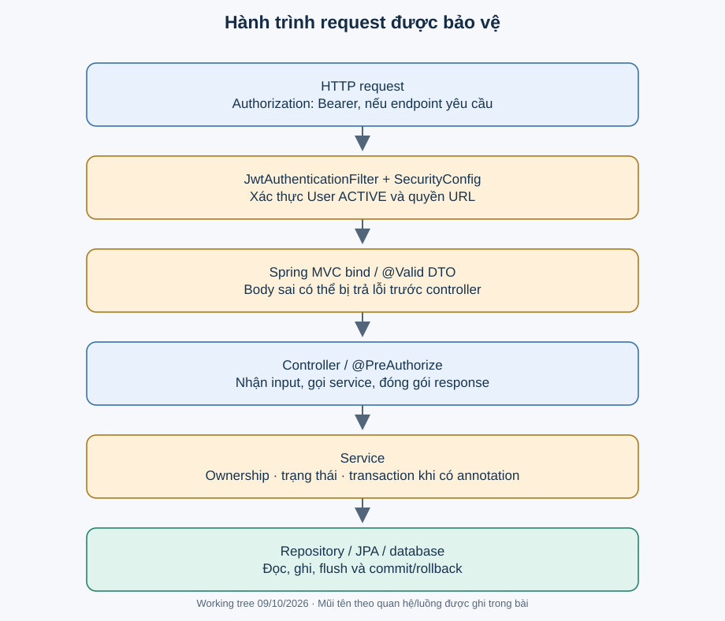

# Kiến trúc hiện tại và trade-off

**ĐÃ XÁC MINH:** một ứng dụng Spring Boot, tổ chức theo package tính năng; bên trong thường chia controller, service/interface, service/Impl, repository, entity, DTO, mapper. Mô tả phù hợp là backend đơn khối phân lớp theo tính năng. Chưa có ranh giới dependency đủ để khẳng định Clean/Hexagonal Architecture hay modular monolith được cưỡng chế.

Hình thể hiện luồng đi vào; response quay ngược qua MVC/security. Filter JWT chạy trước controller. MVC bind và validate body trước khi gọi logic controller. Service chứa quy tắc nghiệp vụ và transaction ở những method có annotation. Repository thực thi truy vấn; mapper tạo DTO, hạn chế lộ entity/password và vòng lặp quan hệ.

## Trách nhiệm từng lớp

Controller chuyển HTTP sang lời gọi service và đóng gói ApiResponse. Service kiểm tra trạng thái/quyền sở hữu và phối hợp nhiều repository. Repository biết cách tìm/lưu dữ liệu, gồm derived query, Criteria và JPQL bulk update. Entity biểu diễn state và quan hệ JPA; hiện nhiều invariant nằm ở service, không nằm trong method entity. Mapper MapStruct sinh code lúc compile, không phải reflection động.

## Những lựa chọn đáng phân tích

| Hiện trạng có bằng chứng | Vấn đề giải quyết | Thay thế và đánh đổi | Khi xem xét đổi |
|---|---|---|---|
| Service interface và implementation | Cho controller phụ thuộc hợp đồng, thuận tiện mock | Inject implementation đơn giản hơn nếu chỉ một cách thực hiện; interface không tự bảo đảm loose coupling | Khi abstraction chỉ lặp chữ hoặc xuất hiện implementation mới |
| DTO + MapStruct | Tách API với persistence, giảm mapping tay | Mapping tay dễ debug luồng phức tạp; mapper cần annotation processing | Khi mapping chứa quá nhiều nghiệp vụ |
| JPA + quan hệ | Lưu đồ thị và truy vấn quen thuộc trong một DB | SQL/JDBC kiểm soát truy vấn rõ hơn nhưng thêm mapping thủ công | Khi số query/lock thực đo trở thành vấn đề |
| Transaction service cho Booking/Payment/Waitlist | Gom thay đổi nhiều bảng | Transaction nhỏ giảm lock nhưng phải xử lý bù nếu chia nhỏ | Khi tác vụ ngoài DB xuất hiện hoặc latency cao |
| Scheduler mỗi 60 giây | Dọn trạng thái theo thời gian, đơn giản vận hành | Job queue bền vững thêm hạ tầng; cần khi lỗi/bỏ lỡ/double-run gây hại | Khi có yêu cầu nhiều instance, SLA expiration chặt |
| Atomic reserve + khóa lúc release | Kiểm tra sức chứa tại điểm ghi | @Version yêu cầu retry; khóa bi quan có nguy cơ chờ/deadlock | Sau test cạnh tranh, không vì công nghệ đang phổ biến |

Đây là phân tích kỹ thuật hiện tại, không khẳng định động cơ lịch sử. Xem [ADR-004](../decisions/ADR-004-layered-backend.md) và [transaction](../data/transaction-and-data-integrity.md).

## Giới hạn ranh giới

Module gọi repository/entity của module khác trực tiếp; payment gọi ticketing, waitlist gọi booking. Đơn giản cho ứng dụng nhỏ nhưng thay đổi entity có thể lan nhiều nơi. Chưa cần tách mạng/microservices: trước hết cần invariant tồn kho, test cạnh tranh và hợp đồng rõ. Test service mock không chứng minh behavior SQL/transaction thực.
