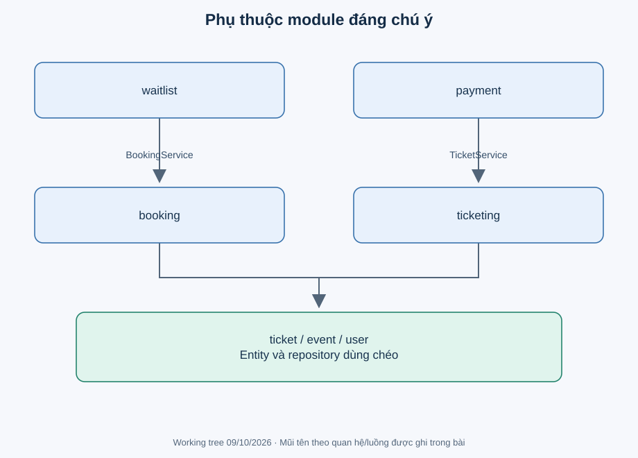

# Bản đồ module và source

Các đường dẫn dưới đây là điểm bắt đầu, không phải danh sách phải đọc hết. Package gốc là `backend/src/main/java/com/eventhub/eventhub_backend/`; test tương ứng ở `backend/src/test/java/com/eventhub/eventhub_backend/`.

| Module | Trách nhiệm và điểm vào | Phụ thuộc trực tiếp đáng chú ý | Học sâu |
|---|---|---|---|
| auth | [AuthController](../../backend/src/main/java/com/eventhub/eventhub_backend/auth/controller/AuthController.java), [AuthServiceImpl](../../backend/src/main/java/com/eventhub/eventhub_backend/auth/service/Impl/AuthServiceImpl.java) | UserRepository/UserMapper, PasswordEncoder, JwtService | [auth](../learning/modules/auth.md) |
| user | [UserController](../../backend/src/main/java/com/eventhub/eventhub_backend/user/controller/UserController.java), [CurrentUserServiceImpl](../../backend/src/main/java/com/eventhub/eventhub_backend/user/service/Impl/CurrentUserServiceImpl.java) | SecurityContextHolder, UserRepository, UserMapper | [user](../learning/modules/user.md) |
| event | [EventController](../../backend/src/main/java/com/eventhub/eventhub_backend/event/controller/EventController.java), [EventServiceImpl](../../backend/src/main/java/com/eventhub/eventhub_backend/event/service/Impl/EventServiceImpl.java) | UserRepository, CurrentUserService, EventMapper, custom Criteria repository | [event](../learning/modules/event.md) |
| ticket | [TicketTypeController](../../backend/src/main/java/com/eventhub/eventhub_backend/ticket/controller/TicketTypeController.java), [TicketTypeServiceImpl](../../backend/src/main/java/com/eventhub/eventhub_backend/ticket/service/Impl/TicketTypeServiceImpl.java) | EventRepository, CurrentUserService, TicketTypeMapper | [ticket](../learning/modules/ticket.md) |
| booking | [BookingController](../../backend/src/main/java/com/eventhub/eventhub_backend/booking/controller/BookingController.java), [BookingServiceImpl](../../backend/src/main/java/com/eventhub/eventhub_backend/booking/service/Impl/BookingServiceImpl.java) | TicketTypeRepository, UserRepository, CurrentUserService | [booking](../learning/modules/booking.md) |
| payment | [PaymentController](../../backend/src/main/java/com/eventhub/eventhub_backend/payment/controller/PaymentController.java), [PaymentServiceImpl](../../backend/src/main/java/com/eventhub/eventhub_backend/payment/service/Impl/PaymentServiceImpl.java) | BookingRepository, PaymentRepository, TicketService | [payment](../learning/modules/payment.md) |
| ticketing | [TicketController](../../backend/src/main/java/com/eventhub/eventhub_backend/ticketing/controller/TicketController.java), [TicketServiceImpl](../../backend/src/main/java/com/eventhub/eventhub_backend/ticketing/service/Impl/TicketServiceImpl.java) | TicketRepository, CurrentUserService; đọc Event/TicketType từ quan hệ | [ticketing](../learning/modules/ticketing.md) |
| waitlist | [WaitlistController](../../backend/src/main/java/com/eventhub/eventhub_backend/waitlist/controller/WaitlistController.java), [WaitlistServiceImpl](../../backend/src/main/java/com/eventhub/eventhub_backend/waitlist/service/Impl/WaitlistServiceImpl.java), [WaitlistOfferServiceImpl](../../backend/src/main/java/com/eventhub/eventhub_backend/waitlist/service/Impl/WaitlistOfferServiceImpl.java) | TicketTypeRepository, UserRepository, BookingService, CurrentUserService | [waitlist](../learning/modules/waitlist.md) |
| common/config | [GlobalExceptionHandler](../../backend/src/main/java/com/eventhub/eventhub_backend/common/exception/GlobalExceptionHandler.java), [SecurityConfig](../../backend/src/main/java/com/eventhub/eventhub_backend/config/SecurityConfig.java), [entry point](../../backend/src/main/java/com/eventhub/eventhub_backend/EventhubBackendApplication.java) | Tất cả module dùng response/error; scheduler gọi service | [common/config](../learning/modules/common-config.md) |

`admin` chỉ có AdminTestController, học cùng common/config; `util/StringUtils` rỗng nên không có bài riêng. `auth/security` học trong auth, không coi là module sản phẩm độc lập.

Mũi tên biểu diễn phụ thuộc service/repository hoặc mô hình của module đích, không biểu diễn HTTP qua nhiều server. Payment gọi TicketService; WaitlistOffer gọi BookingService. Tất cả chạy cùng ứng dụng và DB, không có message broker được chứng minh.
