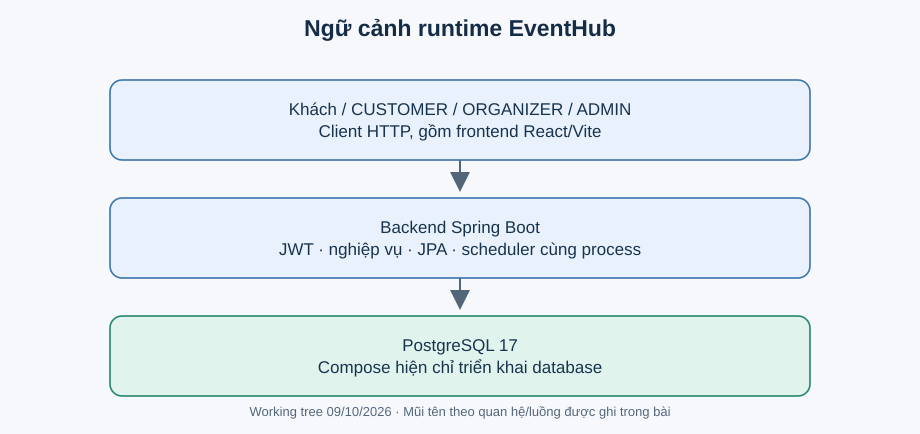

# Ngữ cảnh và runtime

Khách/khách hàng, người tổ chức và quản trị viên gọi HTTP API. Backend Spring Boot xử lý quyền, nghiệp vụ và persistence; PostgreSQL lưu dữ liệu. Frontend là một client có source trong repository, không phải lớp nằm trong transaction của backend. H2 chỉ nằm ở môi trường test.

**ĐÃ XÁC MINH:** [Compose](../../backend/docker-compose.yml) khai báo một dịch vụ PostgreSQL 17, host port 5433 ánh xạ tới cổng 5432 trong container, volume lưu dữ liệu. [Entry point](../../backend/src/main/java/com/eventhub/eventhub_backend/EventhubBackendApplication.java) bật scheduler cùng tiến trình backend. Chưa có manifest triển khai backend, Dockerfile backend hay cấu hình cluster trong phạm vi khảo sát.

**KHOẢNG THIẾU:** không thấy lời gọi provider thanh toán, email, LLM, Kafka hoặc Redis trong backend. `provider` và `providerTransactionId` là dữ liệu client ADMIN cung cấp cho API, không phải bằng chứng đã tích hợp provider. Không vẽ các dịch vụ tương lai như runtime hiện tại.

Nếu triển khai nhiều bản sao backend, scheduler trong mỗi bản sao có thể cùng quét. Đó là rủi ro cần thử nghiệm và thiết kế điều phối, chưa có bằng chứng hệ thống hiện chạy nhiều instance.
