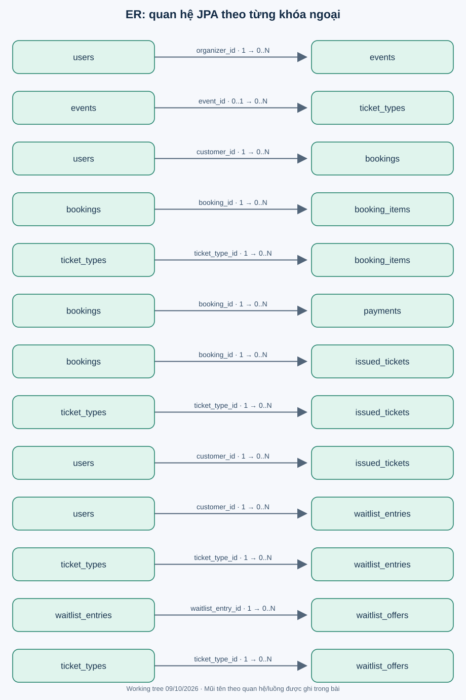

# Quan hệ thực thể

Mỗi hàng của hình là một quan hệ FK dự kiến theo JoinColumn: bảng trái có thể được nhiều hàng bên phải tham chiếu. `1 → 0..N` biểu diễn phía cha/con; với TicketType.event, phía cha có thể vắng vì JoinColumn nullable. Hình tách từng quan hệ để thấy rõ bội số và tránh chồng đường; không thêm FK cho convertedBookingId.

| Phía con sở hữu FK | Phía cha | Cardinality phía con → cha |
|---|---|---|
| events.organizer_id | users | N → 1 bắt buộc |
| ticket_types.event_id | events | N → 0..1 |
| bookings.customer_id | users | N → 1 bắt buộc |
| booking_items.booking_id | bookings | N → 1 bắt buộc |
| booking_items.ticket_type_id | ticket_types | N → 1 bắt buộc |
| payments.booking_id | bookings | N → 1 bắt buộc |
| issued_tickets.booking_id | bookings | N → 1 bắt buộc |
| issued_tickets.ticket_type_id | ticket_types | N → 1 bắt buộc |
| issued_tickets.customer_id | users | N → 1 bắt buộc |
| waitlist_entries.customer_id | users | N → 1 bắt buộc |
| waitlist_entries.ticket_type_id | ticket_types | N → 1 bắt buộc |
| waitlist_offers.waitlist_entry_id | waitlist_entries | N → 1 bắt buộc |
| waitlist_offers.ticket_type_id | ticket_types | N → 1 bắt buộc |

Một Booking có nhiều Payment về mô hình, dù service hiện chỉ nhận confirm khi pending. Một Entry có thể có nhiều Offer lịch sử; “chỉ một CREATED” hiện là exists check, không unique constraint khai báo. Chỉ một phía có property collection không có nghĩa quan hệ DB mất đi ở phía khác.

Ticket.customer và Ticket.ticketType là dữ liệu lặp có chủ đích tiện truy vấn; chưa có constraint kiểm tra chúng khớp customer/type trong booking. Việc gắn đúng nằm trong issueTicketsForBooking. Đây là invariant liên bảng, không được bảo vệ bởi FK đơn lẻ.
