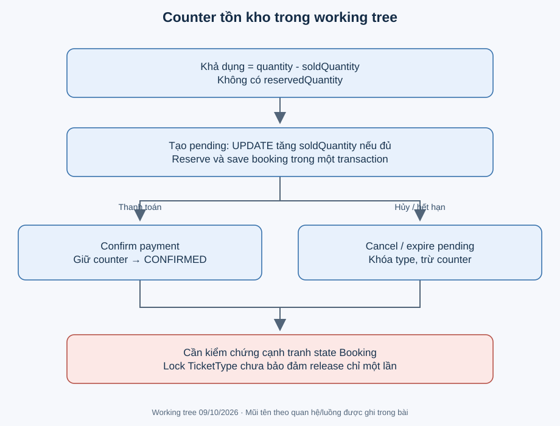

# Transaction, tồn kho và tính nhất quán

Transaction (giao dịch cơ sở dữ liệu) gom thay đổi để commit cùng nhau hoặc rollback nếu lỗi. Nó không tự biến mọi cặp đọc-rồi-ghi thành thao tác nguyên tử và không tự khóa mọi entity trong đồ thị.

Ví dụ minh họa: capacity=10, soldQuantity=8, khách xin 2 thì atomic update đưa bộ đếm lên 10. Request khác xin 1 có thể đã đọc available=2 trước đó, nhưng câu UPDATE có điều kiện tại DB mới là hàng rào quyết định; 0 hàng được sửa khiến service throw và rollback. Source: TicketTypeRepository.reserveAvailableQuantity và BookingServiceImpl.reserveInventory.

## Ranh giới giao dịch có thật

| Method | Nhóm thay đổi | Điểm lỗi/giới hạn |
|---|---|---|
| AuthServiceImpl.register | Băm mật khẩu, lưu User | exists không thay unique; collision chưa handler DB riêng |
| BookingServiceImpl.createBooking | Reserve nhiều TicketType, Booking + cascaded items | Tất cả reserve phải thành công; gộp ID trùng và sắp thứ tự ID để ghi |
| cancelBooking / expirePendingBookings | Trả tồn kho, đổi status booking | Khóa Booking trước; expiry khóa batch theo ID, gộp lượng trả rồi khóa TicketType theo ID |
| PaymentServiceImpl.confirmPayment | Đổi booking, lưu payment, phát ticket | Khóa Booking trước lookup reference; TicketService tham gia transaction; RuntimeException rollback nhóm DB |
| TicketServiceImpl.issueTicketsForBooking / checkInTicket | Phát vé hoặc ghi USED/checkedInAt | Confirm bảo vệ issuance bằng khóa Booking; check-in khóa Ticket cho cả code và payload |
| WaitlistServiceImpl.joinWaitlist | Kiểm tra và lưu entry | Khóa TicketType trước kiểm active duplicate và save; chưa unique active constraint ngoài service |
| WaitlistOfferServiceImpl các method ghi | Entry + Offer; accept còn gọi BookingService | Khóa Type rồi Offer; lỗi Booking rollback; riêng exception accept quá hạn commit EXPIRED |
| EventServiceImpl.completeExpiredEvents | Đổi event quá hạn | Các method create/update/publish/cancel khác không có transaction service bao ngoài |

Annotation dùng `jakarta.transaction.Transactional`. Spring proxy bắt lời gọi từ bean khác; private helper chạy trong transaction của public method nhưng không tạo giao dịch mới. Gọi nội bộ không kích hoạt annotation độc lập. AppException kế thừa RuntimeException nên rollback mặc định. Không bắt rồi nuốt lỗi nếu muốn cả giao dịch thất bại. Cơ chế: [Spring về annotation giao dịch](https://docs.spring.io/spring-framework/reference/data-access/transaction/declarative/annotations.html), [quy tắc rollback](https://docs.spring.io/spring-framework/reference/data-access/transaction/declarative/rolling-back.html).

## Chuyển trạng thái đã được bảo vệ

Ngày 19/10/2026 bổ sung khóa ghi bi quan theo [ADR-005](../decisions/ADR-005-booking-and-checkin-concurrency.md).
Cancel/confirm khóa cùng hàng Booking trước khi kiểm tra. Expiry dùng truy vấn khóa có lọc
pending/cutoff và sắp ID; PostgreSQL READ COMMITTED đánh giá lại hàng đã đổi khi chờ khóa.
Cả batch Booking được khóa trước khi gộp trả chỗ theo thứ tự TicketType ID toàn cục.
Check-in bằng code/payload khóa cùng hàng Ticket, chỉ caller thấy VALID sau khi lấy khóa được đổi USED.

Suite [BookingConcurrencyTest](../../backend/src/test/java/com/eventhub/eventhub_backend/concurrency/BookingConcurrencyTest.java)
tái hiện 9 lỗi trước sửa trên PostgreSQL thật; sau sửa kiểm thêm hai chiều cancel/expiry,
hai booking chung loại vé, expiry batch và rollback khi issuance lỗi. Xem
[biên bản chạy](../project/concurrency-verification.md) để phân biệt phạm vi đã kiểm chứng.

## Các race trước sửa và giới hạn còn lại

1. **Release hai lần trước sửa:** khóa TicketType riêng không ngăn cùng Booking bị trả hai lần. Nay khóa Booking bảo vệ transition; clamp không phải cơ chế chống trùng.
2. **Payment và expiry:** nay cùng tranh khóa Booking; bên commit thành công trước quyết định trạng thái. Confirm vẫn không từ chối chỉ vì tuổi đơn quá cutoff khi scheduler chưa đổi EXPIRED; chưa thêm late-payment policy.
3. **Hai confirm:** cùng Booking được tuần tự hóa; cùng reference replay kết quả cũ, khác reference bị pending guard từ chối. Cùng reference trên hai Booking khác nhau vẫn dựa vào unique DB và chưa có handler collision riêng.
4. **Check-in cạnh tranh:** nay khóa Ticket trước VALID→USED; chỉ kiểm status cuối vẫn chưa đủ, test phải assert kết quả cả hai caller.
5. **Offer hết hạn trong accept:** Phase 8 đã dùng WaitlistOfferExpiredException + dontRollbackOn riêng cho nhánh này. Ownership trước expire; test PostgreSQL reload xác nhận entry/offer EXPIRED và cấp người tiếp theo. AppException khác vẫn rollback. Xem [kiểm chứng Phase 8](../project/phase-8-verification.md).

## Validation khác constraint

@Positive trên DTO chỉ chạy khi MVC validation được gọi; ghi trực tiếp repository có thể bỏ qua nó. FK ngăn tham chiếu cha không tồn tại, nhưng không bảo đảm tất cả item của booking cùng event. NOT NULL không ngăn số lượng âm. Unique payment reference giảm trùng reference nhưng không giải quyết cạnh tranh status booking. Chưa có DDL kiểm tra `0 <= soldQuantity <= quantity` được xác minh.

## Hiệu năng và N+1

toResponse của booking/ticket/waitlist duyệt quan hệ LAZY có thể phát sinh thêm query theo dòng. Chưa đo query count nên đây là rủi ro, không kết luận N+1 production đã xảy ra. Criteria search có hai query data/count, dùng LIKE có wildcard đầu và sort động. Đề xuất đo SQL/EXPLAIN, sau đó chọn fetch join/entity graph/projection hoặc index theo query thật. Không thêm cache trước khi đo.
