# Hướng dẫn Cấu hình & Vận hành Supabase PostgreSQL đa môi trường (LOCAL / SIT / UAT)

> **Cập nhật:** 02/11/2026  
> **Dự án:** EventHub — Nền tảng quản lý sự kiện, đặt vé & check-in trực tiếp  
> **Công nghệ:** Java 21, Spring Boot 3.5.0, Spring Data JPA / Hibernate, HikariCP, PostgreSQL / Supabase, Vite / React 19  

---

## 1. Tổng quan Kiến trúc đa môi trường

EventHub áp dụng mô hình quản lý cấu hình theo tiêu chuẩn doanh nghiệp (**12-Factor App**) với việc phân tách rạch ròi 4 môi trường thực thi: **LOCAL**, **SIT** (System Integration Testing), **UAT** (User Acceptance Testing), và **PROD** (Production).

```mermaid
flowchart TD
    subgraph ClientLayer [Tầng Giao Diện]
        Browser[Trình duyệt Khách hàng / Quản trị viên]
    end

    subgraph AppLayer [Tầng Ứng Dụng Backend]
        LocalApp["Backend Profile: local (localhost:8080)"]
        SITApp["Backend Profile: sit (CI/CD Test Runner / Staging)"]
        UATApp["Backend Profile: uat (Nghiệm thu Demo / Render)"]
    end

    subgraph DBLayer [Tầng Cơ Sở Dữ Liệu]
        LocalDB[("PostgreSQL Local (Docker Port 5433)")]
        SupabaseSIT[("Supabase Cloud SIT (Session Pooler Port 5432)")]
        SupabaseUAT[("Supabase Cloud UAT (Session Pooler Port 5432)")]
    end

    Browser -->|API Calls| LocalApp
    Browser -->|API Calls| SITApp
    Browser -->|API Calls| UATApp

    LocalApp -->|JDBC Direct| LocalDB
    SITApp -->|JDBC + TLS sslmode=require| SupabaseSIT
    UATApp -->|JDBC + TLS sslmode=require| SupabaseUAT
```



---

## 2. Bảng ma trận so sánh các môi trường

| Tiêu chí | Môi trường LOCAL | Môi trường SIT (Tích hợp) | Môi trường UAT (Nghiệm thu) | Môi trường PROD (Vận hành) |
|---|---|---|---|---|
| **Mục đích** | Lập trình tính năng, debug offline trên máy | Kiểm thử tích hợp tự động, test liên thông VNPay | Nghiệm thu người dùng, demo bảo vệ đồ án/tuyển dụng | Triển khai phục vụ khách hàng thực tế |
| **Nơi lưu Database** | Docker container local / Postgres máy cá nhân | Supabase Free Project (SIT) | Supabase Free/Pro Project (UAT) | Supabase Pro / Dedicated Database |
| **Spring Profile** | `local` | `sit` | `uat` | `prod` |
| **Cổng kết nối DB** | `5433` (hoặc `5432`) | `5432` (Session Pooler) | `5432` (Session Pooler) | `5432` (Session Pooler) |
| **Chiến lược Schema** | `ddl-auto: update` | `ddl-auto: update` | `ddl-auto: validate` | `ddl-auto: validate` |
| **Hiển thị SQL log** | `show-sql: true` | `show-sql: false` | `show-sql: false` | `show-sql: false` |
| **Hikari Max Pool** | `10` | `5` (tiết kiệm pool slot) | `8` | `10` - `15` |
| **SSL Mode** | Không bắt buộc | `sslmode=require` (TLS 1.3) | `sslmode=require` (TLS 1.3) | `sslmode=require` (TLS 1.3) |
| **Dữ liệu mẫu** | Nạp tùy ý | Tự động hoặc import `seed-data.sql` | Dữ liệu sạch, chuẩn chỉnh kiểm thử | Dữ liệu thật của khách hàng |

---

## 3. Tại sao chọn Supabase Session Pooler (Port 5432) thay vì Transaction Pooler (Port 6543)?

Supabase cung cấp 3 phương thức kết nối tới cơ sở dữ liệu:

1. **Direct Connection (Cổng 5432 - Direct Host)**:
   - *Ưu điểm:* Toàn quyền quản lý DDL, migration.
   - *Nhược điểm:* Các project Supabase Free mới áp dụng hạ tầng **IPv6-only**. Nhiều nhà mạng Internet hoặc server cloud chưa hỗ trợ IPv6 đầy đủ sẽ không thể phân giải được host (gây lỗi `UnknownHostException`).
2. **Transaction Pooler (Cổng 6543 - Supavisor)**:
   - *Ưu điểm:* Hỗ trợ IPv4, chịu tải hàng ngàn kết nối stateless.
   - *Nhược điểm:* **Không tương thích hoàn toàn với Hibernate/JPA** do giới hạn về prepared statements, session-level variables, và cơ chế giữ connection trong `@Transactional`.
3. **Session Pooler (Cổng 5432 - Supavisor)**:
   - **Lựa chọn tối ưu nhất cho Spring Boot**:
     - Hoạt động mượt mà trên hạ tầng mạng IPv4 qua tên miền `aws-0-<region>.pooler.supabase.com`.
     - Giữ nguyên toàn bộ tính năng Session State của PostgreSQL, tương thích 100% với Spring Data JPA, Hibernate L1 Cache, và các truy vấn phân trang `Pageable`.
     - Hỗ trợ SSL/TLS mã hóa đường truyền an toàn (`sslmode=require`).

---

## 4. Hướng dẫn từng bước thiết lập Supabase

### Bước 4.1: Tạo Project trên Supabase
1. Đăng nhập vào [Supabase Dashboard](https://supabase.com/dashboard).
2. Nhấn **New Project** và chọn Tổ chức của bạn.
3. Thiết lập thông số:
   - **Name:** `eventhub-sit` (cho kiểm thử) hoặc `eventhub-uat` (cho nghiệm thu).
   - **Database Password:** Thiết lập mật khẩu mạnh (chứa chữ hoa, chữ thường, số và ký tự đặc biệt). *Hãy lưu lại mật khẩu này cẩn thận*.
   - **Region:** Chọn **Singapore (`ap-southeast-1`)** để đảm bảo độ trễ thấp nhất (~30ms) từ Việt Nam.
   - **Pricing Plan:** Gói **Free Plan**.
4. Chờ 1–2 phút để Supabase khởi tạo hạ tầng.

### Bước 4.2: Lấy chuỗi kết nối chuẩn (Session Pooler)
1. Trong dashboard của project, vào mục **Project Settings** (biểu tượng bánh răng) -> Chọn thẻ **Database**.
2. Cuộn xuống phần **Connection parameters**:
   - Chọn tab **Session pooler** (đảm bảo hiển thị Port là `5432`).
3. Ghi nhận các thông số:
   - **Host:** `aws-0-ap-southeast-1.pooler.supabase.com` (hoặc index tương ứng).
   - **Port:** `5432`
   - **Database name:** `postgres`
   - **User:** `postgres.<project-ref>` *(Ví dụ: `postgres.abcdefghijklmnop`)*.
   - **Password:** Mật khẩu database bạn đã đặt ở Bước 4.1.

> [!IMPORTANT]
> Với Session Pooler, Username bắt buộc phải có tiền tố `postgres.` kèm mã `<project-ref>`. Nếu chỉ dùng `postgres`, kết nối sẽ bị từ chối do Pooler không định tuyến được project của bạn.

### Bước 4.3: Khởi tạo dữ liệu mẫu (Seed Data)
1. Trong Supabase Dashboard, mở thanh công cụ bên trái -> Chọn **SQL Editor**.
2. Nhấn **New Query**.
3. Mở file [`backend/src/main/resources/seed-data.sql`](file:///c:/Users/ASUS/Desktop/EventHub/backend/src/main/resources/seed-data.sql), copy toàn bộ nội dung và dán vào SQL Editor.
4. Nhấn nút **Run** (Ctrl + Enter).
5. Supabase sẽ nạp sẵn:
   - Tài khoản mẫu (Admin: `abc@eventhub.com`, Organizer: `organizer@eventhub.vn`, Customer: `nguyenvana@gmail.com`). Mật khẩu chung: `123456`.
   - Các sự kiện thực tế (TechFest, Đêm nhạc Indie Sài Gòn, Giải Marathon...).
   - Các hạng vé VIP, Standard, Early Bird và đơn đặt vé mẫu.

### Bước 4.4: Khuyến nghị an toàn bảo mật
1. Vào **Project Settings** -> **API**.
2. Tắt **Data API** nếu bạn chỉ dùng Supabase làm cơ sở dữ liệu quan hệ cho Spring Boot qua JDBC. Điều này ngăn chặn người lạ truy vấn trực tiếp bảng của bạn qua REST/GraphQL công khai.
3. Không chia sẻ chuỗi kết nối kèm mật khẩu lên kho mã nguồn Git.

---

## 5. Hướng dẫn chạy và chuyển đổi Profile trên Backend

### Cách 1: Sử dụng tham số dòng lệnh Maven Wrapper (Khuyên dùng khi dev)

```powershell
# Chạy môi trường LOCAL (Database nội bộ localhost:5433):
cd backend
.\mvnw.cmd spring-boot:run -Dspring-boot.run.profiles=local

# Chạy môi trường SIT (Database Supabase SIT):
.\mvnw.cmd spring-boot:run -Dspring-boot.run.profiles=sit

# Chạy môi trường UAT (Database Supabase UAT):
.\mvnw.cmd spring-boot:run -Dspring-boot.run.profiles=uat
```

### Cách 2: Sử dụng biến môi trường (Khuyên dùng khi deploy Cloud / Docker)

Tạo file `.env` từ file mẫu `.env.example` và thiết lập:
```bash
SPRING_PROFILES_ACTIVE=sit
SUPABASE_SIT_HOST=aws-0-ap-southeast-1.pooler.supabase.com
SUPABASE_SIT_PORT=5432
SUPABASE_SIT_USER=postgres.your-sit-ref
SUPABASE_SIT_PASSWORD=your-password
```

Sau đó chạy backend:
```powershell
cd backend
.\mvnw.cmd spring-boot:run
```

---

## 6. Cấu hình tối ưu HikariCP cho Supabase Free Tier

Gói Supabase Free giới hạn tổng cộng **60 kết nối đồng thời**. Nếu backend tạo pool kết nối quá lớn, database sẽ báo lỗi:
`FATAL: remaining connection slots are reserved for non-replication superuser connections`.

EventHub đã cấu hình HikariCP tối ưu sẵn trong file `application-sit.yml` và `application-uat.yml`:

```yaml
hikari:
  maximum-pool-size: 5       # Chỉ chiếm tối đa 5 kết nối trên Supabase
  minimum-idle: 2            # Luôn giữ 2 kết nối ấm sẵn sàng phản hồi
  connection-timeout: 30000  # Chờ tối đa 30s khi lấy kết nối
  idle-timeout: 30000        # Giải phóng kết nối rảnh rỗi sau 30s
  max-lifetime: 600000       # Làm mới kết nối sau 10 phút để tránh tường lửa ngắt
  data-source-properties:
    options: "-c timezone=Asia/Ho_Chi_Minh" # Đồng bộ múi giờ Việt Nam
```

---

## 7. Checklist xác minh triển khai

- [x] Đã cấu hình `application.yml` đóng vai trò cấu hình chuẩn.
- [x] Đã tạo `application-local.yml` cho dev nội bộ (`ddl-auto: update`, `show-sql: true`).
- [x] Đã tạo `application-sit.yml` kết nối Supabase SIT (`sslmode=require`, Hikari pool tối ưu).
- [x] Đã tạo `application-uat.yml` kết nối Supabase UAT (`ddl-auto: validate` bảo vệ schema).
- [x] Đã tạo template `.env.example` ở root và `frontend/.env.example`.
- [x] Đã kiểm thử `144/144` backend tests passed và `18/18` frontend tests passed.
- [x] Đã cấu hình múi giờ `Asia/Ho_Chi_Minh` cho mọi kết nối Supabase.
