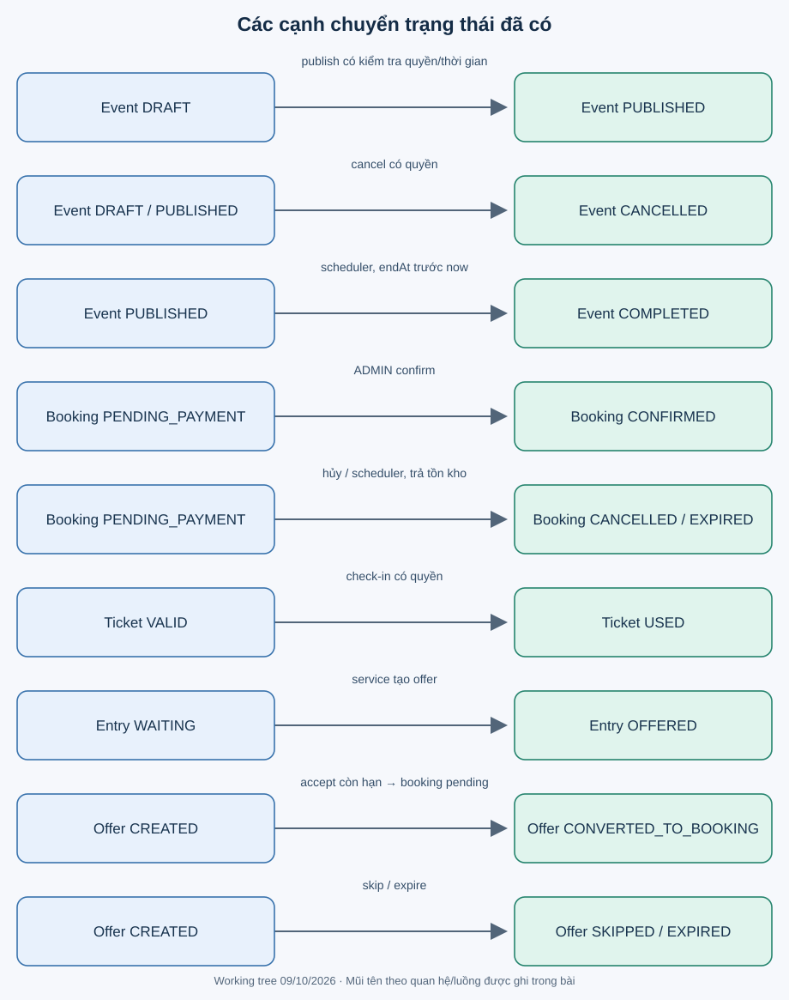

# Vòng đời và chuyển trạng thái

Quan sát mỗi nhánh như một điều kiện service phải kiểm tra, không chỉ là giá trị enum. DB có thể lưu enum hợp lệ nhưng vẫn chứa chuyển trạng thái nghiệp vụ sai nếu cập nhật ngoài đường kiểm soát.

| Đối tượng | Đường chuyển đã thấy | Điều kiện/tác động |
|---|---|---|
| Event | tạo → DRAFT; DRAFT → PUBLISHED | Nội dung đủ, start<end, start ở tương lai, đúng quyền |
| Event | DRAFT/PUBLISHED → CANCELLED | Organizer sở hữu hoặc ADMIN; chưa cascade hủy booking/ticket/refund |
| Event | PUBLISHED → COMPLETED | Scheduler, endAt trước now; không có API complete |
| Booking | tạo → PENDING_PAYMENT | Ghi snapshot giá, tăng soldQuantity có điều kiện |
| Booking | PENDING_PAYMENT → CONFIRMED | ADMIN confirm payment; không tăng soldQuantity lần nữa |
| Booking | PENDING_PAYMENT → CANCELLED / EXPIRED | Trả tồn kho; expired dựa createdAt trước now-900 giây |
| Payment | tạo → SUCCESS | Luồng hiện tại chỉ tạo SUCCESS; PENDING/FAILED/CANCELLED mới là enum |
| Ticket | tạo → VALID → USED | Phát hành sau confirmed; check-in có quyền, ghi checkedInAt |
| WaitlistEntry | tạo → WAITING → OFFERED | Join khi sold-out; service tạo offer |
| WaitlistEntry | OFFERED → CONVERTED / SKIPPED / EXPIRED | Accept, skip hoặc scheduler expiry |
| WaitlistOffer | tạo → CREATED → CONVERTED_TO_BOOKING / SKIPPED / EXPIRED | Accept tạo booking pending; skip không trả reservation vì offer chưa giữ chỗ |

`WaitlistOfferStatus.ACCEPTED`, `WaitlistEntryStatus.CANCELLED` và `TicketStatus.CANCELLED` chưa có đường chuyển tương ứng trong service đã đọc. User có ACTIVE/INACTIVE/BANNED; đăng ký đặt ACTIVE nhưng chưa có API quản trị đổi status.

## Thời gian không phải đồng hồ chính xác tuyệt đối

Booking timeout 900 giây nhưng job quét mỗi phút, nên hết hạn không diễn ra đúng giây thứ 900. Confirm chưa tự so tuổi booking; pending quá 15 phút vẫn có thể confirm trước khi job xử lý. Offer accept kiểm tra expiresAt trực tiếp; exception hết hạn riêng cho phép commit EXPIRED. Quét offer dùng <= cutoff, thống nhất với accept từ chối cả bằng now. Type/Offer được khóa trước transition; xem [Phase 8](../project/phase-8-verification.md).

Nguồn: enum và service tương ứng ở [module index](../architecture/module-index.md); xem [data integrity](../data/transaction-and-data-integrity.md).
