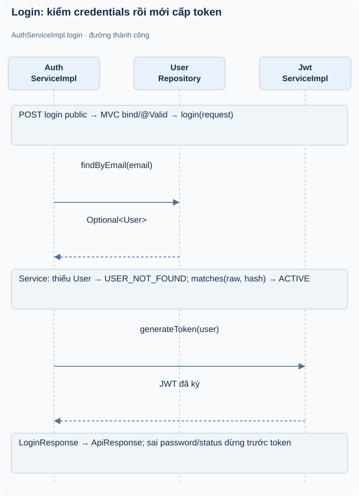
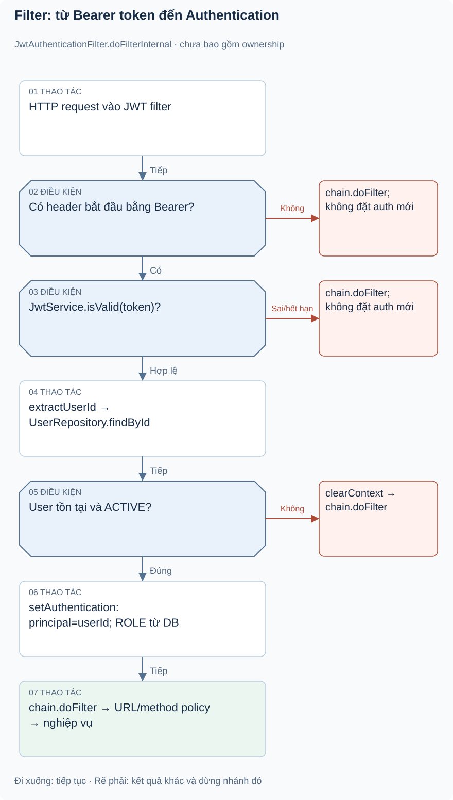

# Bài 1. Auth — đăng nhập và xác thực: bài toán trước code

[Giáo trình](../../README.md) · [Mục lục module](README.md)

**Trong bài:** [Bắt đầu từ người dùng](#bắt-đầu-từ-người-dùng) · [Mở source theo thứ tự này](#mở-source-theo-thứ-tự-này) · [Tự làm có hướng dẫn](#tự-làm-có-hướng-dẫn)

**20–25 phút · Chương 1: Bài toán và đường đi**

**Câu hỏi trung tâm:** Module này quyết định điều gì trong hành trình mua vé, và điều gì thuộc module khác?

Sau bài này, bạn có thể:

- Kể lại nhu cầu của actor và quy tắc chính bằng lời.
- Trace luồng chính từ điểm vào đến kết quả hoặc lỗi.
- Chỉ ra dữ liệu module sở hữu và một giới hạn hiện tại.

**Cần biết trước:** Java class/interface, constructor và HTTP request/response; học bài mở đầu trước. [Lộ trình đầy đủ](../../learning-path.md).

## Bắt đầu từ người dùng

Ví dụ minh họa: Lan muốn đặt vé nhưng chưa có tài khoản. Đăng ký phải tạo CUSTOMER, không cho client tự
chọn ADMIN. Sau login, Lan mang access token ở request tiếp theo. Nếu tài khoản bị BANNED, token còn hạn
cũng không đủ để tiếp tục thao tác qua JWT filter.

Auth chịu trách nhiệm credentials và token; không quyết định Lan sở hữu booking nào. Ownership thuộc
service quản lý tài nguyên. Quy tắc đã có: email không trùng theo service/unique annotation, password
được BCrypt encode, login chỉ ACTIVE, role đăng ký CUSTOMER. Chưa có refresh token hay thu hồi access
token/logout nghiệp vụ.

## Mô hình và luồng thật

### Góc nhìn 1: Login: kiểm credentials rồi mới cấp token

Đọc từ trên xuống. Login dùng credentials; Authentication của request sau được tạo ở filter, không ở
bước cấp token này.

### Góc nhìn 2: Filter: từ Bearer token đến Authentication

Đi xuống theo nhánh hợp lệ; rẽ phải khi điều kiện không đạt. Filter đi tiếp chưa xác thực không đồng
nghĩa mọi URL đều trả 401: policy URL quyết định phía sau.

**Luồng chính, đọc theo từng cụm:**

1. POST login public → MVC bind/validate LoginRequest → AuthServiceImpl.login
2. findByEmail → matches → ACTIVE
3. generateToken → LoginResponse trong ApiResponse

Login không sửa state DB nghiệp vụ. Thiếu user trả USER_NOT_FOUND, sai password INVALID_PASSWORD,
non-ACTIVE UNAUTHORIZED.

Ở request sau, filter verify signature/expiry rồi tải User. Nó đặt principal=userId và ROLE từ DB vào
SecurityContext. SecurityConfig quyết định URL; @PreAuthorize kiểm tra role trên method; service tài
nguyên kiểm tra ownership. Filter không hợp lệ đi tiếp dưới trạng thái chưa xác thực để entry point từ
chối URL bảo vệ; public API vẫn có thể truy cập.

Đọc hình từ điểm vào được ghi trên hình, lần theo các điều kiện trước khi nhìn phần lưu/response. Mũi
tên là thứ tự xử lý, không phải bằng chứng mọi nhánh đều chạy hoặc mọi thay đổi đã commit. Dừng ở nhánh
lỗi và tự nói điều gì chưa xảy ra.

## Mở source theo thứ tự này

Mọi link trong bảng là source thật; đọc từ trên xuống rồi mở test.

| File/Class | Trách nhiệm | Tại sao cần? / đọc khi nào? |
|---|---|---|
| [AuthController](../../../../backend/src/main/java/com/eventhub/eventhub_backend/auth/controller/AuthController.java) | Endpoint và @Valid | Điểm vào HTTP; xem body được kiểm tra trước service |
| [RegisterRequest](../../../../backend/src/main/java/com/eventhub/eventhub_backend/auth/dto/request/RegisterRequest.java), [LoginRequest](../../../../backend/src/main/java/com/eventhub/eventhub_backend/auth/dto/request/LoginRequest.java) | Dữ liệu/validation | Không nhận role; phân biệt ràng buộc đầu vào và rule |
| [AuthServiceImpl](../../../../backend/src/main/java/com/eventhub/eventhub_backend/auth/service/Impl/AuthServiceImpl.java) | register/login | Cốt lõi: encode/matches, status, token |
| [UserMapper](../../../../backend/src/main/java/com/eventhub/eventhub_backend/user/mapper/UserMapper.java), [UserRepository](../../../../backend/src/main/java/com/eventhub/eventhub_backend/user/repository/UserRepository.java) | Mapping và persistence | Tìm email/ID; mapper bỏ role/status lúc tạo |
| [JwtServiceImpl](../../../../backend/src/main/java/com/eventhub/eventhub_backend/auth/security/Impl/JwtServiceImpl.java) | Ký/parse token | Subject, expiry, secret; không log token |
| [JwtAuthenticationFilter](../../../../backend/src/main/java/com/eventhub/eventhub_backend/auth/security/Impl/JwtAuthenticationFilter.java), [SecurityConfig](../../../../backend/src/main/java/com/eventhub/eventhub_backend/config/SecurityConfig.java) | Xác thực từng request và policy URL | Khi debug 401/403 hoặc status DB đổi |
| [PasswordEncoderConfig](../../../../backend/src/main/java/com/eventhub/eventhub_backend/config/PasswordEncoderConfig.java) | Bean BCrypt | Hiểu DI và thuật toán đang dùng |
| [AuthServiceImplTest](../../../../backend/src/test/java/com/eventhub/eventhub_backend/auth/AuthServiceImplTest.java), [JwtAuthenticationFilterTest](../../../../backend/src/test/java/com/eventhub/eventhub_backend/auth/JwtAuthenticationFilterTest.java) | Unit login/filter | Chứng cứ ACTIVE/INACTIVE/BANNED, chưa phải toàn bộ HTTP chain |

Lượt đầu chỉ mở controller và service cốt lõi trong bảng. Ghi tên guard, dữ liệu trước/sau, rồi mới mở
DTO/repository tương ứng. Test đọc sau khi đã tự dự đoán.

## Một ví dụ nhỏ để tự lần theo

Ví dụ minh họa dựa trên rule hiện có: Lan login đúng mật khẩu nhưng tài khoản INACTIVE. Hệ thống có cấp
token không?

1. Xác định actor, dữ liệu và state trước thao tác.
2. Tìm guard tương ứng trong service/controller của bảng source.
3. Ghi quyết định và tác động: Không. Sau matches, login còn kiểm status ACTIVE rồi mới generateToken.
   Xác thực mật khẩu đúng chưa đủ điều kiện tài khoản.

**Thử biến thể trước khi xem:** Nếu người gọi có role đúng nhưng không sở hữu tài nguyên, role có tự bỏ
qua ownership không?

Đối chiếu biến thể

Không với các use case có ownership guard. Auth/common không tự sở hữu booking/event; phải tìm service
tài nguyên. Role ADMIN có ngoại lệ nào thì đọc từng guard, không suy rộng cho mọi endpoint.

## Tự nhớ lại

1. Đóng bài: kể actor, nhu cầu và kết quả của module trong 60 giây.
2. Với tình huống ví dụ, thao tác dừng ở guard nào và dữ liệu nào không thay đổi?
3. Module này có kiểm tiền ngân hàng, giữ chỗ hoặc phát vé không? Chỉ nhận trách nhiệm có source.
4. Tìm một feature chưa có; bằng chứng nào giúp phân biệt “có DTO/service” với “có runtime caller”?

Đáp án định hướng

1. Đối chiếu phần bài toán; phải kể nhu cầu thay vì chỉ tên layer.
2. Không. Sau matches, login còn kiểm status ACTIVE rồi mới generateToken. Xác thực mật khẩu đúng chưa
   đủ điều kiện tài khoản.
3. Xem phạm vi đầu bài và trace, không gán mọi bước mua vé cho module này.
4. Tìm controller/caller, không chỉ class tồn tại. Các khoảng thiếu đã ghi trong bài là điều cần kiểm
   chứng lại khi source đổi.

## Tự làm có hướng dẫn

Vẽ register/login/request sau login bằng ba vùng. Chỉ ra vùng có ghi User, vùng cấp token và vùng đặt
Authentication.

Sau đó bỏ tài liệu, tự ghi một happy path và một failure path. Với mỗi bước, nêu dữ liệu vào/ra; không
viết code production.

Gợi ý

Dùng bảng năm dòng: actor → điểm vào → guard → dữ liệu → kết quả. Khi thiếu bằng chứng, ghi “chưa xác
minh”, không điền theo trí nhớ framework.

Tiêu chí hoàn thành

Có tên method thật, guard cụ thể, dữ liệu trước/sau và nhánh lỗi; không thêm endpoint/tác động ngoài
source. Nếu thiếu hai trong bốn phần, quay lại trace trước bài tiếp.

## Chốt lại và chỗ dễ nhầm

Luồng gọi và quyền hợp lệ chưa chứng minh dữ liệu commit hay chống được cạnh tranh. Học cơ chế ở chương
tiếp theo rồi quay lại tự vẽ luồng này một lần nữa.

[← Bài trước](../../start-here.md) · [Mục lục module](README.md) · [Học tiếp →](02-co-che.md)

Nếu chưa giải thích được câu hỏi trung tâm, làm lại biến thể trước khi học tiếp; không cần đọc thêm mọi
tài liệu tham khảo.
