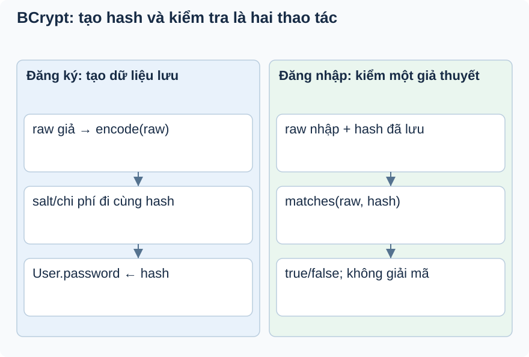

# Bài 2. Mật khẩu: so khớp mà không giải mã

[Giáo trình](../../README.md) · [Mục lục module](README.md)

**Trong bài:** [Tình huống và cách nghĩ](#tình-huống-và-cách-nghĩ) · [Cùng trace source](#cùng-trace-source) · [Luyện từ có hướng dẫn đến tự làm](#luyện-từ-có-hướng-dẫn-đến-tự-làm)

**20–30 phút · Chương 2: Cơ chế và dữ liệu**

**Câu hỏi trung tâm:** Vì sao băm lại cùng mật khẩu rồi so chuỗi lại sai?

Sau bài này, bạn có thể:

- Trace register encode và login matches.
- Giải thích salt khiến hai hash có thể khác nhau.
- Phân biệt encoder thật với encoder mock.

**Cần biết trước:** [Bài toán module](01-bai-toan.md). Java class/interface, constructor và HTTP request/response; học bài mở đầu trước.

## Tình huống và cách nghĩ

Lan đăng ký bằng mật khẩu giả `demo-pass-123`.

Hãy xem hash là dữ liệu dùng để kiểm tra một giả thuyết: “chuỗi người dùng nhập có đúng không?”. Nó
không phải mật khẩu đã mã hóa để lấy lại bản gốc. Salt là phần ngẫu nhiên đi kèm mỗi lần băm; BCrypt lưu
thông tin cần thiết trong chuỗi hash. PasswordEncoder là hợp đồng Java; bean BCryptPasswordEncoder là
đối tượng Spring chọn để thực hiện hợp đồng đó.



Nhìn cột trái để biết DB lưu gì, rồi cột phải để biết login dùng gì. Không nối encode mới với phép so
chuỗi hash: đó là đường đi sai do salt.

## Cơ chế trong EventHub

Phần dưới dựa trên source working tree. Phương án thay thế là phân tích/đề xuất; race cần test riêng
trước khi kết luận runtime.

**Khái niệm/vấn đề:** băm mật khẩu một chiều giúp DB không lưu mật khẩu có thể đọc lại trực tiếp. BCrypt
có salt và chi phí tính toán; cùng mật khẩu có thể tạo hash khác, nên không encode lần hai rồi so chuỗi.
EventHub cần `matches(raw, storedHash)` để xác minh khách mà không giải mã.

**Cơ chế/vị trí/runtime:** PasswordEncoderConfig khai báo bean BCryptPasswordEncoder.
@RequiredArgsConstructor tạo constructor từ final field; Spring truyền bean PasswordEncoder vào
AuthServiceImpl. register encode trước save trong transaction; login matches trước status/token. Nếu bỏ
abstraction, service gắn chặt thuật toán; interface giúp thay encoder/test nhưng vẫn phải có chiến lược
tương thích hash cũ khi đổi.

**Thay thế/trade-off:** PBKDF2/Argon2 là phương án phân tích, chưa dùng. Không tự đổi thuật toán chỉ vì
mới hơn; cần benchmark chi phí login và quy tắc nâng cấp hash. Không dùng hash nhanh đơn thuần để thay
password encoder.

**Lỗi/debug/test:** triệu chứng login luôn sai thường do lưu raw hoặc encode lại khi so. Breakpoint
trước matches, chỉ xem kiểu/luồng, không ghi credentials. PasswordEncoderTest kiểm tra encode/matches
thật; AuthServiceImplTest mock encoder nên không chứng minh BCrypt.

## Cùng trace source

Mở theo thứ tự: [PasswordEncoderConfig](../../../../backend/src/main/java/com/eventhub/eventhub_backend/config/PasswordEncoderConfig.java) → [AuthServiceImpl](../../../../backend/src/main/java/com/eventhub/eventhub_backend/auth/service/Impl/AuthServiceImpl.java).

Điểm cần tìm: `register → encode; login → matches`. Với mỗi guard, ghi input và kết quả khi đúng/sai; với mỗi setter/query, ghi dữ liệu thay đổi ở object hay DB. Tra [bảng source module](01-bai-toan.md) nếu cần DTO hoặc test liên quan.

Đoạn trích nguyên văn từ [AuthServiceImpl, dòng 41](../../../../backend/src/main/java/com/eventhub/eventhub_backend/auth/service/Impl/AuthServiceImpl.java#L41); chỉ là phần cần quan sát, không phải toàn bộ method:

```java
        user.setPassword(passwordEncoder.encode(request.getPassword()));
```

Đọc khối này trong method bao quanh: điều kiện trước nó quyết định có đến được đây không,
caller/transaction phía ngoài quyết định thay đổi có commit không. Không dùng riêng snippet để suy ra
toàn bộ flow.

## Ví dụ được giải từng bước

**Ví dụ minh họa**, dùng ID/số liệu giả; không phải request ghi vào môi trường thật.

Lan đăng ký bằng mật khẩu giả `demo-pass-123`.

1. `register` nhận chuỗi đầu vào và gọi `encode`. DB nhận hash, không nhận chuỗi gốc.
2. Lan login với cùng chuỗi. Service tải hash đã lưu rồi gọi `matches(raw, storedHash)`.
3. Encoder đọc thông tin trong hash để kiểm tra; không có bước giải mã.
4. Hai lần encode có thể khác chuỗi nhưng đều matches đúng đầu vào.

**Dừng lại và dự đoán:** Nam viết test assert encode(raw).equals(storedHash). Test thất bại có chứng
minh login hỏng không?

<details>
<summary>Đối chiếu sau khi đã tự trả lời</summary>

Không. Test chọn sai tính chất. Cần assert matches(raw, storedHash) là true và matches(sai, storedHash)
là false; không đòi hash mới giống hash cũ.

</details>

## Tự nhớ lại, không nhìn lên trên

1. Giải thích bằng lời: Vì sao băm lại cùng mật khẩu rồi so chuỗi lại sai?
2. Trace hoặc dự đoán: Nam viết test assert encode(raw).equals(storedHash). Test thất bại có chứng minh
   login hỏng không?
3. Tìm trong source một guard, query hoặc mapping quyết định kết quả; nó đọc/ghi dữ liệu nào?
4. Bài tập có hướng dẫn muốn chứng minh tính chất nào? Dependency nào phải chạy thật để chứng minh nó?

<details>
<summary>Đáp án và cách kiểm tra</summary>

1. Hãy xem hash là dữ liệu dùng để kiểm tra một giả thuyết: “chuỗi người dùng nhập có đúng không?”. Nó
   không phải mật khẩu đã mã hóa để lấy lại bản gốc. Salt là phần ngẫu nhiên đi kèm mỗi lần băm; BCrypt
   lưu thông tin cần thiết trong chuỗi hash. PasswordEncoder là hợp đồng Java; bean
   BCryptPasswordEncoder là đối tượng Spring chọn để thực hiện hợp đồng đó.

2. Không. Test chọn sai tính chất. Cần assert matches(raw, storedHash) là true và matches(sai,
   storedHash) là false; không đòi hash mới giống hash cũ.

3. Lần theo `register → encode; login → matches` trong các file đã dẫn; câu trả lời phải có tên
   field/điều kiện, không chỉ nói “service kiểm tra”.

4. Phân biệt encoder thật với encoder mock. Đối chiếu gợi ý/rubric bài tập: thuật toán cần
   encoder/mapper thật; query/constraint/rollback/lock cần DB phù hợp; routing/validation/security HTTP
   cần pipeline thật. Chọn phần đúng bài này, không chạy mọi tầng vô điều kiện.

</details>

## Luyện từ có hướng dẫn đến tự làm

**Có hướng dẫn:** Trong ví dụ Java độc lập với dữ liệu giả, tạo hai hash, thử mật khẩu đúng và sai với
mỗi hash; đọc PasswordEncoderTest trước khi tự viết bốn assertion.

**Tự làm:** Một User cũ vô tình lưu raw password. Dự đoán login matches sẽ gặp vấn đề gì, đề xuất cách
phát hiện dữ liệu sai và kế hoạch chuyển đổi an toàn; không “encode lại rồi so chuỗi”.

<details>
<summary>Gợi ý khi mắc kẹt</summary>

Giữ raw cố định, tạo hai hash riêng, kiểm tra bằng matches. Không in raw hoặc hash tài khoản thật.

</details>

<details>
<summary>Rubric tự chấm</summary>

Đạt khi có hai ca đúng, hai ca sai và giải thích salt; chưa đạt nếu chỉ kiểm tra độ dài hash.

Tự cho 0–2 điểm mỗi mục: expected rõ; bằng chứng source đúng; giải thích cơ chế; phân biệt giới hạn
test. Đạt từ 6/8 và không sai invariant chính. Điểm này giúp chọn chỗ ôn, không chứng nhận năng lực
production.

</details>

## Giữ lại điều cốt lõi

BCrypt dùng để kiểm mật khẩu, không giải mã. Register lưu encode(raw); login dùng matches(raw, hash). DI
chọn implementation encoder, còn test phải chọn đúng tính chất thay vì so hash mới với hash cũ.

[← Bài trước](01-bai-toan.md) · [Mục lục module](README.md) · [Học tiếp →](03-co-che.md)

Nếu chưa giải thích được câu hỏi trung tâm, làm lại biến thể trước khi học tiếp; không cần đọc thêm mọi
tài liệu tham khảo.
