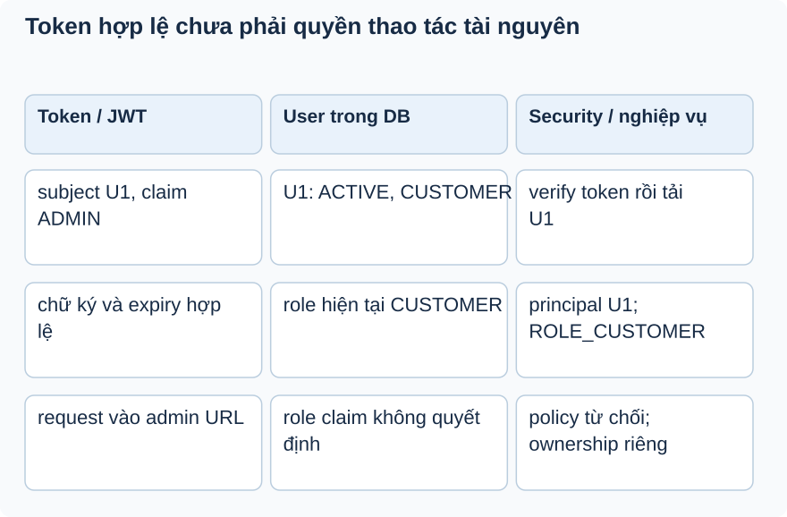

# Bài 3. Từ token đến danh tính trong request

[Giáo trình](../../README.md) · [Mục lục module](README.md)

**Trong bài:** [Tình huống và cách nghĩ](#tình-huống-và-cách-nghĩ) · [Cùng trace source](#cùng-trace-source) · [Luyện từ có hướng dẫn đến tự làm](#luyện-từ-có-hướng-dẫn-đến-tự-làm)

**20–30 phút · Chương 2: Cơ chế và dữ liệu**

**Câu hỏi trung tâm:** Một JWT hợp lệ trở thành người dùng hiện tại bằng cách nào?

Sau bài này, bạn có thể:

- Tách lượt login khỏi lượt HTTP mang token.
- Chỉ nơi filter đặt principal và authority từ DB.
- Dự đoán đường 401/403 khi token hoặc User không hợp lệ.

**Cần biết trước:** [Bài toán module](01-bai-toan.md); bài ngay trước theo thanh điều hướng cuối trang. Java class/interface, constructor và HTTP request/response; học bài mở đầu trước.

## Tình huống và cách nghĩ

Token giả định có role claim ADMIN, nhưng User trong DB là CUSTOMER/ACTIVE.

Phân biệt hai lượt HTTP. Login dùng credentials để xin token. Lượt sau mang token để xác thực request
mới. Authentication là dữ liệu framework ghi nhận về người gọi; SecurityContext giữ nó cho phần xử lý
request phía sau. Chữ ký bảo vệ tính toàn vẹn, không che payload. Quyền tài nguyên còn phụ thuộc role và
ownership.



Đọc từng hàng từ trái sang phải. Cột giữa giải thích vì sao role claim không là authority cuối. Policy
URL/method và ownership là các quyết định tiếp sau xác thực.

## Cơ chế trong EventHub

Phần dưới dựa trên source working tree. Phương án thay thế là phân tích/đề xuất; race cần test riêng
trước khi kết luận runtime.

**Khái niệm/vấn đề:** JWT là thông điệp có chữ ký để xác minh nội dung không bị sửa. Nó giúp client mang
chứng cứ login, không chứa quyền sở hữu mọi tài nguyên. Payload đọc được; không đưa bí mật vào claim.
EventHub vẫn hỏi DB mỗi request để role/status hiện tại có hiệu lực.

**Cơ chế/vị trí/runtime:** JwtServiceImpl ký subject user ID, email/role và timestamps;
parseSignedClaims verify khóa/expiry. JwtAuthenticationFilter là OncePerRequestFilter, lấy prefix
Bearer, gọi isValid rồi extractUserId, tìm User ACTIVE, tạo token Authentication có authority ROLE_*.
SecurityContextHolder đưa Authentication cho phần sau trong request. Filter gọi chain để tiếp tục, không
trả nghiệp vụ booking.

**Thay thế/trade-off:** server session giảm việc client giữ bearer token nhưng cần quản lý session; JWT
không query DB có thể giảm đọc nhưng khó phản ánh banned/role đổi tức thì. Đây là so sánh, không thay
đổi hiện trạng. Không tuyên bố stateless vì config chưa đặt policy rõ.

**Lỗi/debug/test:** 401 trước controller: kiểm tra prefix, hết hạn, chữ ký và User. 403 sau xác thực:
xem role/ownership, không đổi token ngẫu nhiên. Tests filter mock JwtService nên chưa kiểm chữ ký thật.
**ĐỀ XUẤT:** test token bị sửa/hết hạn bằng JwtService thật và HTTP security chain.

## Cùng trace source

Mở theo thứ tự: [JwtServiceImpl](../../../../backend/src/main/java/com/eventhub/eventhub_backend/auth/security/Impl/JwtServiceImpl.java) → [JwtAuthenticationFilter](../../../../backend/src/main/java/com/eventhub/eventhub_backend/auth/security/Impl/JwtAuthenticationFilter.java) → [SecurityConfig](../../../../backend/src/main/java/com/eventhub/eventhub_backend/config/SecurityConfig.java).

Điểm cần tìm: `generateToken; doFilterInternal → setAuthentication`. Với mỗi guard, ghi input và kết quả khi đúng/sai; với mỗi setter/query, ghi dữ liệu thay đổi ở object hay DB. Tra [bảng source module](01-bai-toan.md) nếu cần DTO hoặc test liên quan.

Đoạn trích nguyên văn từ [JwtAuthenticationFilter, dòng 72](../../../../backend/src/main/java/com/eventhub/eventhub_backend/auth/security/Impl/JwtAuthenticationFilter.java#L72); chỉ là phần cần quan sát, không phải toàn bộ method:

```java
        SecurityContextHolder
                .getContext()
                .setAuthentication(authentication);
```

Đọc khối này trong method bao quanh: điều kiện trước nó quyết định có đến được đây không,
caller/transaction phía ngoài quyết định thay đổi có commit không. Không dùng riêng snippet để suy ra
toàn bộ flow.

## Ví dụ được giải từng bước

**Ví dụ minh họa**, dùng ID/số liệu giả; không phải request ghi vào môi trường thật.

Token giả định có role claim ADMIN, nhưng User trong DB là CUSTOMER/ACTIVE.

1. Filter xác minh token và lấy subject là userId.
2. Filter tải User theo ID. Nó không lấy authority cuối cùng từ role claim.
3. Authority được tạo từ role DB: ROLE_CUSTOMER.
4. URL admin bị từ chối dù claim ghi ADMIN. Nếu User chuyển BANNED, filter không thiết lập
   Authentication của User đó.

**Dừng lại và dự đoán:** Token đúng chữ ký nhưng đã hết hạn đi vào URL được bảo vệ: controller có được
gọi như một user ACTIVE không?

<details>
<summary>Đối chiếu sau khi đã tự trả lời</summary>

Không. Kiểm tra token không qua thì filter đi tiếp chưa xác thực; security entry point xử lý đường được
bảo vệ. Public URL có policy khác, nên không suy ra mọi request token sai đều trả cùng một lỗi.

</details>

## Tự nhớ lại, không nhìn lên trên

1. Giải thích bằng lời: Một JWT hợp lệ trở thành người dùng hiện tại bằng cách nào?
2. Trace hoặc dự đoán: Token đúng chữ ký nhưng đã hết hạn đi vào URL được bảo vệ: controller có được gọi
   như một user ACTIVE không?
3. Tìm trong source một guard, query hoặc mapping quyết định kết quả; nó đọc/ghi dữ liệu nào?
4. Bài tập có hướng dẫn muốn chứng minh tính chất nào? Dependency nào phải chạy thật để chứng minh nó?

<details>
<summary>Đáp án và cách kiểm tra</summary>

1. Phân biệt hai lượt HTTP. Login dùng credentials để xin token. Lượt sau mang token để xác thực request
   mới. Authentication là dữ liệu framework ghi nhận về người gọi; SecurityContext giữ nó cho phần xử lý
   request phía sau. Chữ ký bảo vệ tính toàn vẹn, không che payload. Quyền tài nguyên còn phụ thuộc role
   và ownership.

2. Không. Kiểm tra token không qua thì filter đi tiếp chưa xác thực; security entry point xử lý đường
   được bảo vệ. Public URL có policy khác, nên không suy ra mọi request token sai đều trả cùng một lỗi.

3. Lần theo `generateToken; doFilterInternal → setAuthentication` trong các file đã dẫn; câu trả lời
   phải có tên field/điều kiện, không chỉ nói “service kiểm tra”.

4. Dự đoán đường 401/403 khi token hoặc User không hợp lệ. Đối chiếu gợi ý/rubric bài tập: thuật toán
   cần encoder/mapper thật; query/constraint/rollback/lock cần DB phù hợp; routing/validation/security
   HTTP cần pipeline thật. Chọn phần đúng bài này, không chạy mọi tầng vô điều kiện.

</details>

## Luyện từ có hướng dẫn đến tự làm

**Có hướng dẫn:** Vẽ hai lượt login và GET users/me. Ghi chỗ tạo token, chỗ đặt principal và chỗ tải
User; đọc test filter rồi chỉ ra dependency nào bị mock.

**Tự làm:** Tài khoản U1 đang ACTIVE/CUSTOMER được đổi role trong DB sau khi token đã cấp. Tự trace
request tiếp theo, ghi authority và chi phí đọc; so với phương án chỉ tin claim.

<details>
<summary>Gợi ý khi mắc kẹt</summary>

Tìm generateToken, setAuthentication và UserRepository.findById; không gộp hai request thành một transaction.

</details>

<details>
<summary>Rubric tự chấm</summary>

Đạt khi principal=userId, authority từ DB và tách signature test thật khỏi JwtService mock.

Tự cho 0–2 điểm mỗi mục: expected rõ; bằng chứng source đúng; giải thích cơ chế; phân biệt giới hạn
test. Đạt từ 6/8 và không sai invariant chính. Điểm này giúp chọn chỗ ôn, không chứng nhận năng lực
production.

</details>

## Giữ lại điều cốt lõi

Token có chữ ký không che payload và không chứa quyền sở hữu tài nguyên. Filter kiểm token, tải User
ACTIVE, đặt principal=userId và role DB; policy và ownership còn kiểm tiếp.

[← Bài trước](02-co-che.md) · [Mục lục module](README.md) · [Học tiếp →](04-co-che.md)

Nếu chưa giải thích được câu hỏi trung tâm, làm lại biến thể trước khi học tiếp; không cần đọc thêm mọi
tài liệu tham khảo.
