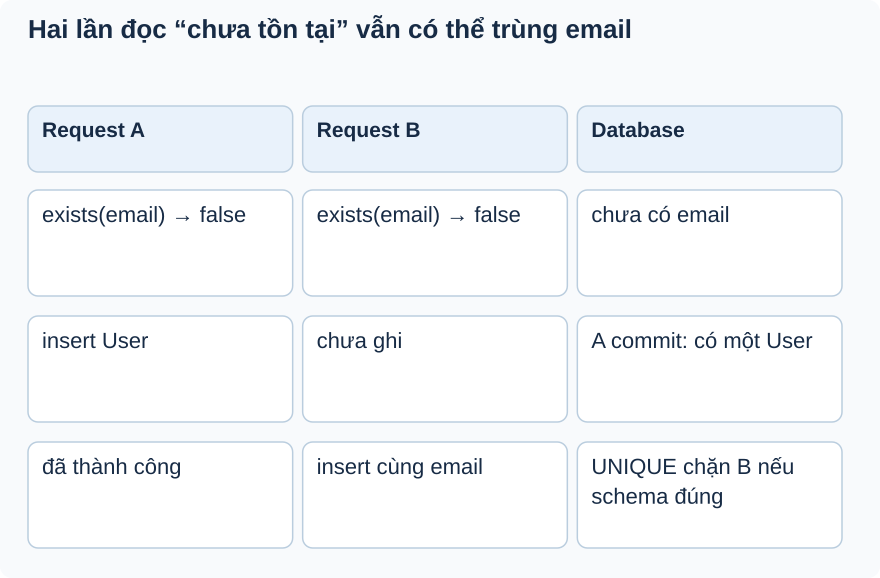

# Bài 4. Ba hàng rào khi đăng ký

[Giáo trình](../../README.md) · [Mục lục module](README.md)

**Trong bài:** [Tình huống và cách nghĩ](#tình-huống-và-cách-nghĩ) · [Cùng trace source](#cùng-trace-source) · [Luyện từ có hướng dẫn đến tự làm](#luyện-từ-có-hướng-dẫn-đến-tự-làm)

**20–30 phút · Chương 2: Cơ chế và dữ liệu**

**Câu hỏi trung tâm:** Vì sao @Valid và existsByEmail vẫn cần UNIQUE ở database?

Sau bài này, bạn có thể:

- Phân biệt hình thức input, nghiệp vụ và constraint DB.
- Vẽ lịch hai request cùng exists=false.
- Thiết kế assertion dữ liệu và response cho collision.

**Cần biết trước:** [Bài toán module](01-bai-toan.md); bài ngay trước theo thanh điều hướng cuối trang. Java class/interface, constructor và HTTP request/response; học bài mở đầu trước.

## Tình huống và cách nghĩ

Hai request cùng email giả đến gần nhau.

Ba câu hỏi khác nhau: dữ liệu có hình thức hợp lệ không; nghiệp vụ có chấp nhận không; nhiều người ghi
cùng lúc có giữ được điều kiện dữ liệu không? @Email không hỏi DB. existsByEmail đọc trạng thái tại một
thời điểm. Constraint ở DB bảo vệ thao tác ghi nếu schema thực tế có constraint đó.



Đọc từ trên xuống theo thời gian. Hai ô false cùng hàng là cửa sổ cạnh tranh; hàng cuối là nơi DB bảo
vệ. Hình là lịch minh họa, chưa là test đã chạy.

## Cơ chế trong EventHub

Phần dưới dựa trên source working tree. Phương án thay thế là phân tích/đề xuất; race cần test riêng
trước khi kết luận runtime.

RegisterRequest kiểm tra email, password dài 8–100 và fullName 2–100 qua @Valid. `existsByEmail` là kiểm
tra nghiệp vụ cho thông báo sớm, còn UNIQUE email mới chặn hai transaction cùng insert email ở DB nếu
schema đúng. Hai request có thể cùng thấy “chưa có”. Transaction register không tự khóa một email chưa
tồn tại.

Có thể chuẩn hóa email và xử lý unique collision trong task sau; hiện chưa thấy normalize hay generic DB
exception handler. Debug cần phân biệt 400 validation, 409 USER_EXISTED từ service và lỗi DB chưa chuẩn
hóa. Bài tập đề xuất: vẽ hai request cùng exists=false và thiết kế assertion một User cuối cùng; test
register HTTP/DB còn thiếu.

Câu hỏi phỏng vấn: tại sao cả DTO validation, service check và DB constraint đều hữu ích nhưng bảo vệ
các lớp khác nhau?

## Cùng trace source

Mở theo thứ tự: [RegisterRequest](../../../../backend/src/main/java/com/eventhub/eventhub_backend/auth/dto/request/RegisterRequest.java) → [AuthServiceImpl](../../../../backend/src/main/java/com/eventhub/eventhub_backend/auth/service/Impl/AuthServiceImpl.java) → [UserRepository](../../../../backend/src/main/java/com/eventhub/eventhub_backend/user/repository/UserRepository.java).

Điểm cần tìm: `register → existsByEmail → save`. Với mỗi guard, ghi input và kết quả khi đúng/sai; với mỗi setter/query, ghi dữ liệu thay đổi ở object hay DB. Tra [bảng source module](01-bai-toan.md) nếu cần DTO hoặc test liên quan.

Đoạn trích nguyên văn từ [User, dòng 20](../../../../backend/src/main/java/com/eventhub/eventhub_backend/user/entity/User.java#L20); chỉ là phần cần quan sát, không phải toàn bộ method:

```java
    @Column(nullable = false, unique = true)
    String email;
```

Đọc khai báo này cùng field/kiểu và nơi gọi nó. Annotation hay interface không tự chứng minh toàn bộ
request: DTO cần validation pipeline, mapper cần nhánh service phù hợp, query cần transaction và DB
thật. Chọn ranh giới liên quan đến ví dụ trong bài.

## Ví dụ được giải từng bước

**Ví dụ minh họa**, dùng ID/số liệu giả; không phải request ghi vào môi trường thật.

Hai request cùng email giả đến gần nhau.

1. A và B đều qua kiểm tra định dạng.
2. A đọc exists=false; B cũng đọc false trước khi A commit.
3. A insert rồi commit.
4. UNIQUE email phải chặn insert trùng của B nếu schema đúng; service check trước đó không đủ.
5. Cần xem handler để biết collision được dịch thành response thế nào; hiện chưa chuẩn hóa riêng lỗi DB này.

**Dừng lại và dự đoán:** Email không đúng định dạng bị @Valid chặn có cần chờ existsByEmail để quyết
định không?

<details>
<summary>Đối chiếu sau khi đã tự trả lời</summary>

Không ở đường MVC có @Valid. Service có thể chưa chạy. Gọi method trực tiếp trong unit test không tự
chạy cùng pipeline MVC.

</details>

## Tự nhớ lại, không nhìn lên trên

1. Giải thích bằng lời: Vì sao @Valid và existsByEmail vẫn cần UNIQUE ở database?
2. Trace hoặc dự đoán: Email không đúng định dạng bị @Valid chặn có cần chờ existsByEmail để quyết định không?
3. Tìm trong source một guard, query hoặc mapping quyết định kết quả; nó đọc/ghi dữ liệu nào?
4. Bài tập có hướng dẫn muốn chứng minh tính chất nào? Dependency nào phải chạy thật để chứng minh nó?

<details>
<summary>Đáp án và cách kiểm tra</summary>

1. Ba câu hỏi khác nhau: dữ liệu có hình thức hợp lệ không; nghiệp vụ có chấp nhận không; nhiều người
   ghi cùng lúc có giữ được điều kiện dữ liệu không? @Email không hỏi DB. existsByEmail đọc trạng thái
   tại một thời điểm. Constraint ở DB bảo vệ thao tác ghi nếu schema thực tế có constraint đó.

2. Không ở đường MVC có @Valid. Service có thể chưa chạy. Gọi method trực tiếp trong unit test không tự
   chạy cùng pipeline MVC.

3. Lần theo `register → existsByEmail → save` trong các file đã dẫn; câu trả lời phải có tên field/điều
   kiện, không chỉ nói “service kiểm tra”.

4. Thiết kế assertion dữ liệu và response cho collision. Đối chiếu gợi ý/rubric bài tập: thuật toán cần
   encoder/mapper thật; query/constraint/rollback/lock cần DB phù hợp; routing/validation/security HTTP
   cần pipeline thật. Chọn phần đúng bài này, không chạy mọi tầng vô điều kiện.

</details>

## Luyện từ có hướng dẫn đến tự làm

**Có hướng dẫn:** Thiết kế test hai transaction đăng ký cùng email: ghi lịch bắt đầu, điểm đồng bộ, kết
quả đếm User và lỗi mong muốn; đánh dấu lỗi HTTP chuẩn hóa là đề xuất.

**Tự làm:** Hai email chỉ khác chữ hoa hoặc khoảng trắng. Từ source hiện tại, ghi điều đã biết và điều
cần xác minh ở normalize/collation/schema; đề xuất policy và test riêng.

<details>
<summary>Gợi ý khi mắc kẹt</summary>

Tách assertion dữ liệu chỉ có một User khỏi assertion response cho request thua.

</details>

<details>
<summary>Rubric tự chấm</summary>

Đạt khi test dùng DB/transaction thật, không chỉ stub hai lần exists=false; không coi annotation là bằng
chứng schema production.

Tự cho 0–2 điểm mỗi mục: expected rõ; bằng chứng source đúng; giải thích cơ chế; phân biệt giới hạn
test. Đạt từ 6/8 và không sai invariant chính. Điểm này giúp chọn chỗ ôn, không chứng nhận năng lực
production.

</details>

## Giữ lại điều cốt lõi

@Valid kiểm input, existsByEmail giúp lỗi sớm, UNIQUE bảo vệ ghi trùng nếu schema đúng. Transaction
không tự khóa email chưa tồn tại; collision DB chưa có contract chuẩn hóa riêng.

[← Bài trước](03-co-che.md) · [Mục lục module](README.md) · [Học tiếp →](05-tu-kiem-chung.md)

Nếu chưa giải thích được câu hỏi trung tâm, làm lại biến thể trước khi học tiếp; không cần đọc thêm mọi
tài liệu tham khảo.
