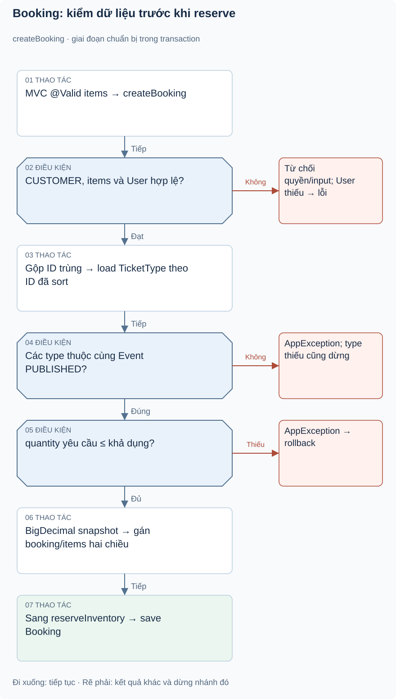
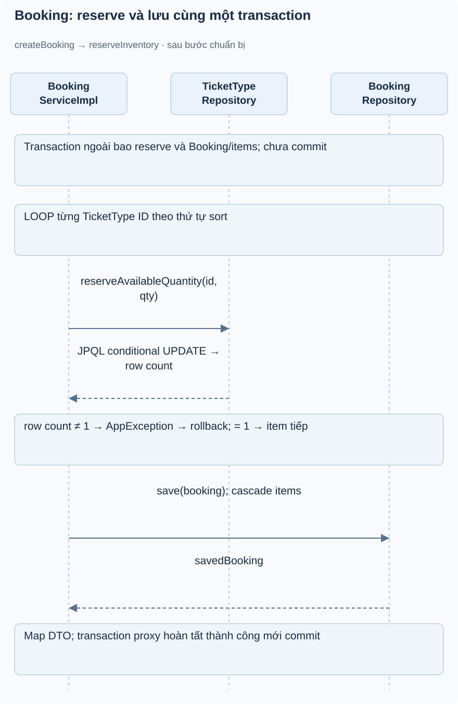

# Bài 1. Booking — giữ chỗ và giá mua: bài toán trước code

[Giáo trình](../../README.md) · [Mục lục module](README.md)

**Trong bài:** [Bắt đầu từ người dùng](#bắt-đầu-từ-người-dùng) · [Mở source theo thứ tự này](#mở-source-theo-thứ-tự-này) · [Tự làm có hướng dẫn](#tự-làm-có-hướng-dẫn)

**20–25 phút · Chương 1: Bài toán và đường đi**

**Câu hỏi trung tâm:** Module này quyết định điều gì trong hành trình mua vé, và điều gì thuộc module khác?

Sau bài này, bạn có thể:

- Kể lại nhu cầu của actor và quy tắc chính bằng lời.
- Trace luồng chính từ điểm vào đến kết quả hoặc lỗi.
- Chỉ ra dữ liệu module sở hữu và một giới hạn hiện tại.

**Cần biết trước:** Hoàn thành Ticket; tính được quantity − soldQuantity và đọc List/Map Java. [Lộ trình đầy đủ](../../learning-path.md).

## Bắt đầu từ người dùng

Ví dụ minh họa: chỉ còn hai vé, Lan và Nam cùng bấm đặt. Nếu cả hai chỉ đọc available rồi lưu booking,
cả hai có thể nghĩ còn chỗ. Booking module phải quyết định tại điểm ghi DB ai giữ được vé, đồng thời bảo
đảm khách bỏ thanh toán không giữ chỗ mãi.

**ĐÃ XÁC MINH working tree:** tạo PENDING_PAYMENT tăng `soldQuantity` để giữ chỗ; hủy/hết hạn giảm counter; confirm không tăng lần nữa. ADR-002 cũ khác hiện tại, xem [ADR-003](../../../decisions/ADR-003-current-inventory-semantics.md). Booking chỉ gồm loại vé cùng một Event PUBLISHED. Khách chỉ xem/hủy booking của mình; chỉ pending được hủy. Giá từ server, lưu unitPrice/subtotal/totalAmount tại lúc đặt.

Module không xác thực tiền ngân hàng, không phát vé và không quản lý reservation bằng cột riêng. Timeout
dựa createdAt: BookingScheduler mỗi 60 giây xử lý pending cũ hơn 900 giây. Chưa có expiresAt trong
Booking.

## Mô hình và luồng thật

### Góc nhìn 1: Booking: kiểm dữ liệu trước khi reserve

Theo nhánh dọc đến snapshot; các nhánh phải đều dừng operation. Precheck chưa giữ được vé: điểm ghi
quyết định nằm trong hình reserve tiếp theo.

### Góc nhìn 2: Booking: reserve và lưu cùng một transaction

Các lời gọi reserve lặp theo ID đã sort. Chỉ row count=1 mới đi tiếp. Lỗi ở bất kỳ item nào rollback cả
operation, kể cả reserve đã thành công trước đó.

**Luồng chính, đọc theo từng cụm:**

1. POST /bookings → JWT/role → @Valid list/items
2. requireCustomer → load User → gộp item theo ID
3. load TicketType theo ID được sort → kiểm event PUBLISHED/cùng event → precheck quantity-sold
4. tính BigDecimal → gán item.booking và booking.items → atomic reserve từng ID theo thứ tự
5. save Booking/cascade items → DTO

Commit diễn ra khi lời gọi service transactional qua proxy hoàn tất; response không thể chứng minh SQL
đã commit nếu chỉ test method gọi trực tiếp không có Spring.

Nếu một loại không tồn tại, event sai hoặc reserve updateRows≠1, AppException làm transaction rollback.
Dù đã reserve item thứ nhất, không được giữ nó khi item thứ hai thất bại. Khi hủy: load
booking→owner→pending→khóa từng TicketType→trừ quantity→CANCELLED→save. Expire làm tương tự cho list
pending quá tuổi; không có HTTP endpoint expire.

Đọc hình từ điểm vào được ghi trên hình, lần theo các điều kiện trước khi nhìn phần lưu/response. Mũi
tên là thứ tự xử lý, không phải bằng chứng mọi nhánh đều chạy hoặc mọi thay đổi đã commit. Dừng ở nhánh
lỗi và tự nói điều gì chưa xảy ra.

## Mở source theo thứ tự này

| File/Class | Trách nhiệm | Vì sao / đọc khi nào |
|---|---|---|
| [BookingController](../../../../backend/src/main/java/com/eventhub/eventhub_backend/booking/controller/BookingController.java) | Create/list/detail/cancel CUSTOMER | Xác định HTTP và quyền đầu vào |
| [CreateBookingRequest](../../../../backend/src/main/java/com/eventhub/eventhub_backend/booking/dto/request/CreateBookingRequest.java), [BookingItemRequest](../../../../backend/src/main/java/com/eventhub/eventhub_backend/booking/dto/request/BookingItemRequest.java) | Items nested @Valid | Tránh list rỗng và số lượng không dương ở API |
| [BookingServiceImpl](../../../../backend/src/main/java/com/eventhub/eventhub_backend/booking/service/Impl/BookingServiceImpl.java) | Gộp item, rule, giá, reserve/release | File cốt lõi; bắt đầu createBooking |
| [Booking](../../../../backend/src/main/java/com/eventhub/eventhub_backend/booking/entity/Booking.java), [BookingItem](../../../../backend/src/main/java/com/eventhub/eventhub_backend/booking/entity/BookingItem.java) | Header/items + snapshot | Hiểu cascade và owning side |
| [TicketTypeRepository](../../../../backend/src/main/java/com/eventhub/eventhub_backend/ticket/repository/TicketTypeRepository.java) | Conditional update và lock | Hàng rào thật tại DB |
| [BookingRepository](../../../../backend/src/main/java/com/eventhub/eventhub_backend/booking/repository/BookingRepository.java), [BookingScheduler](../../../../backend/src/main/java/com/eventhub/eventhub_backend/config/BookingScheduler.java) | Query customer/expired và job | Trace pending→expired |
| [BookingServiceImplTest](../../../../backend/src/test/java/com/eventhub/eventhub_backend/booking/BookingServiceImplTest.java) | 12 ca unit | So rule và mock atomic row count |

Lượt đầu chỉ mở controller và service cốt lõi trong bảng. Ghi tên guard, dữ liệu trước/sau, rồi mới mở
DTO/repository tương ứng. Test đọc sau khi đã tự dự đoán.

## Một ví dụ nhỏ để tự lần theo

Ví dụ minh họa dựa trên rule hiện có: Đặt thành công 2 vé, chưa thanh toán: capacity=10, sold trước=3.
Counter sau là mấy?

1. Xác định actor, dữ liệu và state trước thao tác.
2. Tìm guard tương ứng trong service/controller của bảng source.
3. Ghi quyết định và tác động: soldQuantity=5, available=5. PENDING_PAYMENT đã giữ chỗ. Confirm không
   tăng thêm; cancel/expire mới release phần đó.

**Thử biến thể trước khi xem:** Nếu người gọi có role đúng nhưng không sở hữu tài nguyên, role có tự bỏ
qua ownership không?

Đối chiếu biến thể

Không với các use case có ownership guard. Auth/common không tự sở hữu booking/event; phải tìm service
tài nguyên. Role ADMIN có ngoại lệ nào thì đọc từng guard, không suy rộng cho mọi endpoint.

## Tự nhớ lại

1. Đóng bài: kể actor, nhu cầu và kết quả của module trong 60 giây.
2. Với tình huống ví dụ, thao tác dừng ở guard nào và dữ liệu nào không thay đổi?
3. Module này có kiểm tiền ngân hàng, giữ chỗ hoặc phát vé không? Chỉ nhận trách nhiệm có source.
4. Tìm một feature chưa có; bằng chứng nào giúp phân biệt “có DTO/service” với “có runtime caller”?

Đáp án định hướng

1. Đối chiếu phần bài toán; phải kể nhu cầu thay vì chỉ tên layer.
2. soldQuantity=5, available=5. PENDING_PAYMENT đã giữ chỗ. Confirm không tăng thêm; cancel/expire mới
   release phần đó.
3. Xem phạm vi đầu bài và trace, không gán mọi bước mua vé cho module này.
4. Tìm controller/caller, không chỉ class tồn tại. Các khoảng thiếu đã ghi trong bài là điều cần kiểm
   chứng lại khi source đổi.

## Tự làm có hướng dẫn

Trace create/cancel/expire một booking 2 vé bằng bảng counter trước/sau và trạng thái.

Sau đó bỏ tài liệu, tự ghi một happy path và một failure path. Với mỗi bước, nêu dữ liệu vào/ra; không
viết code production.

Gợi ý

Dùng bảng năm dòng: actor → điểm vào → guard → dữ liệu → kết quả. Khi thiếu bằng chứng, ghi “chưa xác
minh”, không điền theo trí nhớ framework.

Tiêu chí hoàn thành

Có tên method thật, guard cụ thể, dữ liệu trước/sau và nhánh lỗi; không thêm endpoint/tác động ngoài
source. Nếu thiếu hai trong bốn phần, quay lại trace trước bài tiếp.

## Chốt lại và chỗ dễ nhầm

Luồng gọi và quyền hợp lệ chưa chứng minh dữ liệu commit hay chống được cạnh tranh. Học cơ chế ở chương
tiếp theo rồi quay lại tự vẽ luồng này một lần nữa.

[← Bài trước](../ticket/05-tu-kiem-chung.md) · [Mục lục module](README.md) · [Học tiếp →](02-co-che.md)

Nếu chưa giải thích được câu hỏi trung tâm, làm lại biến thể trước khi học tiếp; không cần đọc thêm mọi
tài liệu tham khảo.

**Cập nhật 19/10/2026:** Booking transition và check-in đã có khóa DB; test PostgreSQL mới ở [biên bản concurrency](../../../project/concurrency-verification.md). Các bài tập thiết kế biến thể vẫn để tự luyện; phân biệt với những case đã có test thật.
