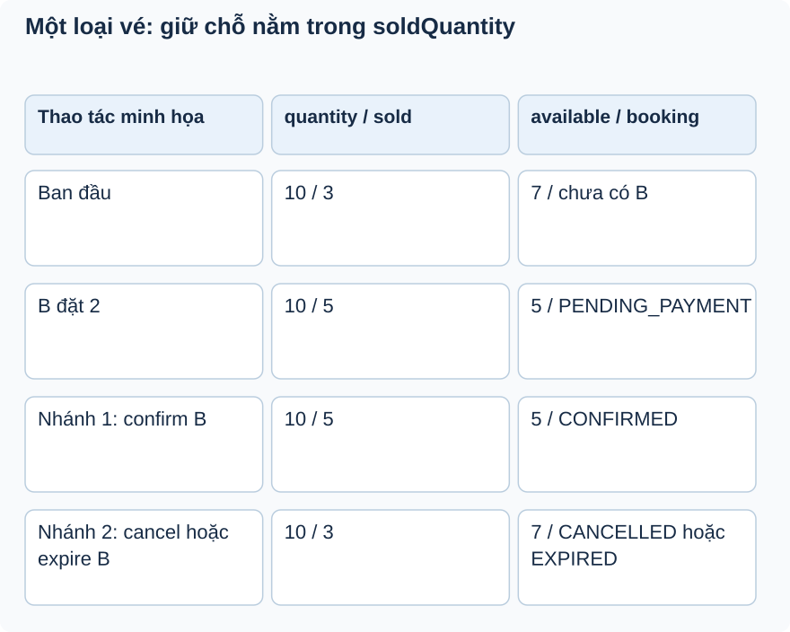

# Bài 2. Gộp yêu cầu, đóng băng giá

[Giáo trình](../../README.md) · [Mục lục module](README.md)

**Trong bài:** [Tình huống và cách nghĩ](#tình-huống-và-cách-nghĩ) · [Cùng trace source](#cùng-trace-source) · [Luyện từ có hướng dẫn đến tự làm](#luyện-từ-có-hướng-dẫn-đến-tự-làm)

**20–30 phút · Chương 2: Cơ chế và dữ liệu**

**Câu hỏi trung tâm:** Vì sao phải gộp ID trùng trước khi tính tồn kho và tiền?

Sau bài này, bạn có thể:

- Gộp quantity theo ID trước khi kiểm khả dụng.
- Tính snapshot unitPrice/subtotal/totalAmount.
- Giải thích BigDecimal bất biến và giới hạn Integer::sum.

**Cần biết trước:** [Bài toán module](01-bai-toan.md). Hoàn thành Ticket; tính được quantity − soldQuantity và đọc List/Map Java.

## Tình huống và cách nghĩ

T1 còn 3 chỗ, giá 100.000; body có T1×2 và T1×2.

Một request có nhiều dòng, nhưng invariant tồn kho áp dụng cho tổng theo loại vé. Map giữ một tổng cho
mỗi ID. Snapshot là bản chụp giá tại lúc mua, không phải bản sao thừa vô ích: nó giữ thỏa thuận khi bảng
giá thay đổi.



Đọc hai hàng đầu chung, rồi chọn một trong hai nhánh cuối. Confirm và cancel/expire là các nhánh thay
thế trong ví dụ, không nối tiếp nhau. Counter bao gồm chỗ giữ pending.

## Cơ chế trong EventHub

Phần dưới dựa trên source working tree. Phương án thay thế là phân tích/đề xuất; race cần test riêng
trước khi kết luận runtime.

Khái niệm: Map<String,Integer> gom cùng loại vé thành một yêu cầu tổng. EventHub dùng LinkedHashMap và
merge(id,qty,Integer::sum), tránh hai dòng cùng ID vượt tồn nếu mỗi dòng được kiểm riêng. Ví dụ giả định
available=3, body có hai dòng mỗi dòng 2: kiểm riêng đều hợp lệ nhưng tổng 4 phải bị từ chối. Sort key
khi reserve tạo thứ tự ghi nhất quán, giúp giảm một kiểu deadlock khi nhiều loại vé; không xóa mọi
deadlock.

UnitPrice và subtotal là snapshot: giá mua đã thỏa thuận không phụ thuộc TicketType sau này.
BigDecimal.multiply/add tạo giá trị mới; biến totalAmount phải nhận kết quả add, không giống biến số
mutable. totalAmount bắt đầu ZERO, subtotal=price×qty; tiền do server tính, client không gửi tổng để
tránh tự sửa giá.

Thay thế: cấm duplicate ID đơn giản hơn nhưng khác UX; tổng hợp SQL hoặc stream collector rút code nhưng
phải giữ validation và thông báo rõ. Snapshot lặp dữ liệu có chủ đích, không “chuẩn hóa” bằng cách chỉ
đọc giá hiện tại. Debug tại requestedQuantities và totalAmount; nguy cơ Integer overflow khi cộng số quá
lớn chưa có giới hạn/max. Tests hiện kiểm happy path/cùng event/thiếu chỗ, chưa thấy test overflow.

## Cùng trace source

Mở theo thứ tự: [BookingServiceImpl](../../../../backend/src/main/java/com/eventhub/eventhub_backend/booking/service/Impl/BookingServiceImpl.java) → [BookingItem](../../../../backend/src/main/java/com/eventhub/eventhub_backend/booking/entity/BookingItem.java).

Điểm cần tìm: `createBooking; aggregateRequestedQuantities`. Với mỗi guard, ghi input và kết quả khi đúng/sai; với mỗi setter/query, ghi dữ liệu thay đổi ở object hay DB. Tra [bảng source module](01-bai-toan.md) nếu cần DTO hoặc test liên quan.

Đoạn trích nguyên văn từ [BookingServiceImpl, dòng 189](../../../../backend/src/main/java/com/eventhub/eventhub_backend/booking/service/Impl/BookingServiceImpl.java#L189); chỉ là phần cần quan sát, không phải toàn bộ method:

```java
            requestedQuantities.merge(item.getTicketTypeId(), item.getQuantity(), Integer::sum);
```

Đọc khối này trong method bao quanh: điều kiện trước nó quyết định có đến được đây không,
caller/transaction phía ngoài quyết định thay đổi có commit không. Không dùng riêng snippet để suy ra
toàn bộ flow.

## Ví dụ được giải từng bước

**Ví dụ minh họa**, dùng ID/số liệu giả; không phải request ghi vào môi trường thật.

T1 còn 3 chỗ, giá 100.000; body có T1×2 và T1×2.

1. LinkedHashMap gộp thành T1×4.
2. So tổng 4 với available 3: từ chối trước reserve.
3. Với T1×2 hợp lệ, subtotal=100.000×2=200.000.
4. totalAmount cộng các subtotal bằng BigDecimal và lưu snapshot. Đổi giá TicketType sau đó không được
   tính lại booking cũ.

**Dừng lại và dự đoán:** BigDecimal total=ZERO; gọi total.add(subtotal) nhưng không nhận kết quả: total
có đổi không?

<details>
<summary>Đối chiếu sau khi đã tự trả lời</summary>

Không. BigDecimal bất biến; add trả giá trị mới. Source phải gán lại kết quả vào totalAmount.

</details>

## Tự nhớ lại, không nhìn lên trên

1. Giải thích bằng lời: Vì sao phải gộp ID trùng trước khi tính tồn kho và tiền?
2. Trace hoặc dự đoán: BigDecimal total=ZERO; gọi total.add(subtotal) nhưng không nhận kết quả: total có
   đổi không?
3. Tìm trong source một guard, query hoặc mapping quyết định kết quả; nó đọc/ghi dữ liệu nào?
4. Bài tập có hướng dẫn muốn chứng minh tính chất nào? Dependency nào phải chạy thật để chứng minh nó?

<details>
<summary>Đáp án và cách kiểm tra</summary>

1. Một request có nhiều dòng, nhưng invariant tồn kho áp dụng cho tổng theo loại vé. Map giữ một tổng
   cho mỗi ID. Snapshot là bản chụp giá tại lúc mua, không phải bản sao thừa vô ích: nó giữ thỏa thuận
   khi bảng giá thay đổi.

2. Không. BigDecimal bất biến; add trả giá trị mới. Source phải gán lại kết quả vào totalAmount.

3. Lần theo `createBooking; aggregateRequestedQuantities` trong các file đã dẫn; câu trả lời phải có tên
   field/điều kiện, không chỉ nói “service kiểm tra”.

4. Giải thích BigDecimal bất biến và giới hạn Integer::sum. Đối chiếu gợi ý/rubric bài tập: thuật toán
   cần encoder/mapper thật; query/constraint/rollback/lock cần DB phù hợp; routing/validation/security
   HTTP cần pipeline thật. Chọn phần đúng bài này, không chạy mọi tầng vô điều kiện.

</details>

## Luyện từ có hướng dẫn đến tự làm

**Có hướng dẫn:** Tính tay T1×1, T2×2, T1×2 với giá 120.000 và 80.000; viết expected tổng quantity theo
ID, subtotal và total, rồi đối chiếu loop source.

**Tự làm:** Tạo input giả có hai quantity dương rất lớn cho cùng ID. Tự kiểm nguy cơ Integer overflow
trước precheck, đề xuất giới hạn và assertion; không dùng số tiền client để “sửa” tổng.

<details>
<summary>Gợi ý khi mắc kẹt</summary>

Gộp trước: T1×3, T2×2; không cộng giá hiện tại sau khi booking đã lưu.

</details>

<details>
<summary>Rubric tự chấm</summary>

Đạt khi total=520.000 và nêu Integer::sum có nguy cơ overflow nếu không giới hạn đầu vào.

Tự cho 0–2 điểm mỗi mục: expected rõ; bằng chứng source đúng; giải thích cơ chế; phân biệt giới hạn
test. Đạt từ 6/8 và không sai invariant chính. Điểm này giúp chọn chỗ ôn, không chứng nhận năng lực
production.

</details>

## Giữ lại điều cốt lõi

Invariant áp trên tổng theo TicketType nên phải gộp ID trùng. Snapshot server giữ giá mua cũ; BigDecimal
add/multiply trả giá trị mới. Sort key giảm một kiểu deadlock, không bảo đảm hết deadlock.

[← Bài trước](01-bai-toan.md) · [Mục lục module](README.md) · [Học tiếp →](03-co-che.md)

Nếu chưa giải thích được câu hỏi trung tâm, làm lại biến thể trước khi học tiếp; không cần đọc thêm mọi
tài liệu tham khảo.
