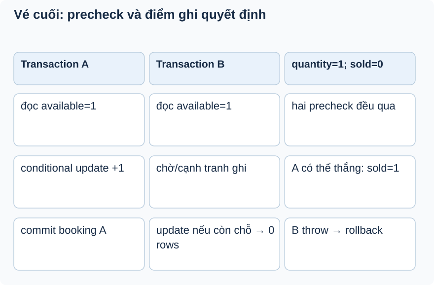

# Bài 3. Ai thắng vé cuối?

[Giáo trình](../../README.md) · [Mục lục module](README.md)

**Trong bài:** [Tình huống và cách nghĩ](#tình-huống-và-cách-nghĩ) · [Cùng trace source](#cùng-trace-source) · [Luyện từ có hướng dẫn đến tự làm](#luyện-từ-có-hướng-dẫn-đến-tự-làm)

**20–30 phút · Chương 2: Cơ chế và dữ liệu**

**Câu hỏi trung tâm:** Vì sao precheck trong Java chưa bảo vệ được vé cuối?

Sau bài này, bạn có thể:

- Vẽ cửa sổ read/precheck của hai request.
- Chỉ điều kiện JPQL và row count quyết định reserve.
- Phân biệt counter DB với entity đã load có thể stale.

**Cần biết trước:** [Bài toán module](01-bai-toan.md); bài ngay trước theo thanh điều hướng cuối trang. Hoàn thành Ticket; tính được quantity − soldQuantity và đọc List/Map Java.

## Tình huống và cách nghĩ

quantity=1, sold=0; A và B đều muốn 1.

Read rồi write là hai thời điểm khác nhau. Transaction gom thay đổi thành một đơn vị, nhưng không mặc
định bắt hai request đọc tuần tự. Conditional update đưa phép so sánh capacity và tăng counter vào cùng
thao tác DB. Affected rows là kết quả quyết định, không chỉ là số liệu để log.



Nhìn hàng đầu: đọc đúng lúc đó vẫn không giữ được chỗ. Điểm quyết định là UPDATE có điều kiện và row
count. Lịch thắng A là minh họa; cơ chế chờ cần test PostgreSQL thật.

## Cơ chế trong EventHub

Phần dưới dựa trên source working tree. Phương án thay thế là phân tích/đề xuất; race cần test riêng
trước khi kết luận runtime.

reserveAvailableQuantity thực hiện tăng COALESCE(soldQuantity,0)+quantity với điều kiện không vượt
quantity. DB kiểm điều kiện và cập nhật cùng câu lệnh; affected rows=1 mới thành công. Precheck Java
giúp lỗi sớm, nhưng có thể cũ ngay sau khi đọc. Vì vậy không được bỏ conditional update rồi tin
@Transactional đã chống oversell.

Runtime hai transaction tranh chỗ phải được xác minh trên PostgreSQL: câu ghi có thể chờ nhau và kiểm
điều kiện với dữ liệu mới theo behavior DB. Unit test chỉ stub 0/1 row count, không tạo tranh chấp thật.
Bulk JPQL không tự đồng bộ entity TicketType đã load; flushAutomatically đẩy pending changes trước
query, không refresh object sau query.

[Cơ chế modifying query của Spring Data JPA](https://docs.spring.io/spring-data/jpa/reference/jpa/query-methods.html).

Thay thế: @Version optimistic lock + retry yêu cầu version field và xử lý conflict; pessimistic lock
trước read giúp serialize nhưng giữ lock lâu. Atomic conditional update phù hợp phép tăng đơn giản, phải
kiểm row count và transaction nhiều item. Lỗi thường gặp: quên check 0 row; test mock cập nhật object
rồi tưởng DB behavior; stale persistence context sau bulk. Breakpoint row count, quan sát SQL và object
separately.

## Cùng trace source

Mở theo thứ tự: [TicketTypeRepository](../../../../backend/src/main/java/com/eventhub/eventhub_backend/ticket/repository/TicketTypeRepository.java) → [BookingServiceImpl](../../../../backend/src/main/java/com/eventhub/eventhub_backend/booking/service/Impl/BookingServiceImpl.java).

Điểm cần tìm: `reserveAvailableQuantity; reserveInventory`. Với mỗi guard, ghi input và kết quả khi đúng/sai; với mỗi setter/query, ghi dữ liệu thay đổi ở object hay DB. Tra [bảng source module](01-bai-toan.md) nếu cần DTO hoặc test liên quan.

Đoạn trích nguyên văn từ [TicketTypeRepository, dòng 22](../../../../backend/src/main/java/com/eventhub/eventhub_backend/ticket/repository/TicketTypeRepository.java#L22); chỉ là phần cần quan sát, không phải toàn bộ method:

```java
    @Modifying(flushAutomatically = true)
    @Query("""
            update TicketType ticketType
            set ticketType.soldQuantity = COALESCE(ticketType.soldQuantity, 0) + :quantity
            where ticketType.id = :ticketTypeId
              and ticketType.quantity is not null
              and COALESCE(ticketType.soldQuantity, 0) + :quantity <= ticketType.quantity
            """)
    int reserveAvailableQuantity(@Param("ticketTypeId") String ticketTypeId, @Param("quantity") int quantity);
```

Đọc khai báo này cùng field/kiểu và nơi gọi nó. Annotation hay interface không tự chứng minh toàn bộ
request: DTO cần validation pipeline, mapper cần nhánh service phù hợp, query cần transaction và DB
thật. Chọn ranh giới liên quan đến ví dụ trong bài.

## Ví dụ được giải từng bước

**Ví dụ minh họa**, dùng ID/số liệu giả; không phải request ghi vào môi trường thật.

quantity=1, sold=0; A và B đều muốn 1.

1. A đọc available=1; B cũng đọc 1. Cả hai qua precheck.
2. A chạy update có điều kiện sold+1<=quantity và tăng sold thành 1.
3. B phải dựa vào kết quả update của DB; nếu không còn đủ, affected rows=0.
4. Service yêu cầu row count=1, nếu không throw để rollback booking. Lịch chờ/kiểm lại thực tế cần test
   PostgreSQL.

**Dừng lại và dự đoán:** A giữ được loại T1 nhưng T2 trả 0 rows trong cùng createBooking: T1 có được giữ
lại không?

<details>
<summary>Đối chiếu sau khi đã tự trả lời</summary>

Không khi lời gọi đi qua transaction proxy và AppException thoát ra. Reserve T1 và insert booking/items
phải rollback cùng operation. Unit mock không chứng minh commit/rollback thật.

</details>

## Tự nhớ lại, không nhìn lên trên

1. Giải thích bằng lời: Vì sao precheck trong Java chưa bảo vệ được vé cuối?
2. Trace hoặc dự đoán: A giữ được loại T1 nhưng T2 trả 0 rows trong cùng createBooking: T1 có được giữ
   lại không?
3. Tìm trong source một guard, query hoặc mapping quyết định kết quả; nó đọc/ghi dữ liệu nào?
4. Bài tập có hướng dẫn muốn chứng minh tính chất nào? Dependency nào phải chạy thật để chứng minh nó?

<details>
<summary>Đáp án và cách kiểm tra</summary>

1. Read rồi write là hai thời điểm khác nhau. Transaction gom thay đổi thành một đơn vị, nhưng không mặc
   định bắt hai request đọc tuần tự. Conditional update đưa phép so sánh capacity và tăng counter vào
   cùng thao tác DB. Affected rows là kết quả quyết định, không chỉ là số liệu để log.

2. Không khi lời gọi đi qua transaction proxy và AppException thoát ra. Reserve T1 và insert
   booking/items phải rollback cùng operation. Unit mock không chứng minh commit/rollback thật.

3. Lần theo `reserveAvailableQuantity; reserveInventory` trong các file đã dẫn; câu trả lời phải có tên
   field/điều kiện, không chỉ nói “service kiểm tra”.

4. Phân biệt counter DB với entity đã load có thể stale. Đối chiếu gợi ý/rubric bài tập: thuật toán cần
   encoder/mapper thật; query/constraint/rollback/lock cần DB phù hợp; routing/validation/security HTTP
   cần pipeline thật. Chọn phần đúng bài này, không chạy mọi tầng vô điều kiện.

</details>

## Luyện từ có hướng dẫn đến tự làm

**Có hướng dẫn:** Vẽ timeline hai transaction dùng vé cuối; thiết kế test DB thật đồng bộ điểm bắt đầu,
đếm booking thành công và counter sau commit.

**Tự làm:** Sau bulk reserve, object TicketType đã load còn sold cũ. Tự thiết kế cách quan sát DB và
object riêng, nêu vì sao flushAutomatically không phải refresh; kiểm trước khi đề xuất clear/refresh.

<details>
<summary>Gợi ý khi mắc kẹt</summary>

Không dùng sleep để “hy vọng” tranh chấp; cần cơ chế đồng bộ và connection/transaction riêng.

</details>

<details>
<summary>Rubric tự chấm</summary>

Đạt khi xác định điểm quyết định là conditional update, nêu invariant sold<=quantity và kiểm cả booking
lẫn counter.

Tự cho 0–2 điểm mỗi mục: expected rõ; bằng chứng source đúng; giải thích cơ chế; phân biệt giới hạn
test. Đạt từ 6/8 và không sai invariant chính. Điểm này giúp chọn chỗ ôn, không chứng nhận năng lực
production.

</details>

## Giữ lại điều cốt lõi

Precheck giúp lỗi sớm nhưng không giữ chỗ. Conditional update kiểm capacity và tăng counter cùng thao
tác; row count phải bằng1. Bulk JPQL không tự đồng bộ object đã load; Mockito không chứng minh
contention DB.

[← Bài trước](02-co-che.md) · [Mục lục module](README.md) · [Học tiếp →](04-co-che.md)

Nếu chưa giải thích được câu hỏi trung tâm, làm lại biến thể trước khi học tiếp; không cần đọc thêm mọi
tài liệu tham khảo.
