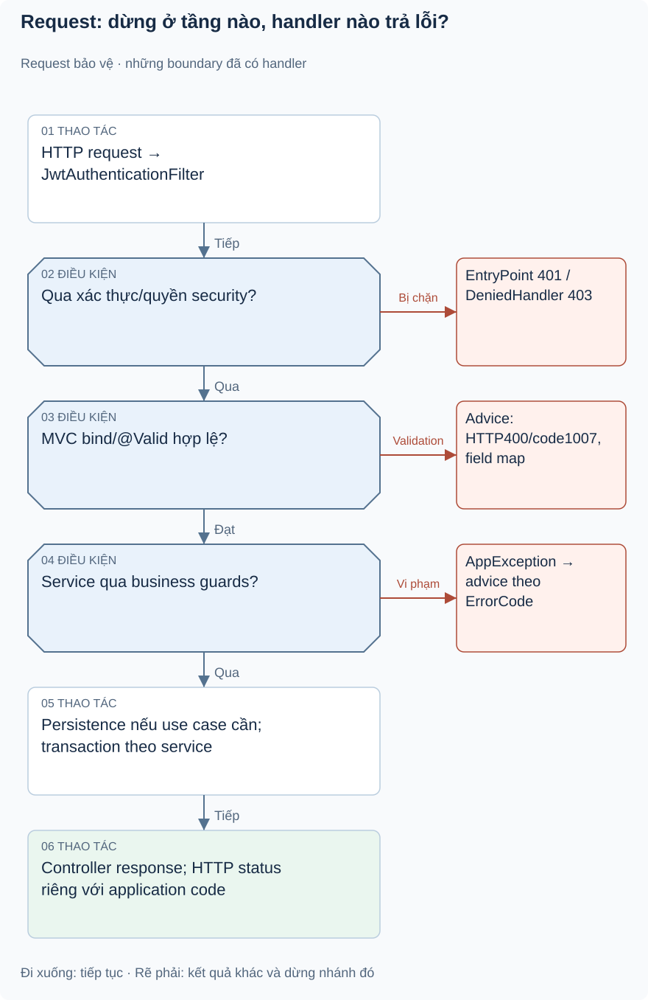

# Bài 1. Common/config — cơ chế dùng chung: bài toán trước code

[Giáo trình](../../README.md) · [Mục lục module](README.md)

**Trong bài:** [Bắt đầu từ người dùng](#bắt-đầu-từ-người-dùng) · [Mở source theo thứ tự này](#mở-source-theo-thứ-tự-này) · [Tự làm có hướng dẫn](#tự-làm-có-hướng-dẫn)

**20–25 phút · Chương 1: Bài toán và đường đi**

**Câu hỏi trung tâm:** Module này quyết định điều gì trong hành trình mua vé, và điều gì thuộc module khác?

Sau bài này, bạn có thể:

- Kể lại nhu cầu của actor và quy tắc chính bằng lời.
- Trace luồng chính từ điểm vào đến kết quả hoặc lỗi.
- Chỉ ra dữ liệu module sở hữu và một giới hạn hiện tại.

**Cần biết trước:** Bài response/lỗi có thể đọc sau Auth; auditing sau Ticket; scheduling sau Booking và Waitlist. [Lộ trình đầy đủ](../../learning-path.md).

## Bắt đầu từ người dùng

Ví dụ minh họa: Lan gửi quantity=0. Backend cần trả lỗi field dễ đọc thay vì stack trace. Khi Lan đặt
đúng, hệ thống cần timestamp để job biết đơn đã chờ bao lâu. Hai nhu cầu này thuộc hạ tầng chung, không
phải business rule riêng của payment.

Nhóm này gồm response envelope, exception/error codes, BaseEntity/auditing, bean password/security và
scheduler. `admin` chỉ có endpoint test quyền, không có domain quản trị riêng; `util/StringUtils` đang
rỗng nên không tạo abstraction giả. Business rule vẫn nằm trong service module; common không quyết định
một booking có được confirm hay không.

## Mô hình và luồng thật

### Góc nhìn 1: Request: dừng ở tầng nào, handler nào trả lỗi?

Rẽ phải ngay ở tầng phát sinh lỗi: request có thể chưa vào service hoặc DB. Hình không hứa mọi lỗi
framework/DB đều được chuẩn hóa cùng envelope.

Request bảo vệ đi qua JWT/filter trước controller. MVC deserialize body, bind DTO và @Valid; lỗi
MethodArgumentNotValidException đi tới advice, tạo map field/message và HTTP 400 code1007. Nếu
validation qua nhưng service vi phạm domain, throw AppException(ErrorCode), advice lấy HTTP status từ
enum. Nếu thành công controller tạo ApiResponse với result DTO. 401/403 từ security có handler riêng ghi
JSON bằng ObjectMapper.

Hình biểu diễn thứ tự vào, không có nghĩa mọi lỗi đi hết tới DB. Với request body sai, service có thể
chưa được gọi. Với exception chưa có handler, không được hứa cùng envelope;
ErrorCode.INTERNAL_SERVER_ERROR tồn tại nhưng chưa có catch-all method dùng nó.

Đọc hình từ điểm vào được ghi trên hình, lần theo các điều kiện trước khi nhìn phần lưu/response. Mũi
tên là thứ tự xử lý, không phải bằng chứng mọi nhánh đều chạy hoặc mọi thay đổi đã commit. Dừng ở nhánh
lỗi và tự nói điều gì chưa xảy ra.

## Mở source theo thứ tự này

| File/Class | Trách nhiệm | Vì sao / khi đọc |
|---|---|---|
| [Entry point](../../../../backend/src/main/java/com/eventhub/eventhub_backend/EventhubBackendApplication.java) | Spring context, auditing, scheduler, UTC | Hiểu bean/component bắt đầu từ đâu |
| [ApiResponse](../../../../backend/src/main/java/com/eventhub/eventhub_backend/common/response/ApiResponse.java), [PageResponse](../../../../backend/src/main/java/com/eventhub/eventhub_backend/common/response/PageResponse.java) | Hợp đồng response generic | T không làm mất kiểu payload trong Java |
| [AppException](../../../../backend/src/main/java/com/eventhub/eventhub_backend/common/exception/AppException.java), [ErrorCode](../../../../backend/src/main/java/com/eventhub/eventhub_backend/common/exception/ErrorCode.java), [GlobalExceptionHandler](../../../../backend/src/main/java/com/eventhub/eventhub_backend/common/exception/GlobalExceptionHandler.java) | Domain exception→HTTP | Theo dấu throw trong service ra response |
| [AuthenticationEntryPoint](../../../../backend/src/main/java/com/eventhub/eventhub_backend/common/exception/JwtAuthenticationEntryPoint.java), [AccessDeniedHandler](../../../../backend/src/main/java/com/eventhub/eventhub_backend/common/exception/JwtAccessDeniedHandler.java) | 401/403 từ security | Lỗi trước MVC không chỉ dựa controller advice |
| [BaseEntity](../../../../backend/src/main/java/com/eventhub/eventhub_backend/common/entity/BaseEntity.java) | UUID/audit fields | Thời gian tạo hỗ trợ expiry và trace |
| [BookingScheduler](../../../../backend/src/main/java/com/eventhub/eventhub_backend/config/BookingScheduler.java), [EventScheduler](../../../../backend/src/main/java/com/eventhub/eventhub_backend/config/EventScheduler.java), [WaitlistScheduler](../../../../backend/src/main/java/com/eventhub/eventhub_backend/config/WaitlistScheduler.java) | Job mỗi phút | Tách trigger khỏi rule service |
| [AdminTestController](../../../../backend/src/main/java/com/eventhub/eventhub_backend/admin/controller/AdminTestController.java) | GET admin/test | Kiểm role, không suy ra admin CRUD |
| [Context test](../../../../backend/src/test/java/com/eventhub/eventhub_backend/EventhubBackendApplicationTests.java), [UserRepositoryTest](../../../../backend/src/test/java/com/eventhub/eventhub_backend/user/UserRepositoryTest.java) | Spring/H2 khởi tạo và lưu entity | Bằng chứng tích hợp tối thiểu, không test mọi scheduler |

SecurityConfig/PasswordEncoderConfig được học chi tiết trong [auth](../auth.md); không sao chép policy ở đây.

Lượt đầu chỉ mở controller và service cốt lõi trong bảng. Ghi tên guard, dữ liệu trước/sau, rồi mới mở
DTO/repository tương ứng. Test đọc sau khi đã tự dự đoán.

## Một ví dụ nhỏ để tự lần theo

Ví dụ minh họa dựa trên rule hiện có: quantity=0 bị MVC validation chặn: có thể kết luận service đã chạy
rồi rollback không?

1. Xác định actor, dữ liệu và state trước thao tác.
2. Tìm guard tương ứng trong service/controller của bảng source.
3. Ghi quyết định và tác động: Không. Validation có thể lỗi trước lời gọi service. Cần theo đúng
   exception boundary để biết transaction nào thực sự bắt đầu.

**Thử biến thể trước khi xem:** Nếu người gọi có role đúng nhưng không sở hữu tài nguyên, role có tự bỏ
qua ownership không?

Đối chiếu biến thể

Không với các use case có ownership guard. Auth/common không tự sở hữu booking/event; phải tìm service
tài nguyên. Role ADMIN có ngoại lệ nào thì đọc từng guard, không suy rộng cho mọi endpoint.

## Tự nhớ lại

1. Đóng bài: kể actor, nhu cầu và kết quả của module trong 60 giây.
2. Với tình huống ví dụ, thao tác dừng ở guard nào và dữ liệu nào không thay đổi?
3. Module này có kiểm tiền ngân hàng, giữ chỗ hoặc phát vé không? Chỉ nhận trách nhiệm có source.
4. Tìm một feature chưa có; bằng chứng nào giúp phân biệt “có DTO/service” với “có runtime caller”?

Đáp án định hướng

1. Đối chiếu phần bài toán; phải kể nhu cầu thay vì chỉ tên layer.
2. Không. Validation có thể lỗi trước lời gọi service. Cần theo đúng exception boundary để biết
   transaction nào thực sự bắt đầu.
3. Xem phạm vi đầu bài và trace, không gán mọi bước mua vé cho module này.
4. Tìm controller/caller, không chỉ class tồn tại. Các khoảng thiếu đã ghi trong bài là điều cần kiểm
   chứng lại khi source đổi.

## Tự làm có hướng dẫn

Trace một request thành công và một request validation lỗi, chỉ chỗ rẽ và handler.

Sau đó bỏ tài liệu, tự ghi một happy path và một failure path. Với mỗi bước, nêu dữ liệu vào/ra; không
viết code production.

Gợi ý

Dùng bảng năm dòng: actor → điểm vào → guard → dữ liệu → kết quả. Khi thiếu bằng chứng, ghi “chưa xác
minh”, không điền theo trí nhớ framework.

Tiêu chí hoàn thành

Có tên method thật, guard cụ thể, dữ liệu trước/sau và nhánh lỗi; không thêm endpoint/tác động ngoài
source. Nếu thiếu hai trong bốn phần, quay lại trace trước bài tiếp.

## Chốt lại và chỗ dễ nhầm

Luồng gọi và quyền hợp lệ chưa chứng minh dữ liệu commit hay chống được cạnh tranh. Học cơ chế ở chương
tiếp theo rồi quay lại tự vẽ luồng này một lần nữa.

[← Bài trước](../waitlist/05-tu-kiem-chung.md) · [Mục lục module](README.md) · [Học tiếp →](02-co-che.md)

Nếu chưa giải thích được câu hỏi trung tâm, làm lại biến thể trước khi học tiếp; không cần đọc thêm mọi
tài liệu tham khảo.
