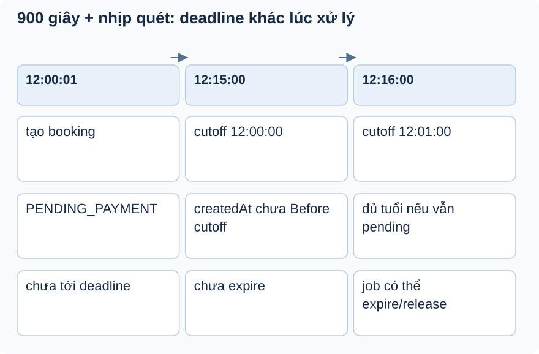

# Bài 4. Đồng hồ và tác vụ nền

[Giáo trình](../../README.md) · [Mục lục module](README.md)

**Trong bài:** [Tình huống và cách nghĩ](#tình-huống-và-cách-nghĩ) · [Cùng trace source](#cùng-trace-source) · [Luyện từ có hướng dẫn đến tự làm](#luyện-từ-có-hướng-dẫn-đến-tự-làm)

**20–30 phút · Chương 2: Cơ chế và dữ liệu**

**Câu hỏi trung tâm:** Timeout 900 giây có nghĩa đúng giây thứ 900 không?

Sau bài này, bạn có thể:

- Tính cutoff now−900 và mốc Before.
- Tách trigger scheduler khỏi rule service.
- Nêu thiếu user context và phối hợp nhiều instance.

**Cần biết trước:** [Bài toán module](01-bai-toan.md); bài ngay trước theo thanh điều hướng cuối trang. Bài response/lỗi có thể đọc sau Auth; auditing sau Ticket; scheduling sau Booking và Waitlist.

## Tình huống và cách nghĩ

Booking tạo 12:00:01; timeout 900 giây; job quét phút tròn.

Scheduler là trigger đánh thức service; cutoff là dữ liệu service dùng để chọn bản ghi. Nhịp quét tạo
khoảng trễ so với deadline nghiệp vụ. fixedRate khai báo nhịp, không là cam kết SLA khi job chậm/lỗi và
không tự phối hợp nhiều instance.



Đọc mốc từ trái sang phải. Đây là lịch giả định job quét phút tròn, không lỗi. Before là so sánh nghiêm
ngặt; job chậm hoặc nhiều instance cần kiểm riêng, không suy ra SLA tuyệt đối.

## Cơ chế trong EventHub

Phần dưới dựa trên source working tree. Phương án thay thế là phân tích/đề xuất; race cần test riêng
trước khi kết luận runtime.

@EnableScheduling kích hoạt @Scheduled trên bean; trigger gọi service thay vì copy rule vào job.
BookingScheduler truyền cutoff now-900 giây mỗi60 giây, EventScheduler gọi completeExpiredEvents,
WaitlistScheduler expireCreatedOffers(now). Constructor DI từ @RequiredArgsConstructor cung cấp service,
dễ mock rule caller trong test nhưng không tự tạo distributed job lock.

Runtime job không có user request/SecurityContext; service nền phải nhận dữ liệu thích hợp và không cần
current customer. Chạy nhiều backend instance có thể chạy nhiều job; chưa có bằng chứng deployed
multi-instance hay bảo vệ double-run đầy đủ. fixedRate là cấu hình nhịp, không hứa chính xác SLA hoặc
thực thi chồng nhau; behavior thread/executor thực cần kiểm chứng khi vận hành.

Thay thế: external scheduler/job queue có persistence/retry nhưng thêm vận hành; injectable Clock giúp
test mốc thời gian ổn định mà không ngủ, là đề xuất cho code sau. Debug expiry kiểm cutoff/status/query
Before và transaction, không thay timezone bừa. Tests service expire có nhưng chưa test scheduler
runtime/multi-instance.

## Cùng trace source

Mở theo thứ tự: [BookingScheduler](../../../../backend/src/main/java/com/eventhub/eventhub_backend/config/BookingScheduler.java) → [EventScheduler](../../../../backend/src/main/java/com/eventhub/eventhub_backend/config/EventScheduler.java) → [WaitlistScheduler](../../../../backend/src/main/java/com/eventhub/eventhub_backend/config/WaitlistScheduler.java).

Điểm cần tìm: `@Scheduled; expirePendingBookings; expireCreatedOffers`. Với mỗi guard, ghi input và kết quả khi đúng/sai; với mỗi setter/query, ghi dữ liệu thay đổi ở object hay DB. Tra [bảng source module](01-bai-toan.md) nếu cần DTO hoặc test liên quan.

Đoạn trích nguyên văn từ [BookingScheduler, dòng 18](../../../../backend/src/main/java/com/eventhub/eventhub_backend/config/BookingScheduler.java#L18); chỉ là phần cần quan sát, không phải toàn bộ method:

```java
    @Scheduled(fixedRate = 60000)
    public void expirePendingBookings() {
        bookingService.expirePendingBookings(Instant.now().minusSeconds(PAYMENT_TIMEOUT_SECONDS));
    }
}
```

Đọc khối này trong method bao quanh: điều kiện trước nó quyết định có đến được đây không,
caller/transaction phía ngoài quyết định thay đổi có commit không. Không dùng riêng snippet để suy ra
toàn bộ flow.

## Ví dụ được giải từng bước

**Ví dụ minh họa**, dùng ID/số liệu giả; không phải request ghi vào môi trường thật.

Booking tạo 12:00:01; timeout 900 giây; job quét phút tròn.

1. Đến 12:15:00, createdAt chưa trước cutoff 12:00:00 nên chưa chọn.
2. Đến 12:16:00, cutoff=12:01:00, booking đủ điều kiện nếu vẫn pending.
3. Job gọi service expire và release, không có customer SecurityContext.
4. Đây là lịch lý tưởng minh họa; job lỗi có thể trễ hơn.

**Dừng lại và dự đoán:** Hai backend instance bật scheduling có mặc định chỉ một job được chạy không?

<details>
<summary>Đối chiếu sau khi đã tự trả lời</summary>

Không thấy distributed lock/coordination trong source. Không suy ra đang deploy nhiều instance, nhưng
cấu hình hiện không tự bảo vệ single runner.

</details>

## Nối với bài đã học

Nhớ Before khác !isAfter ở mốc bằng nhau. Với job, thêm nhịp quét và cutoff vào dự đoán độ trễ. [Ôn bài gốc](../waitlist/04-co-che.md).

## Tự nhớ lại, không nhìn lên trên

1. Giải thích bằng lời: Timeout 900 giây có nghĩa đúng giây thứ 900 không?
2. Trace hoặc dự đoán: Hai backend instance bật scheduling có mặc định chỉ một job được chạy không?
3. Tìm trong source một guard, query hoặc mapping quyết định kết quả; nó đọc/ghi dữ liệu nào?
4. Bài tập có hướng dẫn muốn chứng minh tính chất nào? Dependency nào phải chạy thật để chứng minh nó?

<details>
<summary>Đáp án và cách kiểm tra</summary>

1. Scheduler là trigger đánh thức service; cutoff là dữ liệu service dùng để chọn bản ghi. Nhịp quét tạo
   khoảng trễ so với deadline nghiệp vụ. fixedRate khai báo nhịp, không là cam kết SLA khi job chậm/lỗi
   và không tự phối hợp nhiều instance.

2. Không thấy distributed lock/coordination trong source. Không suy ra đang deploy nhiều instance, nhưng
   cấu hình hiện không tự bảo vệ single runner.

3. Lần theo `@Scheduled; expirePendingBookings; expireCreatedOffers` trong các file đã dẫn; câu trả lời
   phải có tên field/điều kiện, không chỉ nói “service kiểm tra”.

4. Nêu thiếu user context và phối hợp nhiều instance. Đối chiếu gợi ý/rubric bài tập: thuật toán cần
   encoder/mapper thật; query/constraint/rollback/lock cần DB phù hợp; routing/validation/security HTTP
   cần pipeline thật. Chọn phần đúng bài này, không chạy mọi tầng vô điều kiện.

</details>

## Luyện từ có hướng dẫn đến tự làm

**Có hướng dẫn:** Thiết kế test cutoff trước/bằng/sau createdAt; đề xuất injectable Clock để không
sleep. Nối với test cancel-vs-expire ở Booking.

**Tự làm:** Job quét bị lỗi hai phút rồi chạy lại. Tự dự đoán đơn nào được chọn theo createdAt/status và
thiết kế test không sleep; nêu dữ liệu quan sát để phân biệt trễ với không release.

<details>
<summary>Gợi ý khi mắc kẹt</summary>

Đọc query Before và timeoutSeconds; tách test tính cutoff khỏi test service release.

</details>

<details>
<summary>Rubric tự chấm</summary>

Đạt khi nhận boundary nghiêm ngặt, không dùng current user trong job và ghi Clock là đề xuất.

Tự cho 0–2 điểm mỗi mục: expected rõ; bằng chứng source đúng; giải thích cơ chế; phân biệt giới hạn
test. Đạt từ 6/8 và không sai invariant chính. Điểm này giúp chọn chỗ ôn, không chứng nhận năng lực
production.

</details>

## Giữ lại điều cốt lõi

900 giây là ngưỡng chọn, nhịp quét quyết định lúc xử lý. Before nghiêm ngặt và fixedRate không hứa SLA.
Job không có current customer mặc định và chưa có distributed coordination trong source.

[← Bài trước](03-co-che.md) · [Mục lục module](README.md) · [Học tiếp →](05-tu-kiem-chung.md)

Nếu chưa giải thích được câu hỏi trung tâm, làm lại biến thể trước khi học tiếp; không cần đọc thêm mọi
tài liệu tham khảo.
