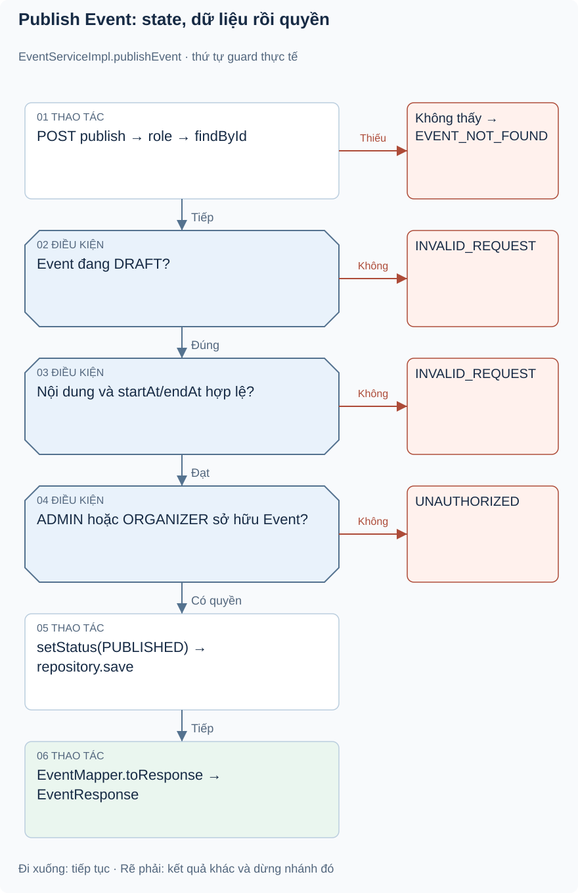

# Bài 1. Event — vòng đời sự kiện: bài toán trước code

[Giáo trình](../../README.md) · [Mục lục module](README.md)

**Trong bài:** [Bắt đầu từ người dùng](#bắt-đầu-từ-người-dùng) · [Mở source theo thứ tự này](#mở-source-theo-thứ-tự-này) · [Tự làm có hướng dẫn](#tự-làm-có-hướng-dẫn)

**20–25 phút · Chương 1: Bài toán và đường đi**

**Câu hỏi trung tâm:** Module này quyết định điều gì trong hành trình mua vé, và điều gì thuộc module khác?

Sau bài này, bạn có thể:

- Kể lại nhu cầu của actor và quy tắc chính bằng lời.
- Trace luồng chính từ điểm vào đến kết quả hoặc lỗi.
- Chỉ ra dữ liệu module sở hữu và một giới hạn hiện tại.

**Cần biết trước:** Hoàn thành User; phân biệt role và ownership. [Lộ trình đầy đủ](../../learning-path.md).

## Bắt đầu từ người dùng

Ví dụ minh họa: Minh tạo workshop, chỉnh lịch khi còn DRAFT rồi publish để khách đặt vé. Sau công bố,
đổi giờ tùy tiện ảnh hưởng người đã mua, nên implementation hạn chế chỉnh startAt/endAt. Khi hết chương
trình, scheduler chuyển COMPLETED; CANCELLED/COMPLETED không được sửa qua updateEvent.

Event quản lý nội dung, organizer và trạng thái; không thu tiền hay phát vé. Địa điểm là String, không
có Venue độc lập. Public API chỉ thấy PUBLISHED. Organizer phải sở hữu event khi quản lý; ADMIN được qua
kiểm tra ownership theo source.

## Mô hình và luồng thật

### Góc nhìn 1: Publish Event: state, dữ liệu rồi quyền

Đọc các guard theo thứ tự dọc. Role ở HTTP không thay ownership trong service; save không có transaction
service bao cả đoạn read/check/write.

POST /events/{eventId}/publish đi qua JWT và role ADMIN/ORGANIZER. Service findById, yêu cầu DRAFT; kiểm
tra title/description/location có text và start/end khác null, start<end và start>now; sau đó
role/ownership, set PUBLISHED, repository.save, mapper tạo EventResponse. Lỗi bất kỳ trước set không
lưu. Service publish không có @Transactional bao ngoài; save có giao dịch repository riêng, không tự
khóa khoảng read→check→write.

Việc public GET không dùng current user: getPublishedEvent lọc status và trả EVENT_NOT_FOUND cho draft.
GET /events/{id} là đường authenticated, behavior khác theo role. Không suy ra cùng policy cho mọi API
có chữ events trong path.

Đọc hình từ điểm vào được ghi trên hình, lần theo các điều kiện trước khi nhìn phần lưu/response. Mũi
tên là thứ tự xử lý, không phải bằng chứng mọi nhánh đều chạy hoặc mọi thay đổi đã commit. Dừng ở nhánh
lỗi và tự nói điều gì chưa xảy ra.

## Mở source theo thứ tự này

| File/Class | Trách nhiệm | Tại sao cần? / khi đọc |
|---|---|---|
| [EventController](../../../../backend/src/main/java/com/eventhub/eventhub_backend/event/controller/EventController.java) | HTTP create/search/public/update/publish/cancel/detail | Bắt đầu từ use case và role |
| [CreateEventRequest](../../../../backend/src/main/java/com/eventhub/eventhub_backend/event/dto/request/CreateEventRequest.java), [UpdateEventRequest](../../../../backend/src/main/java/com/eventhub/eventhub_backend/event/dto/request/UpdateEventRequest.java), [EventSearchRequest](../../../../backend/src/main/java/com/eventhub/eventhub_backend/event/dto/request/EventSearchRequest.java) | Validation/body/query | Hiểu trường bắt buộc và PATCH nullable |
| [EventServiceImpl](../../../../backend/src/main/java/com/eventhub/eventhub_backend/event/service/Impl/EventServiceImpl.java) | Rule/lifecycle/ownership | File cốt lõi cần trace từng if |
| [Event](../../../../backend/src/main/java/com/eventhub/eventhub_backend/event/entity/Event.java), [EventStatus](../../../../backend/src/main/java/com/eventhub/eventhub_backend/event/entity/EventStatus.java) | State và persistence | So schema với rule service |
| [EventMapper](../../../../backend/src/main/java/com/eventhub/eventhub_backend/event/mapper/EventMapper.java) | DTO mapping/null ignore | Khi PATCH bỏ field cần giữ giá trị |
| [EventRepository](../../../../backend/src/main/java/com/eventhub/eventhub_backend/event/repository/EventRepository.java), [EventRepositoryImpl](../../../../backend/src/main/java/com/eventhub/eventhub_backend/event/repository/Impl/EventRepositoryImpl.java), [EventSpecification](../../../../backend/src/main/java/com/eventhub/eventhub_backend/event/repository/Impl/EventSpecification.java) | Derived query + Criteria search/count/sort | Khi học SQL và phân trang |
| [EventScheduler](../../../../backend/src/main/java/com/eventhub/eventhub_backend/config/EventScheduler.java) | Hoàn tất quá hạn mỗi phút | Không có HTTP caller cho completeExpiredEvents |
| [EventServiceImplTest](../../../../backend/src/test/java/com/eventhub/eventhub_backend/event/EventServiceImplTest.java), [EventMapperTest](../../../../backend/src/test/java/com/eventhub/eventhub_backend/event/EventMapperTest.java) | 15 rule tests + 3 mapping tests | Đọc sau khi tự dự đoán nhánh |

Lượt đầu chỉ mở controller và service cốt lõi trong bảng. Ghi tên guard, dữ liệu trước/sau, rồi mới mở
DTO/repository tương ứng. Test đọc sau khi đã tự dự đoán.

## Một ví dụ nhỏ để tự lần theo

Ví dụ minh họa dựa trên rule hiện có: Workshop DRAFT có đầy đủ thông tin: public detail có hiển thị vì
nội dung đã tốt không?

1. Xác định actor, dữ liệu và state trước thao tác.
2. Tìm guard tương ứng trong service/controller của bảng source.
3. Ghi quyết định và tác động: Không. Public detail yêu cầu PUBLISHED, trả EVENT_NOT_FOUND cho draft.
   Publish là thao tác có guard riêng.

**Thử biến thể trước khi xem:** Nếu người gọi có role đúng nhưng không sở hữu tài nguyên, role có tự bỏ
qua ownership không?

Đối chiếu biến thể

Không với các use case có ownership guard. Auth/common không tự sở hữu booking/event; phải tìm service
tài nguyên. Role ADMIN có ngoại lệ nào thì đọc từng guard, không suy rộng cho mọi endpoint.

## Tự nhớ lại

1. Đóng bài: kể actor, nhu cầu và kết quả của module trong 60 giây.
2. Với tình huống ví dụ, thao tác dừng ở guard nào và dữ liệu nào không thay đổi?
3. Module này có kiểm tiền ngân hàng, giữ chỗ hoặc phát vé không? Chỉ nhận trách nhiệm có source.
4. Tìm một feature chưa có; bằng chứng nào giúp phân biệt “có DTO/service” với “có runtime caller”?

Đáp án định hướng

1. Đối chiếu phần bài toán; phải kể nhu cầu thay vì chỉ tên layer.
2. Không. Public detail yêu cầu PUBLISHED, trả EVENT_NOT_FOUND cho draft. Publish là thao tác có guard riêng.
3. Xem phạm vi đầu bài và trace, không gán mọi bước mua vé cho module này.
4. Tìm controller/caller, không chỉ class tồn tại. Các khoảng thiếu đã ghi trong bài là điều cần kiểm
   chứng lại khi source đổi.

## Tự làm có hướng dẫn

Vẽ đường DRAFT→PUBLISHED và đánh dấu role, owner, nội dung, thời gian; so với đường cancel.

Sau đó bỏ tài liệu, tự ghi một happy path và một failure path. Với mỗi bước, nêu dữ liệu vào/ra; không
viết code production.

Gợi ý

Dùng bảng năm dòng: actor → điểm vào → guard → dữ liệu → kết quả. Khi thiếu bằng chứng, ghi “chưa xác
minh”, không điền theo trí nhớ framework.

Tiêu chí hoàn thành

Có tên method thật, guard cụ thể, dữ liệu trước/sau và nhánh lỗi; không thêm endpoint/tác động ngoài
source. Nếu thiếu hai trong bốn phần, quay lại trace trước bài tiếp.

## Chốt lại và chỗ dễ nhầm

Luồng gọi và quyền hợp lệ chưa chứng minh dữ liệu commit hay chống được cạnh tranh. Học cơ chế ở chương
tiếp theo rồi quay lại tự vẽ luồng này một lần nữa.

[← Bài trước](../user/04-tu-kiem-chung.md) · [Mục lục module](README.md) · [Học tiếp →](02-co-che.md)

Nếu chưa giải thích được câu hỏi trung tâm, làm lại biến thể trước khi học tiếp; không cần đọc thêm mọi
tài liệu tham khảo.
