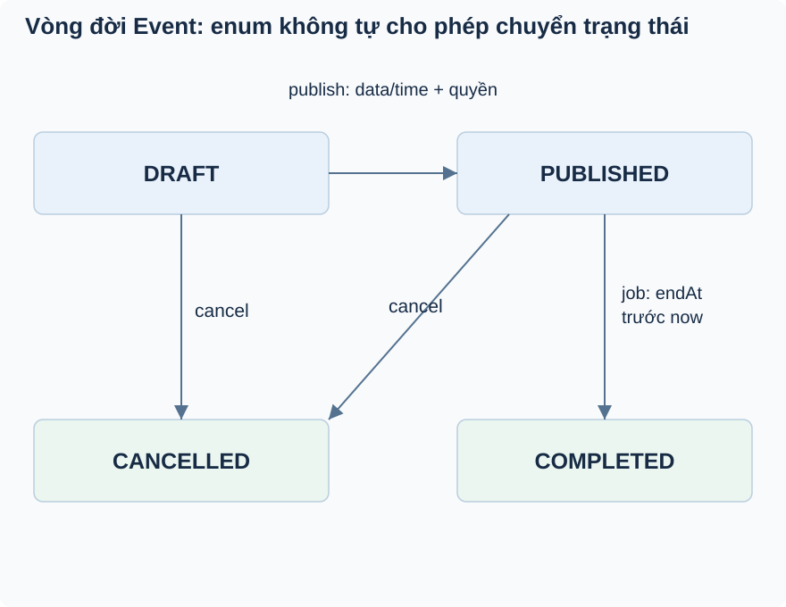

# Bài 2. Trạng thái quyết định thao tác

[Giáo trình](../../README.md) · [Mục lục module](README.md)

**Trong bài:** [Tình huống và cách nghĩ](#tình-huống-và-cách-nghĩ) · [Cùng trace source](#cùng-trace-source) · [Luyện từ có hướng dẫn đến tự làm](#luyện-từ-có-hướng-dẫn-đến-tự-làm)

**20–30 phút · Chương 2: Cơ chế và dữ liệu**

**Câu hỏi trung tâm:** Vì sao có role ORGANIZER vẫn chưa đủ để publish Event?

Sau bài này, bạn có thể:

- Vẽ cạnh lifecycle từ caller và guard thật.
- Phân biệt role, owner và trạng thái.
- Dự đoán public visibility và terminal update.

**Cần biết trước:** [Bài toán module](01-bai-toan.md). Hoàn thành User; phân biệt role và ownership.

## Tình huống và cách nghĩ

Event E1 là DRAFT, thuộc organizer O1.

State machine là cách mô tả trạng thái và những đường chuyển được phép. Role trả lời người gọi thuộc
nhóm nào; ownership trả lời tài nguyên thuộc ai; state guard trả lời lúc này có được làm không. Cả ba
điều kiện đều có thể cần, nhưng thứ tự kiểm tra thật phải đọc service.



Bắt đầu DRAFT ở góc trên trái. Chỉ đi theo cạnh có caller hiện có. CANCELLED/COMPLETED là terminal trong
update; không có cạnh reopen hoặc tự refund.

## Cơ chế trong EventHub

Phần dưới dựa trên source working tree. Phương án thay thế là phân tích/đề xuất; race cần test riêng
trước khi kết luận runtime.

Máy trạng thái (state machine) là cách mô tả các trạng thái và đường chuyển cho phép. Enum chỉ giới hạn
tên state; rule service mới quyết định DRAFT được publish và terminal không sửa. EventHub cần nó để nội
dung công bố không thay đổi tùy tiện. DB status NOT NULL/enum STRING không chứng minh chuyển
DRAFT→COMPLETED bất kỳ là hợp lệ.

Runtime publish kiểm tra state rồi data rồi caller; thứ tự này ảnh hưởng lỗi người gọi nhận. updateEvent
nhánh PUBLISHED chỉ set title/description/location, từ chối time/thumbnail khác null; category gửi lên
bị bỏ qua. Nhánh DRAFT tính start/end kết hợp giá trị cũ/mới và kiểm tra thời gian trước mapper. Nếu chỉ
validate request field riêng lẻ sẽ bỏ sót trường hợp start mới sau end cũ.

Thay thế: method domain trên entity hoặc transition service riêng có thể gom rule khi phức tạp; hiện if
nhỏ dễ theo dấu. Thêm state machine framework lúc này làm tăng cấu hình chưa có lợi ích được chứng minh.
Debug lỗi 400 bằng status và thời gian cả cũ lẫn request, không chỉ body. Tests có publish valid,
completed reject và published time reject; test concurrency chưa có.

## Cùng trace source

Mở theo thứ tự: [EventServiceImpl](../../../../backend/src/main/java/com/eventhub/eventhub_backend/event/service/Impl/EventServiceImpl.java) → [EventStatus](../../../../backend/src/main/java/com/eventhub/eventhub_backend/event/entity/EventStatus.java).

Điểm cần tìm: `publishEvent; cancelEvent; completeExpiredEvents`. Với mỗi guard, ghi input và kết quả khi đúng/sai; với mỗi setter/query, ghi dữ liệu thay đổi ở object hay DB. Tra [bảng source module](01-bai-toan.md) nếu cần DTO hoặc test liên quan.

Đoạn trích nguyên văn từ [EventServiceImpl, dòng 168](../../../../backend/src/main/java/com/eventhub/eventhub_backend/event/service/Impl/EventServiceImpl.java#L168); chỉ là phần cần quan sát, không phải toàn bộ method:

```java
        event.setStatus(EventStatus.PUBLISHED);

        eventRepository.save(event);

        return eventMapper.toResponse(event);
```

Đọc khối này trong method bao quanh: điều kiện trước nó quyết định có đến được đây không,
caller/transaction phía ngoài quyết định thay đổi có commit không. Không dùng riêng snippet để suy ra
toàn bộ flow.

## Ví dụ được giải từng bước

**Ví dụ minh họa**, dùng ID/số liệu giả; không phải request ghi vào môi trường thật.

Event E1 là DRAFT, thuộc organizer O1.

1. O2 có role ORGANIZER nhưng không sở hữu E1, nên không được publish.
2. O1 còn phải có nội dung và thời gian hợp lệ.
3. Publish thành công chuyển PUBLISHED, public detail mới có thể thấy.
4. Khi kết thúc, job complete chỉ chọn PUBLISHED đã qua endAt. Cancel không tự hoàn tiền các booking.

**Dừng lại và dự đoán:** E1 đã CANCELLED, O1 sửa title: có được phép vì chỉ sửa thông tin không?

<details>
<summary>Đối chiếu sau khi đã tự trả lời</summary>

Không. Service chặn chỉnh sửa trạng thái terminal. Quyền sở hữu không vượt qua state guard.

</details>

## Nối với bài đã học

Identity đã biết ở User. Lần này thêm ownership và state: biết ai gọi chưa đủ để publish event của người khác. [Ôn bài gốc](../user/02-co-che.md).

## Tự nhớ lại, không nhìn lên trên

1. Giải thích bằng lời: Vì sao có role ORGANIZER vẫn chưa đủ để publish Event?
2. Trace hoặc dự đoán: E1 đã CANCELLED, O1 sửa title: có được phép vì chỉ sửa thông tin không?
3. Tìm trong source một guard, query hoặc mapping quyết định kết quả; nó đọc/ghi dữ liệu nào?
4. Bài tập có hướng dẫn muốn chứng minh tính chất nào? Dependency nào phải chạy thật để chứng minh nó?

<details>
<summary>Đáp án và cách kiểm tra</summary>

1. State machine là cách mô tả trạng thái và những đường chuyển được phép. Role trả lời người gọi thuộc
   nhóm nào; ownership trả lời tài nguyên thuộc ai; state guard trả lời lúc này có được làm không. Cả ba
   điều kiện đều có thể cần, nhưng thứ tự kiểm tra thật phải đọc service.

2. Không. Service chặn chỉnh sửa trạng thái terminal. Quyền sở hữu không vượt qua state guard.

3. Lần theo `publishEvent; cancelEvent; completeExpiredEvents` trong các file đã dẫn; câu trả lời phải
   có tên field/điều kiện, không chỉ nói “service kiểm tra”.

4. Dự đoán public visibility và terminal update. Đối chiếu gợi ý/rubric bài tập: thuật toán cần
   encoder/mapper thật; query/constraint/rollback/lock cần DB phù hợp; routing/validation/security HTTP
   cần pipeline thật. Chọn phần đúng bài này, không chạy mọi tầng vô điều kiện.

</details>

## Luyện từ có hướng dẫn đến tự làm

**Có hướng dẫn:** Vẽ các đường create/publish/cancel/complete thực có từ service; gạch riêng một đường
bạn nghĩ nên có nhưng chưa triển khai.

**Tự làm:** Event hết giờ nhưng job chưa chạy; một caller gọi cancel. Tìm guard thật để dự đoán, rồi
thiết kế test mốc thời gian và test hai transition cạnh tranh riêng.

<details>
<summary>Gợi ý khi mắc kẹt</summary>

Enum chỉ cho tập trạng thái; tìm setter và guard để xác định cạnh thật.

</details>

<details>
<summary>Rubric tự chấm</summary>

Đạt khi DRAFT/PUBLISHED/CANCELLED/COMPLETED có nguồn chuyển cụ thể, không tự thêm reopen/refund.

Tự cho 0–2 điểm mỗi mục: expected rõ; bằng chứng source đúng; giải thích cơ chế; phân biệt giới hạn
test. Đạt từ 6/8 và không sai invariant chính. Điểm này giúp chọn chỗ ôn, không chứng nhận năng lực
production.

</details>

## Giữ lại điều cốt lõi

Enum giới hạn tên state; service mới giới hạn transition. Publish cần DRAFT, dữ liệu/thời gian và quyền;
terminal không update. Cancel không tự hoàn tiền, complete là đường job riêng.

[← Bài trước](01-bai-toan.md) · [Mục lục module](README.md) · [Học tiếp →](03-co-che.md)

Nếu chưa giải thích được câu hỏi trung tâm, làm lại biến thể trước khi học tiếp; không cần đọc thêm mọi
tài liệu tham khảo.
