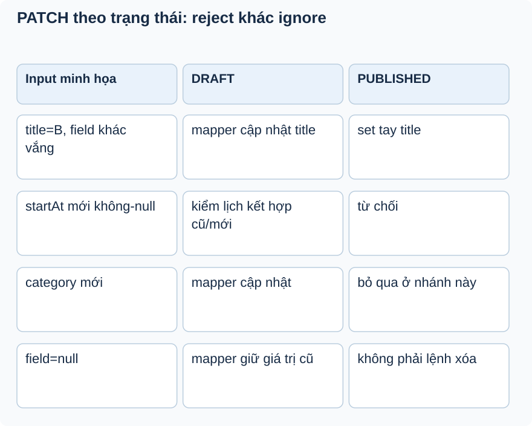

# Bài 3. PATCH: giữ cũ hay xóa đi?

[Giáo trình](../../README.md) · [Mục lục module](README.md)

**Trong bài:** [Tình huống và cách nghĩ](#tình-huống-và-cách-nghĩ) · [Cùng trace source](#cùng-trace-source) · [Luyện từ có hướng dẫn đến tự làm](#luyện-từ-có-hướng-dẫn-đến-tự-làm)

**20–30 phút · Chương 2: Cơ chế và dữ liệu**

**Câu hỏi trung tâm:** Vắng field và gửi null có ý nghĩa gì với mapper hiện tại?

Sau bài này, bạn có thể:

- Dự đoán absent/null qua null-ignore mapper.
- Phân biệt nhánh DRAFT với set tay ở PUBLISHED.
- Lập test table reject, ignore và update.

**Cần biết trước:** [Bài toán module](01-bai-toan.md); bài ngay trước theo thanh điều hướng cuối trang. Hoàn thành User; phân biệt role và ownership.

## Tình huống và cách nghĩ

Draft có title A, start S, end E; request chỉ gửi title B.

PATCH là cập nhật một phần, nhưng ý nghĩa chính xác phụ thuộc DTO và mapper. Java DTO nullable có thể
không phân biệt field vắng với explicit null. Với null-ignore, null nghĩa giữ giá trị cũ trong mapping;
nó không cung cấp thao tác xóa field bằng null.



Chọn hàng theo field, rồi chọn cột theo state trước request. Đừng dùng null-ignore để giải thích mọi
nhánh: PUBLISHED xử lý tay và từ chối time/thumbnail không-null.

## Cơ chế trong EventHub

Phần dưới dựa trên source working tree. Phương án thay thế là phân tích/đề xuất; race cần test riêng
trước khi kết luận runtime.

PATCH biểu diễn cập nhật từng phần; UpdateEventRequest dùng field nullable, mapper IGNORE bỏ null để
không xóa dữ liệu cũ. MapStruct sinh setter logic lúc compile. EventHub cần giữ lịch cũ nếu client chỉ
sửa title. Nhưng Java DTO hiện không phân biệt field vắng với field JSON=null: cả hai thường thành null,
nên không hỗ trợ “xóa mô tả bằng null” qua mapper.

Nhánh PUBLISHED set tay để kiểm soát field an toàn; nhánh DRAFT dùng mapper. Hai đường có thể lệch, ví
dụ category trong published không đổi và chuỗi trắng không bị Bean Validation trong UpdateEventRequest.
Đây là behavior cần hợp đồng/test rõ, không tự sửa vì docs muốn chuẩn hóa.

Thay thế: JSON Merge Patch hay wrapper optional-field biểu diễn absent/null rõ hơn nhưng tăng
parsing/contract. Khi chưa cần clear field, null-ignore đơn giản. Debug bằng so object trước/sau mapper;
xem generated mapper nếu nghi setter sai. EventMapperTest kiểm tra category mapping và giữ category khi
null.

## Cùng trace source

Mở theo thứ tự: [UpdateEventRequest](../../../../backend/src/main/java/com/eventhub/eventhub_backend/event/dto/request/UpdateEventRequest.java) → [EventServiceImpl](../../../../backend/src/main/java/com/eventhub/eventhub_backend/event/service/Impl/EventServiceImpl.java) → [EventMapper](../../../../backend/src/main/java/com/eventhub/eventhub_backend/event/mapper/EventMapper.java).

Điểm cần tìm: `updateEvent; updateEntity trong EventMapper`. Với mỗi guard, ghi input và kết quả khi đúng/sai; với mỗi setter/query, ghi dữ liệu thay đổi ở object hay DB. Tra [bảng source module](01-bai-toan.md) nếu cần DTO hoặc test liên quan.

Đoạn trích nguyên văn từ [EventMapper, dòng 18](../../../../backend/src/main/java/com/eventhub/eventhub_backend/event/mapper/EventMapper.java#L18); chỉ là phần cần quan sát, không phải toàn bộ method:

```java
    @BeanMapping(nullValuePropertyMappingStrategy = NullValuePropertyMappingStrategy.IGNORE)
    void updateEntity(UpdateEventRequest request, @MappingTarget Event event);
```

Đọc khai báo này cùng field/kiểu và nơi gọi nó. Annotation hay interface không tự chứng minh toàn bộ
request: DTO cần validation pipeline, mapper cần nhánh service phù hợp, query cần transaction và DB
thật. Chọn ranh giới liên quan đến ví dụ trong bài.

## Ví dụ được giải từng bước

**Ví dụ minh họa**, dùng ID/số liệu giả; không phải request ghi vào môi trường thật.

Draft có title A, start S, end E; request chỉ gửi title B.

1. Service kiểm tra người gọi và state.
2. Vì start/end mới null, kiểm thời gian bằng giá trị cũ kết hợp giá trị mới nếu có.
3. Mapper ghi title B và bỏ qua field null.
4. Với PUBLISHED, gửi startAt không-null bị chặn; category trong request không đồng nghĩa được update ở
   nhánh này.

**Dừng lại và dự đoán:** Request gửi thumbnailUrl=null có xóa thumbnail cũ nhờ null-ignore không?

<details>
<summary>Đối chiếu sau khi đã tự trả lời</summary>

Không. Mapper bỏ qua null. Nếu cần phân biệt xóa/vắng phải thay hợp đồng cập nhật; đó là đề xuất, chưa
là behavior hiện tại.

</details>

## Tự nhớ lại, không nhìn lên trên

1. Giải thích bằng lời: Vắng field và gửi null có ý nghĩa gì với mapper hiện tại?
2. Trace hoặc dự đoán: Request gửi thumbnailUrl=null có xóa thumbnail cũ nhờ null-ignore không?
3. Tìm trong source một guard, query hoặc mapping quyết định kết quả; nó đọc/ghi dữ liệu nào?
4. Bài tập có hướng dẫn muốn chứng minh tính chất nào? Dependency nào phải chạy thật để chứng minh nó?

<details>
<summary>Đáp án và cách kiểm tra</summary>

1. PATCH là cập nhật một phần, nhưng ý nghĩa chính xác phụ thuộc DTO và mapper. Java DTO nullable có thể
   không phân biệt field vắng với explicit null. Với null-ignore, null nghĩa giữ giá trị cũ trong
   mapping; nó không cung cấp thao tác xóa field bằng null.

2. Không. Mapper bỏ qua null. Nếu cần phân biệt xóa/vắng phải thay hợp đồng cập nhật; đó là đề xuất,
   chưa là behavior hiện tại.

3. Lần theo `updateEvent; updateEntity trong EventMapper` trong các file đã dẫn; câu trả lời phải có tên
   field/điều kiện, không chỉ nói “service kiểm tra”.

4. Lập test table reject, ignore và update. Đối chiếu gợi ý/rubric bài tập: thuật toán cần
   encoder/mapper thật; query/constraint/rollback/lock cần DB phù hợp; routing/validation/security HTTP
   cần pipeline thật. Chọn phần đúng bài này, không chạy mọi tầng vô điều kiện.

</details>

## Luyện từ có hướng dẫn đến tự làm

**Có hướng dẫn:** Lập ma trận DRAFT/PUBLISHED × title/startAt/category/null. Tìm nhánh xử lý và dự đoán
field sau update cho từng dòng.

**Tự làm:** Draft có startAt mới sau endAt cũ, request chỉ sửa startAt. Tự viết expected và trace cách
kết hợp thời gian; sau đó thiết kế cách biểu diễn explicit clear field.

<details>
<summary>Gợi ý khi mắc kẹt</summary>

Xem service trước mapper; mapper chỉ chạy sau các guard và không quyết định mọi field ở nhánh PUBLISHED.

</details>

<details>
<summary>Rubric tự chấm</summary>

Đạt khi phân biệt reject, ignore và update; không hứa null xóa field.

Tự cho 0–2 điểm mỗi mục: expected rõ; bằng chứng source đúng; giải thích cơ chế; phân biệt giới hạn
test. Đạt từ 6/8 và không sai invariant chính. Điểm này giúp chọn chỗ ôn, không chứng nhận năng lực
production.

</details>

## Giữ lại điều cốt lõi

Null-ignore giữ field cũ, không cho thao tác xóa bằng null. DRAFT dùng mapper sau guard thời gian;
PUBLISHED set tay một số field, từ chối time/thumbnail và bỏ qua category.

[← Bài trước](02-co-che.md) · [Mục lục module](README.md) · [Học tiếp →](04-co-che.md)

Nếu chưa giải thích được câu hỏi trung tâm, làm lại biến thể trước khi học tiếp; không cần đọc thêm mọi
tài liệu tham khảo.
