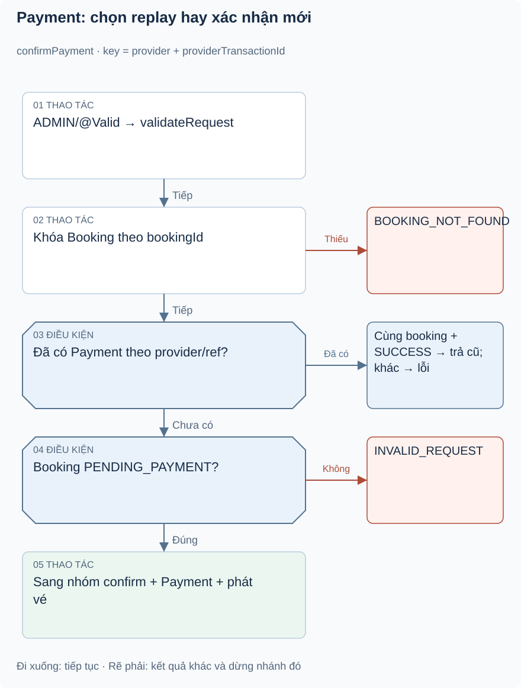
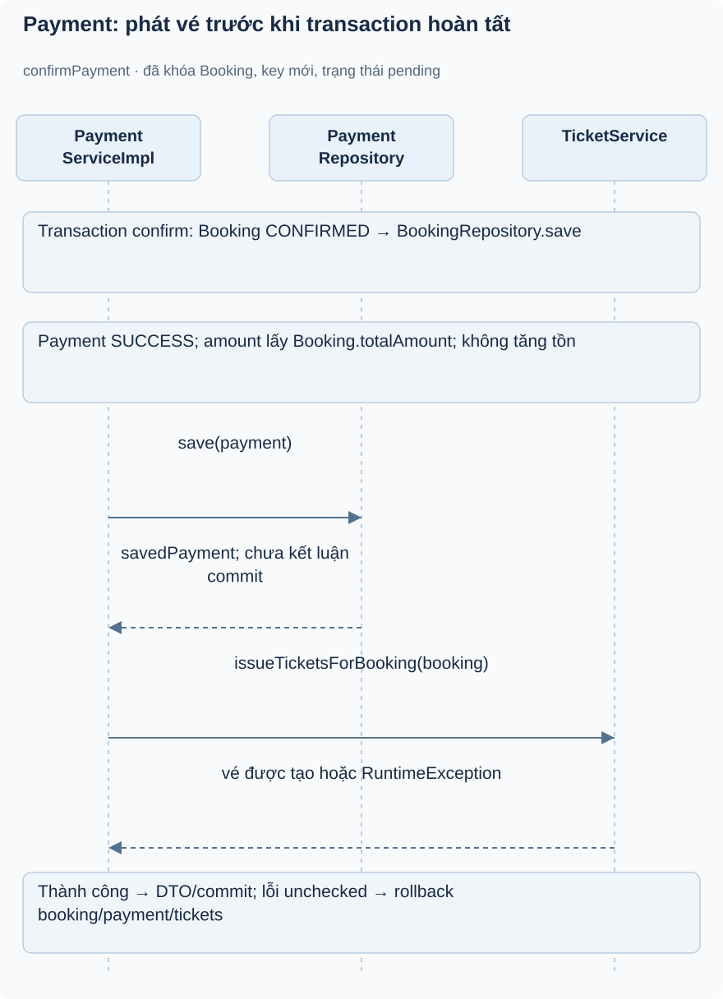

# Bài 1. Payment — xác nhận và tính nhất quán: bài toán trước code

[Giáo trình](../../README.md) · [Mục lục module](README.md)

**Trong bài:** [Bắt đầu từ người dùng](#bắt-đầu-từ-người-dùng) · [Mở source theo thứ tự này](#mở-source-theo-thứ-tự-này) · [Tự làm có hướng dẫn](#tự-làm-có-hướng-dẫn)

**20–25 phút · Chương 1: Bài toán và đường đi**

**Câu hỏi trung tâm:** Module này quyết định điều gì trong hành trình mua vé, và điều gì thuộc module khác?

Sau bài này, bạn có thể:

- Kể lại nhu cầu của actor và quy tắc chính bằng lời.
- Trace luồng chính từ điểm vào đến kết quả hoặc lỗi.
- Chỉ ra dữ liệu module sở hữu và một giới hạn hiện tại.

**Cần biết trước:** Hoàn thành Booking; hiểu snapshot, giữ chỗ và rollback. [Lộ trình đầy đủ](../../learning-path.md).

## Bắt đầu từ người dùng

Ví dụ minh họa: ADMIN bấm xác nhận một booking sau khi đối soát ngoài hệ thống. Request timeout, ADMIN
gửi lại cùng reference. Backend không nên tạo payment/vé lần hai trong lượt retry tuần tự. Đây là bài
toán idempotency (thực hiện lặp lại có kết quả tương đương), khác việc người dùng cố ý thực hiện giao
dịch mới.

**ĐÃ XÁC MINH:** endpoint ADMIN POST /payments/confirm nhận bookingId/provider/providerTransactionId,
chỉ confirm pending, ghi Payment SUCCESS với amount từ booking và phát vé. Không có payment URL, webhook
verify signature, ngân hàng SDK, refund hoặc payment-intent API. Provider chỉ là chuỗi dữ liệu; không
chứng minh tiền thực đã chuyển.

## Mô hình và luồng thật

### Góc nhìn 1: Payment: chọn replay hay xác nhận mới

Khóa Booking trước lookup reference. Retry cùng booking chờ transaction trước commit; nhánh replay trả kết quả cũ. Collision cùng key trên hai booking khác vẫn dựa vào unique DB.

### Góc nhìn 2: Payment: phát vé trước khi transaction hoàn tất

Nhìn ranh giới transaction ngoài: save Payment chưa phải commit riêng. TicketService bean tham gia
transaction; lỗi unchecked rollback nhóm confirm, không rollback reservation đã commit từ createBooking
trước đó.

JWT/ADMIN → @Valid → service validateRequest (đường gọi trực tiếp cũng được bảo vệ) → khóa Booking → query payment theo
provider/reference. Nếu có, phải cùng booking và SUCCESS; trả response cũ, không phát vé lại. Nếu chưa
có: kiểm Booking đã khóa→pending→CONFIRMED→save→Payment SUCCESS amount=totalAmount,
paidAt=now→save→issueTicketsForBooking→response. Transaction kết thúc ở proxy public confirmPayment; lỗi
phát vé RuntimeException rollback nhóm DB theo cơ chế mặc định.

Không có kiểm lại tồn kho hoặc tăng soldQuantity ở payment hiện tại, vì booking đã giữ. Đây là khác biệt
đáng chú ý với tài liệu cũ. Không có điều kiện createdAt timeout trực tiếp: booking còn pending có thể
được confirm dù đã quá tuổi trước khi scheduler chạm tới.

Đọc hình từ điểm vào được ghi trên hình, lần theo các điều kiện trước khi nhìn phần lưu/response. Mũi
tên là thứ tự xử lý, không phải bằng chứng mọi nhánh đều chạy hoặc mọi thay đổi đã commit. Dừng ở nhánh
lỗi và tự nói điều gì chưa xảy ra.

## Mở source theo thứ tự này

| File/Class | Trách nhiệm | Vì sao / khi đọc |
|---|---|---|
| [PaymentController](../../../../backend/src/main/java/com/eventhub/eventhub_backend/payment/controller/PaymentController.java) | Role ADMIN và request | Bắt đầu từ ranh giới HTTP |
| [ConfirmPaymentRequest](../../../../backend/src/main/java/com/eventhub/eventhub_backend/payment/dto/request/ConfirmPaymentRequest.java), [PaymentResponse](../../../../backend/src/main/java/com/eventhub/eventhub_backend/payment/dto/response/PaymentResponse.java) | 3 input bắt buộc và kết quả | Client không gửi amount đáng tin |
| [PaymentServiceImpl](../../../../backend/src/main/java/com/eventhub/eventhub_backend/payment/service/Impl/PaymentServiceImpl.java) | Replay/status/transaction | Trace confirmPayment và handleExistingPayment |
| [Payment](../../../../backend/src/main/java/com/eventhub/eventhub_backend/payment/entity/Payment.java), [PaymentStatus](../../../../backend/src/main/java/com/eventhub/eventhub_backend/payment/entity/PaymentStatus.java) | Bản ghi và unique reference | DB khai báo khác rule pending booking |
| [PaymentRepository](../../../../backend/src/main/java/com/eventhub/eventhub_backend/payment/repository/PaymentRepository.java) | Tìm provider/reference | Điểm deduplicate đầu tiên |
| [TicketServiceImpl](../../../../backend/src/main/java/com/eventhub/eventhub_backend/ticketing/service/Impl/TicketServiceImpl.java) | Phát vé trong transaction | Phụ thuộc module khác có tác động DB |
| [PaymentServiceImplTest](../../../../backend/src/test/java/com/eventhub/eventhub_backend/payment/PaymentServiceImplTest.java) | 4 ca unit | Confirm/replay/wrong booking/status |

Lượt đầu chỉ mở controller và service cốt lõi trong bảng. Ghi tên guard, dữ liệu trước/sau, rồi mới mở
DTO/repository tương ứng. Test đọc sau khi đã tự dự đoán.

## Một ví dụ nhỏ để tự lần theo

Ví dụ minh họa dựa trên rule hiện có: ADMIN xác nhận booking pending: Payment có hỏi ngân hàng trước khi
set SUCCESS không?

1. Xác định actor, dữ liệu và state trước thao tác.
2. Tìm guard tương ứng trong service/controller của bảng source.
3. Ghi quyết định và tác động: Không trong flow hiện có. Đây là xác nhận nội bộ, amount lấy booking
   total, sau đó phát vé cùng transaction DB.

**Thử biến thể trước khi xem:** Nếu người gọi có role đúng nhưng không sở hữu tài nguyên, role có tự bỏ
qua ownership không?

Đối chiếu biến thể

Không với các use case có ownership guard. Auth/common không tự sở hữu booking/event; phải tìm service
tài nguyên. Role ADMIN có ngoại lệ nào thì đọc từng guard, không suy rộng cho mọi endpoint.

## Tự nhớ lại

1. Đóng bài: kể actor, nhu cầu và kết quả của module trong 60 giây.
2. Với tình huống ví dụ, thao tác dừng ở guard nào và dữ liệu nào không thay đổi?
3. Module này có kiểm tiền ngân hàng, giữ chỗ hoặc phát vé không? Chỉ nhận trách nhiệm có source.
4. Tìm một feature chưa có; bằng chứng nào giúp phân biệt “có DTO/service” với “có runtime caller”?

Đáp án định hướng

1. Đối chiếu phần bài toán; phải kể nhu cầu thay vì chỉ tên layer.
2. Không trong flow hiện có. Đây là xác nhận nội bộ, amount lấy booking total, sau đó phát vé cùng
   transaction DB.
3. Xem phạm vi đầu bài và trace, không gán mọi bước mua vé cho module này.
4. Tìm controller/caller, không chỉ class tồn tại. Các khoảng thiếu đã ghi trong bài là điều cần kiểm
   chứng lại khi source đổi.

## Tự làm có hướng dẫn

Trace confirmPayment từ provider/ref đến booking/payment/tickets; khoanh vùng transaction và dữ liệu
server chọn.

Sau đó bỏ tài liệu, tự ghi một happy path và một failure path. Với mỗi bước, nêu dữ liệu vào/ra; không
viết code production.

Gợi ý

Dùng bảng năm dòng: actor → điểm vào → guard → dữ liệu → kết quả. Khi thiếu bằng chứng, ghi “chưa xác
minh”, không điền theo trí nhớ framework.

Tiêu chí hoàn thành

Có tên method thật, guard cụ thể, dữ liệu trước/sau và nhánh lỗi; không thêm endpoint/tác động ngoài
source. Nếu thiếu hai trong bốn phần, quay lại trace trước bài tiếp.

## Chốt lại và chỗ dễ nhầm

Luồng gọi và quyền hợp lệ chưa chứng minh dữ liệu commit hay chống được cạnh tranh. Học cơ chế ở chương
tiếp theo rồi quay lại tự vẽ luồng này một lần nữa.

[← Bài trước](../booking/05-tu-kiem-chung.md) · [Mục lục module](README.md) · [Học tiếp →](02-co-che.md)

Nếu chưa giải thích được câu hỏi trung tâm, làm lại biến thể trước khi học tiếp; không cần đọc thêm mọi
tài liệu tham khảo.

**Cập nhật 19/10/2026:** Booking transition và check-in đã có khóa DB; test PostgreSQL mới ở [biên bản concurrency](../../../project/concurrency-verification.md). Các bài tập thiết kế biến thể vẫn để tự luyện; phân biệt với những case đã có test thật.
