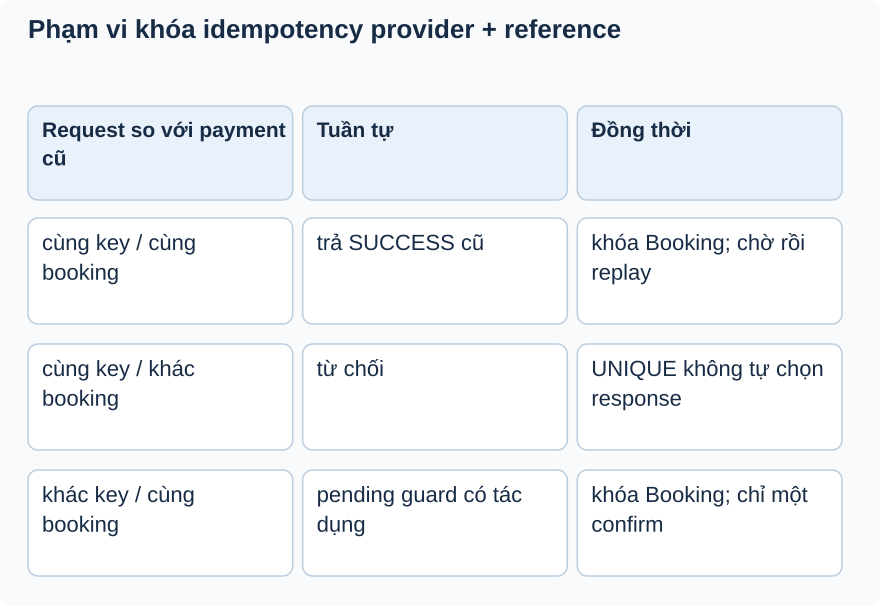

# Bài 2. Nhận lại cùng xác nhận

[Giáo trình](../../README.md) · [Mục lục module](README.md)

**Trong bài:** [Tình huống và cách nghĩ](#tình-huống-và-cách-nghĩ) · [Cùng trace source](#cùng-trace-source) · [Luyện từ có hướng dẫn đến tự làm](#luyện-từ-có-hướng-dẫn-đến-tự-làm)

**20–30 phút · Chương 2: Cơ chế và dữ liệu**

**Câu hỏi trung tâm:** Một idempotency key bảo vệ phạm vi nào?

Sau bài này, bạn có thể:

- Định nghĩa key provider/reference và payload phải khớp.
- Trace replay trước state guard pending.
- Phân biệt same-key collision với same-booking race.

**Cần biết trước:** [Bài toán module](01-bai-toan.md). Hoàn thành Booking; hiểu snapshot, giữ chỗ và rollback.

## Tình huống và cách nghĩ

Lần đầu provider P, ref R, booking B pending.

Idempotency nghĩa là lặp lại cùng ý định không tạo thêm hiệu ứng nghiệp vụ. Cần định nghĩa “cùng” bằng
khóa. Ở EventHub khóa là cặp provider và providerTransactionId, không phải chỉ bookingId. Retry tuần tự
và hai request cùng lúc là hai bài toán khác nhau.



Đọc key và booking trước. Cùng booking được khóa trước lookup; cùng key khác booking dựa vào unique DB và chưa chuẩn hóa lỗi collision.

## Cơ chế trong EventHub

Phần dưới dựa trên source working tree. Phương án thay thế là phân tích/đề xuất; race cần test riêng
trước khi kết luận runtime.

Khái niệm: một request lặp cùng giao dịch nên nhận kết quả tương đương, không lặp tác động. EventHub
nhận diện bằng cặp provider/providerTransactionId. Cặp này phù hợp phân biệt reference của từng
provider; bookingId phải khớp để ngăn lấy reference của đơn A xác nhận đơn B. amount luôn từ booking để
không tin số tiền client.

Runtime hiện tại lấy khóa Booking trước query reference. Retry cùng booking phải chờ commit nên lookup thấy SUCCESS cũ; hai reference khác trên cùng booking bị pending guard phân xử. Cùng key nhưng hai booking khác nhau vẫn dựa vào unique DB; chưa có handler chuẩn hóa collision thành response nghiệp vụ.

Thay thế: conditional booking transition, locking booking, xử lý unique collision rồi đối soát record
trong transaction phù hợp. Provider webhook sau này cần signature/amount/currency/status validation; đó
là đề xuất, chưa có. Debug replay ở query key và handleExistingPayment, không log reference người thật.
Tests hiện có replay cùng reference, reference thuộc booking khác và suite PostgreSQL cho retry đồng thời/khác reference/cancel/expiry. Xem [biên bản](../../../project/concurrency-verification.md).

## Cùng trace source

Mở theo thứ tự: [PaymentServiceImpl](../../../../backend/src/main/java/com/eventhub/eventhub_backend/payment/service/Impl/PaymentServiceImpl.java) → [PaymentRepository](../../../../backend/src/main/java/com/eventhub/eventhub_backend/payment/repository/PaymentRepository.java) → [Payment](../../../../backend/src/main/java/com/eventhub/eventhub_backend/payment/entity/Payment.java).

Điểm cần tìm: `confirmPayment; handleExistingPayment`. Với mỗi guard, ghi input và kết quả khi đúng/sai; với mỗi setter/query, ghi dữ liệu thay đổi ở object hay DB. Tra [bảng source module](01-bai-toan.md) nếu cần DTO hoặc test liên quan.

Đoạn trích nguyên văn từ [PaymentServiceImpl, dòng 45](../../../../backend/src/main/java/com/eventhub/eventhub_backend/payment/service/Impl/PaymentServiceImpl.java#L45); chỉ là phần cần quan sát, không phải toàn bộ method:

```java
        if (existingPayment.isPresent()) {
            return handleExistingPayment(existingPayment.get(), request);
        }
```

Đọc khối này trong method bao quanh: điều kiện trước nó quyết định có đến được đây không,
caller/transaction phía ngoài quyết định thay đổi có commit không. Không dùng riêng snippet để suy ra
toàn bộ flow.

## Ví dụ được giải từng bước

**Ví dụ minh họa**, dùng ID/số liệu giả; không phải request ghi vào môi trường thật.

Lần đầu provider P, ref R, booking B pending.

1. Không thấy payment (P,R); service confirm B và tạo payment SUCCESS.
2. Retry cùng (P,R,B) thấy payment trước khi đọc pending và trả kết quả cũ.
3. Cùng (P,R) nhưng booking C bị từ chối vì không khớp booking.
4. Hai request cùng lúc đều không thấy key có thể va UNIQUE khi insert; chưa có handler riêng chuyển
   collision thành response idempotent.

**Dừng lại và dự đoán:** Cùng booking B nhưng ref R2 có được bảo vệ bởi UNIQUE(P,R) không?

<details>
<summary>Đối chiếu sau khi đã tự trả lời</summary>

Không. Đây là key khác. B đã confirmed thì request tuần tự bị state guard chặn; hai request cạnh tranh
vẫn cần bảo vệ transition Booking.

</details>

## Tự nhớ lại, không nhìn lên trên

1. Giải thích bằng lời: Một idempotency key bảo vệ phạm vi nào?
2. Trace hoặc dự đoán: Cùng booking B nhưng ref R2 có được bảo vệ bởi UNIQUE(P,R) không?
3. Tìm trong source một guard, query hoặc mapping quyết định kết quả; nó đọc/ghi dữ liệu nào?
4. Bài tập có hướng dẫn muốn chứng minh tính chất nào? Dependency nào phải chạy thật để chứng minh nó?

<details>
<summary>Đáp án và cách kiểm tra</summary>

1. Idempotency nghĩa là lặp lại cùng ý định không tạo thêm hiệu ứng nghiệp vụ. Cần định nghĩa “cùng”
   bằng khóa. Ở EventHub khóa là cặp provider và providerTransactionId, không phải chỉ bookingId. Retry
   tuần tự và hai request cùng lúc là hai bài toán khác nhau.

2. Không. Đây là key khác. B đã confirmed thì request tuần tự bị state guard chặn; hai request cạnh
   tranh vẫn cần bảo vệ transition Booking.

3. Lần theo `confirmPayment; handleExistingPayment` trong các file đã dẫn; câu trả lời phải có tên
   field/điều kiện, không chỉ nói “service kiểm tra”.

4. Phân biệt same-key collision với same-booking race. Đối chiếu gợi ý/rubric bài tập: thuật toán cần
   encoder/mapper thật; query/constraint/rollback/lock cần DB phù hợp; routing/validation/security HTTP
   cần pipeline thật. Chọn phần đúng bài này, không chạy mọi tầng vô điều kiện.

</details>

## Luyện từ có hướng dẫn đến tự làm

**Có hướng dẫn:** Lập ma trận retry cùng key/cùng booking, cùng key/khác booking, khác key/cùng booking;
tách tuần tự và đồng thời.

**Tự làm:** Cùng key đã SUCCESS nhưng request đổi bookingId. Tự viết expected/error/side-effect, rồi
thiết kế contract tương lai cho cùng key khác payload và hai request đồng thời.

<details>
<summary>Gợi ý khi mắc kẹt</summary>

Đọc handleExistingPayment trước state guard; unique key không thay lock/version của booking.

</details>

<details>
<summary>Rubric tự chấm</summary>

Đạt khi phạm vi key đúng, không tuyên bố exactly-once toàn hệ thống từ một unique constraint.

Tự cho 0–2 điểm mỗi mục: expected rõ; bằng chứng source đúng; giải thích cơ chế; phân biệt giới hạn
test. Đạt từ 6/8 và không sai invariant chính. Điểm này giúp chọn chỗ ôn, không chứng nhận năng lực
production.

</details>

## Giữ lại điều cốt lõi

Idempotency hiện nhận diện bằng provider+reference và kiểm booking khớp. Replay tuần tự trả cũ; UNIQUE
chỉ chặn duplicate key nếu schema đúng, không tự cho response retry thành công hoặc khóa transition
Booking.

[← Bài trước](01-bai-toan.md) · [Mục lục module](README.md) · [Học tiếp →](03-co-che.md)

Nếu chưa giải thích được câu hỏi trung tâm, làm lại biến thể trước khi học tiếp; không cần đọc thêm mọi
tài liệu tham khảo.
