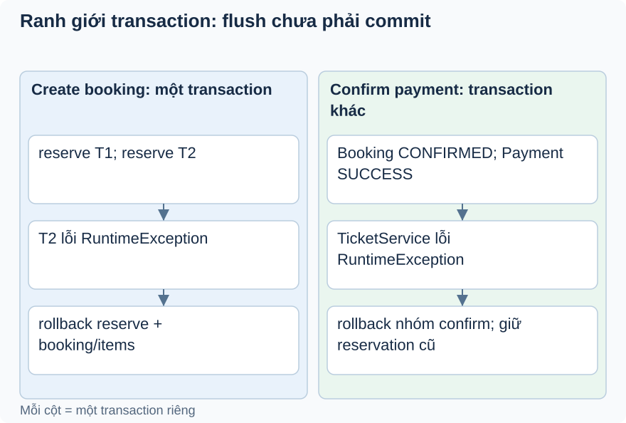

# Bài 3. Phát vé nằm trong giao dịch nào?

[Giáo trình](../../README.md) · [Mục lục module](README.md)

**Trong bài:** [Tình huống và cách nghĩ](#tình-huống-và-cách-nghĩ) · [Cùng trace source](#cùng-trace-source) · [Luyện từ có hướng dẫn đến tự làm](#luyện-từ-có-hướng-dẫn-đến-tự-làm)

**20–30 phút · Chương 2: Cơ chế và dữ liệu**

**Câu hỏi trung tâm:** TicketService lỗi sau khi lưu Payment thì dữ liệu nào bị rollback?

Sau bài này, bạn có thể:

- Trace confirm qua TicketService bean trong transaction.
- Phân biệt flush, commit và unchecked rollback.
- Giữ đúng reservation đã commit ở operation trước.

**Cần biết trước:** [Bài toán module](01-bai-toan.md); bài ngay trước theo thanh điều hướng cuối trang. Hoàn thành Booking; hiểu snapshot, giữ chỗ và rollback.

## Tình huống và cách nghĩ

B pending, giữ 2 chỗ từ trước.

Một service gọi service khác không nhất thiết tạo transaction mới. Hai bean dùng transactional mặc định
REQUIRED tham gia transaction hiện có nếu gọi qua proxy cùng transaction manager. Flush gửi SQL chưa
đồng nghĩa commit; transaction ngoài còn có thể rollback.



Hai cột là hai operation khác thời điểm, không cùng một transaction. Đọc đến hàng lỗi rồi lần ngược để
xác định nhóm bị rollback. Reservation từ create đã commit trước confirm nên vẫn giữ khi confirm lỗi.

## Cơ chế trong EventHub

Phần dưới dựa trên source working tree. Phương án thay thế là phân tích/đề xuất; race cần test riêng
trước khi kết luận runtime.

Payment chuyển booking, tạo payment và gọi TicketService bean. Cả hai public method có
jakarta.transaction.Transactional mặc định REQUIRED: lời gọi qua proxy tham gia giao dịch đang có, không
phải commit ticket riêng trước payment. Nếu phát vé throw unchecked, cần rollback cả
booking/payment/ticket để không có SUCCESS không vé do lỗi DB trong cùng transaction.

save có thể chưa insert ngay cho tới flush, nên unique collision có thể xuất hiện muộn hơn dòng save.
Unit test tạo service bằng Mockito không có proxy/DB: verify(issueTickets) không chứng minh rollback.
Giao dịch DB cũng không rollback email hoặc ngân hàng nếu sau này thêm lời gọi ngoài; cần thiết kế riêng
khi tích hợp thật.

Thay thế: async issuance giúp response nhanh nhưng tạo trạng thái “đã trả tiền chưa có vé”, cần
retry/outbox và observability. Hiện synchronous đơn giản, dễ giữ nhóm ghi DB, chưa có lý do đo được để
thêm broker. Debug transaction bằng trạng thái DB sau exception trong test tích hợp, đừng chỉ nhìn
entity trong debugger. Test đề xuất lỗi ticket issuance thực và unique collision tại flush.

## Cùng trace source

Mở theo thứ tự: [PaymentServiceImpl](../../../../backend/src/main/java/com/eventhub/eventhub_backend/payment/service/Impl/PaymentServiceImpl.java) → [TicketServiceImpl](../../../../backend/src/main/java/com/eventhub/eventhub_backend/ticketing/service/Impl/TicketServiceImpl.java).

Điểm cần tìm: `confirmPayment → issueTicketsForBooking`. Với mỗi guard, ghi input và kết quả khi đúng/sai; với mỗi setter/query, ghi dữ liệu thay đổi ở object hay DB. Tra [bảng source module](01-bai-toan.md) nếu cần DTO hoặc test liên quan.

Đoạn trích nguyên văn từ [PaymentServiceImpl, dòng 58](../../../../backend/src/main/java/com/eventhub/eventhub_backend/payment/service/Impl/PaymentServiceImpl.java#L58); chỉ là phần cần quan sát, không phải toàn bộ method:

```java
        Payment savedPayment = paymentRepository.save(payment);
        ticketService.issueTicketsForBooking(booking);

        return toResponse(savedPayment);
```

Đọc khối này trong method bao quanh: điều kiện trước nó quyết định có đến được đây không,
caller/transaction phía ngoài quyết định thay đổi có commit không. Không dùng riêng snippet để suy ra
toàn bộ flow.

## Ví dụ được giải từng bước

**Ví dụ minh họa**, dùng ID/số liệu giả; không phải request ghi vào môi trường thật.

B pending, giữ 2 chỗ từ trước.

1. confirmPayment mở transaction, đổi B CONFIRMED.
2. Save Payment SUCCESS; chưa kết luận đã commit.
3. Gọi TicketService qua bean; phát vé gặp RuntimeException.
4. Exception thoát ra làm rollback booking/payment/tickets trong DB; B trở lại pending. Counter giữ chỗ
   đã commit lúc createBooking trước đó không nằm trong lần rollback này.

**Dừng lại và dự đoán:** Bước phát vé gửi email ra ngoài rồi lỗi: rollback JPA có thu hồi được email không?

<details>
<summary>Đối chiếu sau khi đã tự trả lời</summary>

Không. Transaction DB không hoàn tác tác động ngoài DB. Gửi email hiện không phải flow đã triển khai ở
đây; outbox là đề xuất nếu tích hợp sau này.

</details>

## Nối với bài đã học

Nhớ nhóm reserve+booking/items. Lần này hỏi transaction qua bean khác và phân biệt reservation đã commit trước đó. [Ôn bài gốc](../booking/04-co-che.md).

## Tự nhớ lại, không nhìn lên trên

1. Giải thích bằng lời: TicketService lỗi sau khi lưu Payment thì dữ liệu nào bị rollback?
2. Trace hoặc dự đoán: Bước phát vé gửi email ra ngoài rồi lỗi: rollback JPA có thu hồi được email không?
3. Tìm trong source một guard, query hoặc mapping quyết định kết quả; nó đọc/ghi dữ liệu nào?
4. Bài tập có hướng dẫn muốn chứng minh tính chất nào? Dependency nào phải chạy thật để chứng minh nó?

<details>
<summary>Đáp án và cách kiểm tra</summary>

1. Một service gọi service khác không nhất thiết tạo transaction mới. Hai bean dùng transactional mặc
   định REQUIRED tham gia transaction hiện có nếu gọi qua proxy cùng transaction manager. Flush gửi SQL
   chưa đồng nghĩa commit; transaction ngoài còn có thể rollback.

2. Không. Transaction DB không hoàn tác tác động ngoài DB. Gửi email hiện không phải flow đã triển khai
   ở đây; outbox là đề xuất nếu tích hợp sau này.

3. Lần theo `confirmPayment → issueTicketsForBooking` trong các file đã dẫn; câu trả lời phải có tên
   field/điều kiện, không chỉ nói “service kiểm tra”.

4. Giữ đúng reservation đã commit ở operation trước. Đối chiếu gợi ý/rubric bài tập: thuật toán cần
   encoder/mapper thật; query/constraint/rollback/lock cần DB phù hợp; routing/validation/security HTTP
   cần pipeline thật. Chọn phần đúng bài này, không chạy mọi tầng vô điều kiện.

</details>

## Luyện từ có hướng dẫn đến tự làm

**Có hướng dẫn:** Thiết kế test Spring/DB với TicketService lỗi thật sau một thao tác persist; kiểm B
pending, không payment/ticket mới và counter giữ chỗ ban đầu vẫn còn.

**Tự làm:** Nếu phát vé async sau khi confirm đã commit, tự lập bảng trạng thái khi consumer lỗi và tiêu
chí retry. So với synchronous hiện tại; đánh dấu outbox/queue là đề xuất.

<details>
<summary>Gợi ý khi mắc kẹt</summary>

Mockito verify save chỉ thấy lời gọi. Muốn chứng minh rollback, đọc DB sau khi transaction thất bại bằng
transaction/context mới.

</details>

<details>
<summary>Rubric tự chấm</summary>

Đạt khi nhận đúng ranh giới createBooking vs confirmPayment và không tính reserve lần hai.

Tự cho 0–2 điểm mỗi mục: expected rõ; bằng chứng source đúng; giải thích cơ chế; phân biệt giới hạn
test. Đạt từ 6/8 và không sai invariant chính. Điểm này giúp chọn chỗ ôn, không chứng nhận năng lực
production.

</details>

## Giữ lại điều cốt lõi

Payment và issuance tham gia transaction hiện có qua bean REQUIRED. Lỗi unchecked có thể rollback nhóm
confirm, nhưng không rollback reservation đã commit ở createBooking trước đó hay tác động ngoài DB.

[← Bài trước](02-co-che.md) · [Mục lục module](README.md) · [Học tiếp →](04-co-che.md)

Nếu chưa giải thích được câu hỏi trung tâm, làm lại biến thể trước khi học tiếp; không cần đọc thêm mọi
tài liệu tham khảo.
