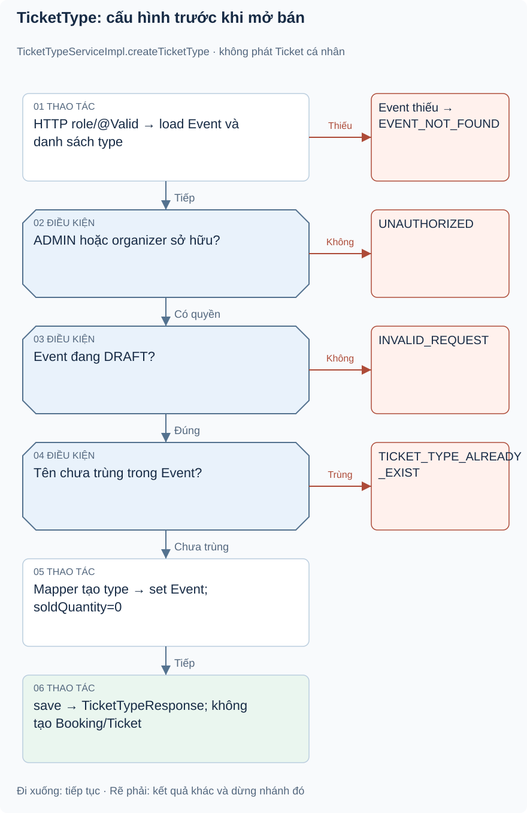

# Bài 1. Ticket — thiết kế loại vé: bài toán trước code

[Giáo trình](../../README.md) · [Mục lục module](README.md)

**Trong bài:** [Bắt đầu từ người dùng](#bắt-đầu-từ-người-dùng) · [Mở source theo thứ tự này](#mở-source-theo-thứ-tự-này) · [Tự làm có hướng dẫn](#tự-làm-có-hướng-dẫn)

**20–25 phút · Chương 1: Bài toán và đường đi**

**Câu hỏi trung tâm:** Module này quyết định điều gì trong hành trình mua vé, và điều gì thuộc module khác?

Sau bài này, bạn có thể:

- Kể lại nhu cầu của actor và quy tắc chính bằng lời.
- Trace luồng chính từ điểm vào đến kết quả hoặc lỗi.
- Chỉ ra dữ liệu module sở hữu và một giới hạn hiện tại.

**Cần biết trước:** Hoàn thành Event; hiểu DRAFT và PUBLISHED. [Lộ trình đầy đủ](../../learning-path.md).

## Bắt đầu từ người dùng

Ví dụ minh họa: workshop có vé Standard và VIP. Đây là hai TicketType có giá và capacity riêng, chưa
phải vé cấp cho khách. Ban tổ chức chỉ được cấu hình khi Event còn DRAFT; sau publish không thay đổi sức
chứa bằng CRUD hiện có. Điều này giảm việc thay đổi sản phẩm đã mở bán.

Quy tắc service: organizer phải sở hữu event hoặc là ADMIN; tên loại vé không trùng trong event, so
không phân biệt hoa thường; create đặt soldQuantity=0; update quantity không nhỏ hơn soldQuantity;
delete yêu cầu DRAFT và không có soldQuantity>0. Module không phát hành vé hay xác nhận tiền.

## Mô hình và luồng thật

### Góc nhìn 1: TicketType: cấu hình trước khi mở bán

Theo các điều kiện trước khi nhìn bước mapper/save. DRAFT và ownership là hai hàng rào riêng; tên được
so không phân biệt hoa thường trong danh sách hiện có.

**Luồng chính, đọc theo từng cụm:**

1. POST /events/{eventId}/ticket-types → role → MVC validate body
2. service load event và danh sách loại vé → ownership/role → DRAFT
3. tên chưa trùng → mapper tạo entity → set event/soldQuantity=0
4. save → response

Không cập nhật booking hay phát hành Ticket. Service create không có transaction bao ngoài nhiều query;
save dùng repository transaction.

Nếu tên trùng trả TICKET_TYPE_ALREADY_EXIST/409; sai trạng thái INVALID_REQUEST/400; thiếu event
EVENT_NOT_FOUND/404. GET loại vé chỉ cần authenticated theo config, không lọc event public trong
service; không suy ra rule visibility giống Event public API.

Đọc hình từ điểm vào được ghi trên hình, lần theo các điều kiện trước khi nhìn phần lưu/response. Mũi
tên là thứ tự xử lý, không phải bằng chứng mọi nhánh đều chạy hoặc mọi thay đổi đã commit. Dừng ở nhánh
lỗi và tự nói điều gì chưa xảy ra.

## Mở source theo thứ tự này

| File/Class | Trách nhiệm | Vì sao / khi đọc |
|---|---|---|
| [TicketTypeController](../../../../backend/src/main/java/com/eventhub/eventhub_backend/ticket/controller/TicketTypeController.java) | CRUD API | Role và path khác ticketing |
| [CreateTicketTypeRequest](../../../../backend/src/main/java/com/eventhub/eventhub_backend/ticket/dto/request/CreateTicketTypeRequest.java), [UpdateTicketTypeRequest](../../../../backend/src/main/java/com/eventhub/eventhub_backend/ticket/dto/request/UpdateTicketTypeRequest.java) | Input và validation | Giá/số lượng dương, PATCH nullable |
| [TicketTypeServiceImpl](../../../../backend/src/main/java/com/eventhub/eventhub_backend/ticket/service/Impl/TicketTypeServiceImpl.java) | Rule và ownership | Cốt lõi create/update/delete |
| [TicketType](../../../../backend/src/main/java/com/eventhub/eventhub_backend/ticket/entity/TicketType.java) | Giá, capacity, counter, Event | Entity ít constraint hơn DTO |
| [TicketTypeMapper](../../../../backend/src/main/java/com/eventhub/eventhub_backend/ticket/mapper/TicketTypeMapper.java), [response](../../../../backend/src/main/java/com/eventhub/eventhub_backend/ticket/dto/response/TicketTypeResponse.java) | Mapping và availableQuantity | Phân biệt giá trị suy ra với cột DB |
| [TicketTypeRepository](../../../../backend/src/main/java/com/eventhub/eventhub_backend/ticket/repository/TicketTypeRepository.java) | findByEventId, lock và reserve | CRUD đọc tại đây; reserve học ở booking |
| [TicketTypeServiceImplTest](../../../../backend/src/test/java/com/eventhub/eventhub_backend/ticket/TicketTypeServiceImplTest.java) | 10 ca unit | Name/quantity/ownership/DRAFT |

Lượt đầu chỉ mở controller và service cốt lõi trong bảng. Ghi tên guard, dữ liệu trước/sau, rồi mới mở
DTO/repository tương ứng. Test đọc sau khi đã tự dự đoán.

## Một ví dụ nhỏ để tự lần theo

Ví dụ minh họa dựa trên rule hiện có: Loại vé VIP đã tạo có quantity=100: đó có phải 100 vé cá nhân có
mã để check-in không?

1. Xác định actor, dữ liệu và state trước thao tác.
2. Tìm guard tương ứng trong service/controller của bảng source.
3. Ghi quyết định và tác động: Không. TicketType là cấu hình tên/giá/capacity. Ticketing chỉ phát Ticket
   cá nhân khi booking confirmed.

**Thử biến thể trước khi xem:** Nếu người gọi có role đúng nhưng không sở hữu tài nguyên, role có tự bỏ
qua ownership không?

Đối chiếu biến thể

Không với các use case có ownership guard. Auth/common không tự sở hữu booking/event; phải tìm service
tài nguyên. Role ADMIN có ngoại lệ nào thì đọc từng guard, không suy rộng cho mọi endpoint.

## Tự nhớ lại

1. Đóng bài: kể actor, nhu cầu và kết quả của module trong 60 giây.
2. Với tình huống ví dụ, thao tác dừng ở guard nào và dữ liệu nào không thay đổi?
3. Module này có kiểm tiền ngân hàng, giữ chỗ hoặc phát vé không? Chỉ nhận trách nhiệm có source.
4. Tìm một feature chưa có; bằng chứng nào giúp phân biệt “có DTO/service” với “có runtime caller”?

Đáp án định hướng

1. Đối chiếu phần bài toán; phải kể nhu cầu thay vì chỉ tên layer.
2. Không. TicketType là cấu hình tên/giá/capacity. Ticketing chỉ phát Ticket cá nhân khi booking confirmed.
3. Xem phạm vi đầu bài và trace, không gán mọi bước mua vé cho module này.
4. Tìm controller/caller, không chỉ class tồn tại. Các khoảng thiếu đã ghi trong bài là điều cần kiểm
   chứng lại khi source đổi.

## Tự làm có hướng dẫn

Lập bảng TicketType và Ticket: ai tạo, thời điểm, field đại diện, module quản lý.

Sau đó bỏ tài liệu, tự ghi một happy path và một failure path. Với mỗi bước, nêu dữ liệu vào/ra; không
viết code production.

Gợi ý

Dùng bảng năm dòng: actor → điểm vào → guard → dữ liệu → kết quả. Khi thiếu bằng chứng, ghi “chưa xác
minh”, không điền theo trí nhớ framework.

Tiêu chí hoàn thành

Có tên method thật, guard cụ thể, dữ liệu trước/sau và nhánh lỗi; không thêm endpoint/tác động ngoài
source. Nếu thiếu hai trong bốn phần, quay lại trace trước bài tiếp.

## Chốt lại và chỗ dễ nhầm

Luồng gọi và quyền hợp lệ chưa chứng minh dữ liệu commit hay chống được cạnh tranh. Học cơ chế ở chương
tiếp theo rồi quay lại tự vẽ luồng này một lần nữa.

[← Bài trước](../event/05-tu-kiem-chung.md) · [Mục lục module](README.md) · [Học tiếp →](02-co-che.md)

Nếu chưa giải thích được câu hỏi trung tâm, làm lại biến thể trước khi học tiếp; không cần đọc thêm mọi
tài liệu tham khảo.
