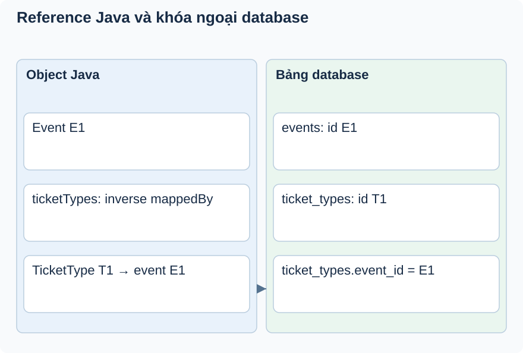

# Bài 4. Quan hệ object và khóa ngoại

[Giáo trình](../../README.md) · [Mục lục module](README.md)

**Trong bài:** [Tình huống và cách nghĩ](#tình-huống-và-cách-nghĩ) · [Cùng trace source](#cùng-trace-source) · [Luyện từ có hướng dẫn đến tự làm](#luyện-từ-có-hướng-dẫn-đến-tự-làm)

**20–30 phút · Chương 2: Cơ chế và dữ liệu**

**Câu hỏi trung tâm:** Gán Event.ticketTypes có đủ để ghi event_id không?

Sau bài này, bạn có thể:

- Chỉ owning side event_id và inverse mappedBy.
- Phân biệt reference, FK, cascade và fetch.
- Thiết kế reload/SQL observation để kiểm mapping.

**Cần biết trước:** [Bài toán module](01-bai-toan.md); bài ngay trước theo thanh điều hướng cuối trang. Hoàn thành Event; hiểu DRAFT và PUBLISHED.

## Tình huống và cách nghĩ

Event E1 và TicketType T1 là dữ liệu minh họa.

Trong Java, reference nối hai object. Trong DB, foreign key lưu ID của bản ghi khác. Owning side là phía
mapping ghi khóa ngoại; inverse side giúp điều hướng object. Cascade điều khiển lan truyền thao tác
entity; fetch điều khiển đọc, hai khái niệm không thay nhau.



Nhìn reference T1.event ở bên trái rồi cột event_id ở bên phải. TicketType là owning side. List phía
Event hỗ trợ điều hướng, không tự gán reference hay cascade persist.

## Cơ chế trong EventHub

Phần dưới dựa trên source working tree. Phương án thay thế là phân tích/đề xuất; race cần test riêng
trước khi kết luận runtime.

TicketType là phía sở hữu event_id qua ManyToOne; Event.ticketTypes là inverse mappedBy. ManyToOne này
không khai báo fetch nên mặc định EAGER, khác nhiều quan hệ LAZY trong dự án. Khi load nhiều loại vé,
provider có thể tải thêm Event; số query cụ thể cần đo, không kết luận chắc N+1 từ annotation.

Project cần quan hệ để từ loại vé tìm event và kiểm tra quyền. Chỉ lưu eventId đơn thuần sẽ giảm truy
cập đồ thị nhưng thêm query tay/logic mapping; đổi LAZY cần kiểm tra transaction và mapping response.
Debug SQL count ở getTicketTypesByEvent, kiểm tra khi mapper lấy event.id có gây query hay không. Test
đề xuất integration fetch/query count; unit mock không mô phỏng loading.

## Cùng trace source

Mở theo thứ tự: [TicketType](../../../../backend/src/main/java/com/eventhub/eventhub_backend/ticket/entity/TicketType.java) → [Event](../../../../backend/src/main/java/com/eventhub/eventhub_backend/event/entity/Event.java).

Điểm cần tìm: `TicketType.event; Event.ticketTypes`. Với mỗi guard, ghi input và kết quả khi đúng/sai; với mỗi setter/query, ghi dữ liệu thay đổi ở object hay DB. Tra [bảng source module](01-bai-toan.md) nếu cần DTO hoặc test liên quan.

Đoạn trích nguyên văn từ [TicketType, dòng 31](../../../../backend/src/main/java/com/eventhub/eventhub_backend/ticket/entity/TicketType.java#L31); chỉ là phần cần quan sát, không phải toàn bộ method:

```java
    @ManyToOne
    @JoinColumn(name = "event_id")
    Event event;
```

Đọc khai báo này cùng field/kiểu và nơi gọi nó. Annotation hay interface không tự chứng minh toàn bộ
request: DTO cần validation pipeline, mapper cần nhánh service phù hợp, query cần transaction và DB
thật. Chọn ranh giới liên quan đến ví dụ trong bài.

## Ví dụ được giải từng bước

**Ví dụ minh họa**, dùng ID/số liệu giả; không phải request ghi vào môi trường thật.

Event E1 và TicketType T1 là dữ liệu minh họa.

1. TicketType.event là phía ManyToOne mang event_id.
2. Event.ticketTypes có mappedBy, là phía ngược.
3. Muốn liên kết được ghi phải đặt T1.event phù hợp và persist theo luồng service.
4. ManyToOne mặc định EAGER không đồng nghĩa mọi query chỉ dùng một JOIN; cần xem SQL thực.

**Dừng lại và dự đoán:** Thêm T1 vào list phía Event nhưng để T1.event=null: có thể dựa vào mappedBy để
tự suy ra FK không?

<details>
<summary>Đối chiếu sau khi đã tự trả lời</summary>

Không. mappedBy nói phía kia sở hữu mapping; không tự sửa reference kia. Source Event.ticketTypes cũng
không khai báo cascade để tự persist toàn bộ graph.

</details>

## Tự nhớ lại, không nhìn lên trên

1. Giải thích bằng lời: Gán Event.ticketTypes có đủ để ghi event_id không?
2. Trace hoặc dự đoán: Thêm T1 vào list phía Event nhưng để T1.event=null: có thể dựa vào mappedBy để tự
   suy ra FK không?
3. Tìm trong source một guard, query hoặc mapping quyết định kết quả; nó đọc/ghi dữ liệu nào?
4. Bài tập có hướng dẫn muốn chứng minh tính chất nào? Dependency nào phải chạy thật để chứng minh nó?

<details>
<summary>Đáp án và cách kiểm tra</summary>

1. Trong Java, reference nối hai object. Trong DB, foreign key lưu ID của bản ghi khác. Owning side là
   phía mapping ghi khóa ngoại; inverse side giúp điều hướng object. Cascade điều khiển lan truyền thao
   tác entity; fetch điều khiển đọc, hai khái niệm không thay nhau.

2. Không. mappedBy nói phía kia sở hữu mapping; không tự sửa reference kia. Source Event.ticketTypes
   cũng không khai báo cascade để tự persist toàn bộ graph.

3. Lần theo `TicketType.event; Event.ticketTypes` trong các file đã dẫn; câu trả lời phải có tên
   field/điều kiện, không chỉ nói “service kiểm tra”.

4. Thiết kế reload/SQL observation để kiểm mapping. Đối chiếu gợi ý/rubric bài tập: thuật toán cần
   encoder/mapper thật; query/constraint/rollback/lock cần DB phù hợp; routing/validation/security HTTP
   cần pipeline thật. Chọn phần đúng bài này, không chạy mọi tầng vô điều kiện.

</details>

## Luyện từ có hướng dẫn đến tự làm

**Có hướng dẫn:** Vẽ hai object và hai bảng, đánh dấu cột event_id; thiết kế test
save/flush/clear/reload để kiểm quan hệ và đếm query khi list.

**Tự làm:** Đề xuất đổi TicketType.event sang LAZY. Tự ghi nơi mapper/service truy cập Event,
transaction cần kiểm và cách đo query count; không đổi annotation chỉ theo khẩu hiệu tối ưu.

<details>
<summary>Gợi ý khi mắc kẹt</summary>

Clear persistence context trước reload để không chỉ nhìn object còn trong bộ nhớ.

</details>

<details>
<summary>Rubric tự chấm</summary>

Đạt khi chỉ đúng owning side, không nhầm EAGER với JOIN và phân biệt cascade/fetch.

Tự cho 0–2 điểm mỗi mục: expected rõ; bằng chứng source đúng; giải thích cơ chế; phân biệt giới hạn
test. Đạt từ 6/8 và không sai invariant chính. Điểm này giúp chọn chỗ ôn, không chứng nhận năng lực
production.

</details>

## Giữ lại điều cốt lõi

TicketType.event ghi FK; Event.ticketTypes là inverse. Gán list không tự gán reference phía owning side.
Fetch quyết định tải, cascade quyết định lan truyền thao tác; EAGER không hứa một JOIN.

[← Bài trước](03-co-che.md) · [Mục lục module](README.md) · [Học tiếp →](05-tu-kiem-chung.md)

Nếu chưa giải thích được câu hỏi trung tâm, làm lại biến thể trước khi học tiếp; không cần đọc thêm mọi
tài liệu tham khảo.
