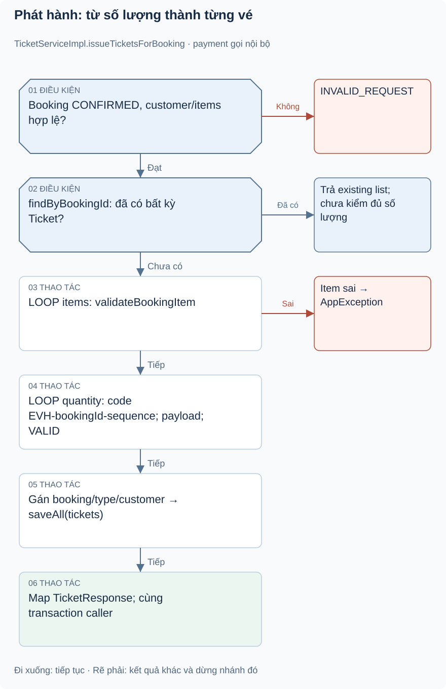
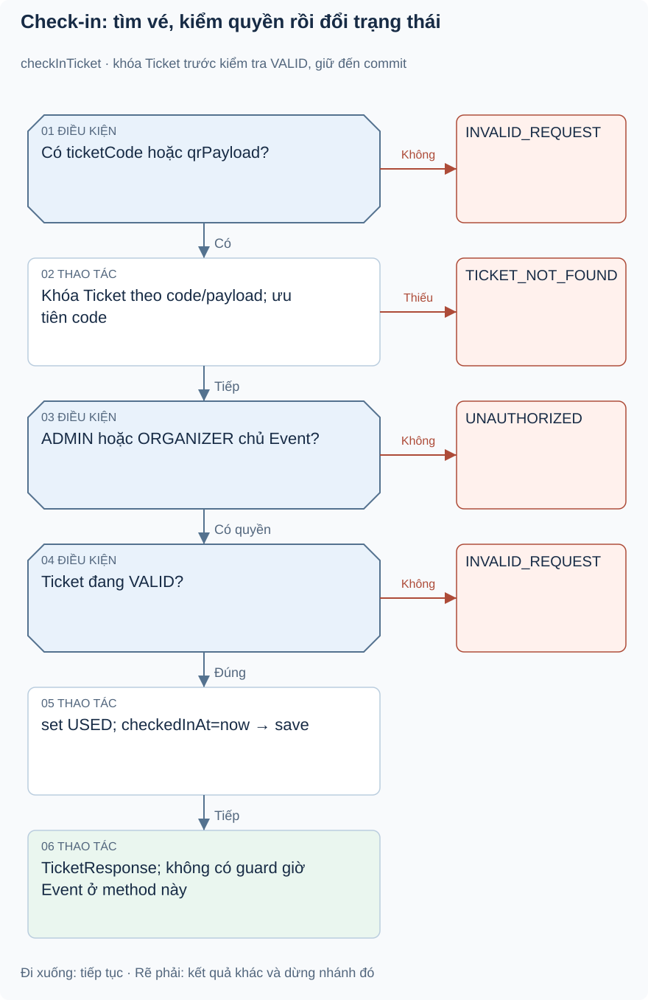

# Bài 1. Ticketing — phát vé và check-in: bài toán trước code

[Giáo trình](../../README.md) · [Mục lục module](README.md)

**Trong bài:** [Bắt đầu từ người dùng](#bắt-đầu-từ-người-dùng) · [Mở source theo thứ tự này](#mở-source-theo-thứ-tự-này) · [Tự làm có hướng dẫn](#tự-làm-có-hướng-dẫn)

**20–25 phút · Chương 1: Bài toán và đường đi**

**Câu hỏi trung tâm:** Module này quyết định điều gì trong hành trình mua vé, và điều gì thuộc module khác?

Sau bài này, bạn có thể:

- Kể lại nhu cầu của actor và quy tắc chính bằng lời.
- Trace luồng chính từ điểm vào đến kết quả hoặc lỗi.
- Chỉ ra dữ liệu module sở hữu và một giới hạn hiện tại.

**Cần biết trước:** Hoàn thành Payment; phân biệt booking CONFIRMED với vé cá nhân. [Lộ trình đầy đủ](../../learning-path.md).

## Bắt đầu từ người dùng

Ví dụ minh họa: Lan trả tiền cho hai vé VIP. TicketType VIP vẫn chỉ là một sản phẩm, nhưng Lan cần hai
Ticket để hai người vào cửa. Lần quét đầu chuyển mỗi vé VALID thành USED; quét lại cùng vé phải bị từ
chối tuần tự.

Module phát hành vé từ Booking CONFIRMED, lưu mã/payload, cho CUSTOMER xem vé của mình và cho organizer
sở hữu event hoặc ADMIN check-in. Không tạo/sửa giá TicketType, không xác thực ngân hàng, không sinh ảnh
QR. `qrPayload` là chuỗi `EVENTHUB|TICKET|` + ticketCode. TicketStatus.CANCELLED tồn tại nhưng chưa thấy
luồng hủy vé.

## Mô hình và luồng thật

### Góc nhìn 1: Phát hành: từ số lượng thành từng vé

Nhánh đã có vé trả list cũ ngay, không kiểm completeness. Nhánh tạo mới duyệt từng item/quantity,
sequence tăng xuyên suốt booking, rồi saveAll.

### Góc nhìn 2: Check-in: tìm vé, kiểm quyền rồi đổi trạng thái

Theo nhánh dọc để thấy lookup trước permission và status. Nếu có cả code/payload, code được ưu tiên.
Nhánh success tuần tự không chứng minh hai scanner chỉ một admission.

Payment gọi issueTicketsForBooking với booking CONFIRMED. Service validate booking/customer/items; nếu
đã có bất kỳ vé nào của booking thì trả list hiện có. Nếu chưa, duyệt items, mỗi quantity tạo một Ticket
với sequence tăng xuyên suốt booking, ticketCode=`EVH-`+bookingId+`-`+sequence, status VALID, gán
booking/type/customer. saveAll rồi map response. Không có endpoint issue công khai.

**Luồng chính, đọc theo từng cụm:**

1. Check-in: JWT + role → service validate request có code hoặc payload → tìm và khóa ticket (nếu cả hai có giá
   trị, ưu tiên code)
2. requireCheckInPermission (ADMIN hoặc chủ event ORGANIZER) → chỉ VALID → set USED/checkedInAt
3. save→response

Transaction bao quanh method check-in. Lỗi không thấy vé 404; sai quyền 403; vé USED 400. Không có kiểm
tra event đang diễn ra trong method này, nên không tự mô tả quy tắc check-in theo khung giờ.

Đọc hình từ điểm vào được ghi trên hình, lần theo các điều kiện trước khi nhìn phần lưu/response. Mũi
tên là thứ tự xử lý, không phải bằng chứng mọi nhánh đều chạy hoặc mọi thay đổi đã commit. Dừng ở nhánh
lỗi và tự nói điều gì chưa xảy ra.

## Mở source theo thứ tự này

| File/Class | Trách nhiệm | Vì sao / khi đọc |
|---|---|---|
| [TicketController](../../../../backend/src/main/java/com/eventhub/eventhub_backend/ticketing/controller/TicketController.java) | List/detail/check-in | Tách role customer và staff hiện tại |
| [TicketServiceImpl](../../../../backend/src/main/java/com/eventhub/eventhub_backend/ticketing/service/Impl/TicketServiceImpl.java) | issue/read/check-in/ownership | Cốt lõi, issuance được payment gọi nội bộ |
| [Ticket](../../../../backend/src/main/java/com/eventhub/eventhub_backend/ticketing/entity/Ticket.java), [TicketStatus](../../../../backend/src/main/java/com/eventhub/eventhub_backend/ticketing/entity/TicketStatus.java) | Mã unique, state, liên kết | Persistence vé cá nhân |
| [CheckInTicketRequest](../../../../backend/src/main/java/com/eventhub/eventhub_backend/ticketing/dto/request/CheckInTicketRequest.java), [TicketResponse](../../../../backend/src/main/java/com/eventhub/eventhub_backend/ticketing/dto/response/TicketResponse.java) | Input code/payload, output | Điều kiện ít nhất một field nằm ở service |
| [TicketRepository](../../../../backend/src/main/java/com/eventhub/eventhub_backend/ticketing/repository/TicketRepository.java) | Query booking/customer/code/payload | Theo dấu tìm vé và replay issuance |
| [TicketServiceImplTest](../../../../backend/src/test/java/com/eventhub/eventhub_backend/ticketing/TicketServiceImplTest.java) | 9 ca unit | Phát vé, ownership, already-used |

Lượt đầu chỉ mở controller và service cốt lõi trong bảng. Ghi tên guard, dữ liệu trước/sau, rồi mới mở
DTO/repository tương ứng. Test đọc sau khi đã tự dự đoán.

## Một ví dụ nhỏ để tự lần theo

Ví dụ minh họa dựa trên rule hiện có: Customer có mã vé VALID: có thể dùng mã đó gọi endpoint check-in
như nhân viên không?

1. Xác định actor, dữ liệu và state trước thao tác.
2. Tìm guard tương ứng trong service/controller của bảng source.
3. Ghi quyết định và tác động: Không. Check-in yêu cầu ADMIN hoặc ORGANIZER sở hữu Event; possession của
   mã không thay thế quyền endpoint/service.

**Thử biến thể trước khi xem:** Nếu người gọi có role đúng nhưng không sở hữu tài nguyên, role có tự bỏ
qua ownership không?

Đối chiếu biến thể

Không với các use case có ownership guard. Auth/common không tự sở hữu booking/event; phải tìm service
tài nguyên. Role ADMIN có ngoại lệ nào thì đọc từng guard, không suy rộng cho mọi endpoint.

## Tự nhớ lại

1. Đóng bài: kể actor, nhu cầu và kết quả của module trong 60 giây.
2. Với tình huống ví dụ, thao tác dừng ở guard nào và dữ liệu nào không thay đổi?
3. Module này có kiểm tiền ngân hàng, giữ chỗ hoặc phát vé không? Chỉ nhận trách nhiệm có source.
4. Tìm một feature chưa có; bằng chứng nào giúp phân biệt “có DTO/service” với “có runtime caller”?

Đáp án định hướng

1. Đối chiếu phần bài toán; phải kể nhu cầu thay vì chỉ tên layer.
2. Không. Check-in yêu cầu ADMIN hoặc ORGANIZER sở hữu Event; possession của mã không thay thế quyền
   endpoint/service.
3. Xem phạm vi đầu bài và trace, không gán mọi bước mua vé cho module này.
4. Tìm controller/caller, không chỉ class tồn tại. Các khoảng thiếu đã ghi trong bài là điều cần kiểm
   chứng lại khi source đổi.

## Tự làm có hướng dẫn

Trace một vé qua phát hành, customer xem, organizer check-in; ghi điều kiện mỗi bước.

Sau đó bỏ tài liệu, tự ghi một happy path và một failure path. Với mỗi bước, nêu dữ liệu vào/ra; không
viết code production.

Gợi ý

Dùng bảng năm dòng: actor → điểm vào → guard → dữ liệu → kết quả. Khi thiếu bằng chứng, ghi “chưa xác
minh”, không điền theo trí nhớ framework.

Tiêu chí hoàn thành

Có tên method thật, guard cụ thể, dữ liệu trước/sau và nhánh lỗi; không thêm endpoint/tác động ngoài
source. Nếu thiếu hai trong bốn phần, quay lại trace trước bài tiếp.

## Chốt lại và chỗ dễ nhầm

Luồng gọi và quyền hợp lệ chưa chứng minh dữ liệu commit hay chống được cạnh tranh. Học cơ chế ở chương
tiếp theo rồi quay lại tự vẽ luồng này một lần nữa.

[← Bài trước](../payment/05-tu-kiem-chung.md) · [Mục lục module](README.md) · [Học tiếp →](02-co-che.md)

Nếu chưa giải thích được câu hỏi trung tâm, làm lại biến thể trước khi học tiếp; không cần đọc thêm mọi
tài liệu tham khảo.

**Cập nhật 19/10/2026:** Booking transition và check-in đã có khóa DB; test PostgreSQL mới ở [biên bản concurrency](../../../project/concurrency-verification.md). Các bài tập thiết kế biến thể vẫn để tự luyện; phân biệt với những case đã có test thật.
