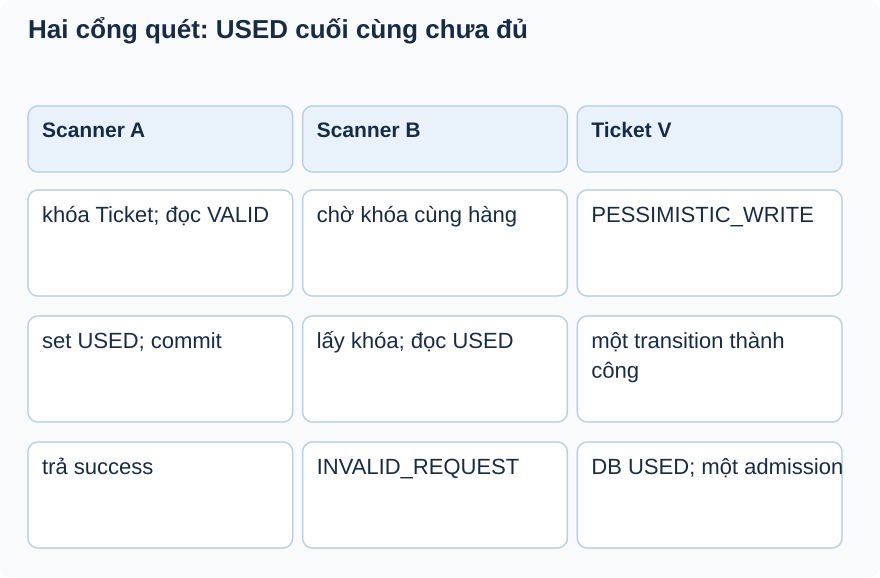

# Bài 3. Quét vé hai lần

[Giáo trình](../../README.md) · [Mục lục module](README.md)

**Trong bài:** [Tình huống và cách nghĩ](#tình-huống-và-cách-nghĩ) · [Cùng trace source](#cùng-trace-source) · [Luyện từ có hướng dẫn đến tự làm](#luyện-từ-có-hướng-dẫn-đến-tự-làm)

**20–30 phút · Chương 2: Cơ chế và dữ liệu**

**Câu hỏi trung tâm:** Vì sao test check-in tuần tự chưa chứng minh chỉ một người được vào?

Sau bài này, bạn có thể:

- Vẽ hai scanner tranh khóa trên cùng Ticket.
- Phân biệt state USED cuối với số admission thành công.
- Chọn assertion cho test đồng thời trên DB thật.

**Cần biết trước:** [Bài toán module](01-bai-toan.md); bài ngay trước theo thanh điều hướng cuối trang. Hoàn thành Payment; phân biệt booking CONFIRMED với vé cá nhân.

## Tình huống và cách nghĩ

Máy A và B cùng quét ticket V.

Trước sửa, check-then-write có cửa sổ giữa đọc VALID và ghi USED: cả hai caller có thể báo thành công dù DB chỉ còn một giá trị USED. Code hiện tại khóa Ticket trước khi kiểm tra; invariant vẫn là chỉ một admission thành công.



Đọc A giữ khóa và commit, rồi B lấy khóa thấy USED. Test PostgreSQL đã kiểm cả hai kết quả, không chỉ trạng thái DB cuối.

## Cơ chế trong EventHub

Phần dưới dựa trên source working tree. Phương án thay thế là phân tích/đề xuất; race cần test riêng
trước khi kết luận runtime.

Check status VALID rồi set USED vẫn là hai thao tác logic. @Transactional gom commit/rollback, còn @Lock(PESSIMISTIC_WRITE) trên hai finder code/payload mới tuần tự hóa chúng. Scanner B chờ A commit rồi đọc USED và nhận INVALID_REQUEST. Ticket không cần thêm @Version cho giải pháp này.

EventHub cần invariant mạnh hơn “DB status cuối USED”: chỉ một lượt được phép vào cửa. Có thể dùng
conditional UPDATE where status=VALID và check affected row=1, hoặc lock Ticket trước kiểm tra, hoặc
version conflict. Conditional update cần xử lý response/timestamp và persistence context; lock có chờ;
optimistic cần báo conflict/retry đúng ngữ nghĩa không cấp vào cửa lại.

Test already-used tuần tự vẫn có giá trị cho guard. Suite BookingConcurrencyTest bổ sung hai transaction thật, quét cùng vé bằng code và payload, kiểm chỉ một success. Xem [biên bản chạy](../../../project/concurrency-verification.md).

## Cùng trace source

Mở theo thứ tự: [TicketServiceImpl](../../../../backend/src/main/java/com/eventhub/eventhub_backend/ticketing/service/Impl/TicketServiceImpl.java) → [TicketRepository](../../../../backend/src/main/java/com/eventhub/eventhub_backend/ticketing/repository/TicketRepository.java).

Điểm cần tìm: `checkInTicket`. Với mỗi guard, ghi input và kết quả khi đúng/sai; với mỗi setter/query, ghi dữ liệu thay đổi ở object hay DB. Tra [bảng source module](01-bai-toan.md) nếu cần DTO hoặc test liên quan.

Đoạn trích nguyên văn từ [TicketServiceImpl, dòng 116](../../../../backend/src/main/java/com/eventhub/eventhub_backend/ticketing/service/Impl/TicketServiceImpl.java#L116); chỉ là phần cần quan sát, không phải toàn bộ method:

```java
        if (ticket.getStatus() != TicketStatus.VALID) {
            throw new AppException(ErrorCode.INVALID_REQUEST);
        }
```

Đọc khối này trong method bao quanh: điều kiện trước nó quyết định có đến được đây không,
caller/transaction phía ngoài quyết định thay đổi có commit không. Không dùng riêng snippet để suy ra
toàn bộ flow.

## Ví dụ được giải từng bước

**Ví dụ minh họa**, dùng ID/số liệu giả; không phải request ghi vào môi trường thật.

Máy A và B cùng quét ticket V.

1. A lấy khóa hàng V rồi đọc VALID; B chờ khóa cùng hàng.
2. A qua role/owner guard của event, set USED và checkedInAt.
3. A commit; B mới lấy được khóa, đọc USED và bị từ chối.
4. Test PostgreSQL đã tái hiện double success trước sửa và kiểm chỉ một success sau sửa.

**Dừng lại và dự đoán:** Một test gọi checkIn lần hai sau lần đầu và thấy lỗi: đã chứng minh double-scan
đồng thời chưa?

<details>
<summary>Đối chiếu sau khi đã tự trả lời</summary>

Chưa. Test tuần tự đọc USED sau lần đầu; không tạo lịch cả hai cùng đọc VALID. Cần hai transaction và
assertion chỉ một success.

</details>

## Nối với bài đã học

Nhớ read/precheck khác điểm ghi quyết định. Check-in lặp lại cùng cửa sổ, nhưng invariant lần này là một admission, không chỉ counter. [Ôn bài gốc](../booking/03-co-che.md).

## Tự nhớ lại, không nhìn lên trên

1. Giải thích bằng lời: Vì sao test check-in tuần tự chưa chứng minh chỉ một người được vào?
2. Trace hoặc dự đoán: Một test gọi checkIn lần hai sau lần đầu và thấy lỗi: đã chứng minh double-scan
   đồng thời chưa?
3. Tìm trong source một guard, query hoặc mapping quyết định kết quả; nó đọc/ghi dữ liệu nào?
4. Bài tập có hướng dẫn muốn chứng minh tính chất nào? Dependency nào phải chạy thật để chứng minh nó?

<details>
<summary>Đáp án và cách kiểm tra</summary>

1. Check-then-write có cửa sổ giữa đọc VALID và ghi USED. Hai thiết bị có thể cùng đọc trước khi một bên
   commit. Trạng thái cuối chỉ có một giá trị USED nhưng hai response thành công vẫn có thể gây hai lần
   cho vào; invariant phải tính hiệu ứng admission.

2. Chưa. Test tuần tự đọc USED sau lần đầu; không tạo lịch cả hai cùng đọc VALID. Cần hai transaction và
   assertion chỉ một success.

3. Lần theo `checkInTicket` trong các file đã dẫn; câu trả lời phải có tên field/điều kiện, không chỉ
   nói “service kiểm tra”.

4. Chọn assertion cho test đồng thời trên DB thật. Đối chiếu gợi ý/rubric bài tập: thuật toán cần
   encoder/mapper thật; query/constraint/rollback/lock cần DB phù hợp; routing/validation/security HTTP
   cần pipeline thật. Chọn phần đúng bài này, không chạy mọi tầng vô điều kiện.

</details>

## Luyện từ có hướng dẫn đến tự làm

**Có hướng dẫn:** Thiết kế test DB hai scanner: điểm đồng bộ, hai caller có quyền, tổng success=1,
checkedInAt và trạng thái cuối; so khóa với conditional update.

**Tự làm:** Với đề xuất conditional VALID→USED, tự thiết kế response cho caller thắng/thua và xử lý
checkedInAt/DTO stale. Nêu vì sao retry conflict không được cấp admission lần hai.

<details>
<summary>Gợi ý khi mắc kẹt</summary>

Đừng chỉ assert status=USED; hai success cũng có thể để lại status đó.

</details>

<details>
<summary>Rubric tự chấm</summary>

Đạt khi kiểm kết quả của cả hai request và không thêm rule giờ mở cổng như behavior hiện có.

Tự cho 0–2 điểm mỗi mục: expected rõ; bằng chứng source đúng; giải thích cơ chế; phân biệt giới hạn
test. Đạt từ 6/8 và không sai invariant chính. Điểm này giúp chọn chỗ ôn, không chứng nhận năng lực
production.

</details>

## Giữ lại điều cốt lõi

Check VALID rồi set USED chưa là transition atomic nếu thiếu lock/version/conditional write. Test tuần
tự chứng minh từ chối USED, không chứng minh hai scanner chỉ một success. Phải kiểm cả kết quả caller
lẫn DB.

[← Bài trước](02-co-che.md) · [Mục lục module](README.md) · [Học tiếp →](04-co-che.md)

Nếu chưa giải thích được câu hỏi trung tâm, làm lại biến thể trước khi học tiếp; không cần đọc thêm mọi
tài liệu tham khảo.
