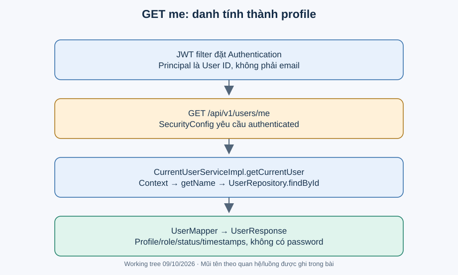

# Bài 1. User — biết ai đang gọi: bài toán trước code

[Giáo trình](../../README.md) · [Mục lục module](README.md)

**Trong bài:** [Bắt đầu từ người dùng](#bắt-đầu-từ-người-dùng) · [Mở source theo thứ tự này](#mở-source-theo-thứ-tự-này) · [Tự làm có hướng dẫn](#tự-làm-có-hướng-dẫn)

**20–25 phút · Chương 1: Bài toán và đường đi**

**Câu hỏi trung tâm:** Module này quyết định điều gì trong hành trình mua vé, và điều gì thuộc module khác?

Sau bài này, bạn có thể:

- Kể lại nhu cầu của actor và quy tắc chính bằng lời.
- Trace luồng chính từ điểm vào đến kết quả hoặc lỗi.
- Chỉ ra dữ liệu module sở hữu và một giới hạn hiện tại.

**Cần biết trước:** Hoàn thành Auth, đặc biệt principal và SecurityContext. [Lộ trình đầy đủ](../../learning-path.md).

## Bắt đầu từ người dùng

Ví dụ minh họa: Lan mở “tài khoản của tôi”. Client không cần gửi userId để chọn tài khoản; backend lấy
danh tính đã xác thực. Nếu API tin ID tùy ý từ client cho thao tác “me”, người dùng có thể xem nhầm tài
khoản khác. User module cung cấp current user cho auth/event/booking/ticketing/waitlist, không tự làm
nghiệp vụ mua vé.

User có email/password/fullName/phone/avatarUrl, role CUSTOMER/ORGANIZER/ADMIN và status
ACTIVE/INACTIVE/BANNED. Đăng ký gán ACTIVE ở auth; chưa có CRUD quản trị user hay đổi role/status qua
API được xác minh.

## Mô hình và luồng thật

JWT filter đã đặt principal là user ID. SecurityConfig yêu cầu authenticated. Controller gọi
getCurrentUser; service kiểm tra Authentication khác null và isAuthenticated, lấy getName, tìm User theo
ID rồi mapper tạo UserResponse. Không có ghi dữ liệu trong luồng này. User không tồn tại trả
USER_NOT_FOUND; Auth null/false trả UNAUTHENTICATED.

getCurrentUserId và getCurrentUserRole là helper khác: không kiểm tra null trước khi truy cập
Authentication. Chúng dựa vào đường gọi đã được bảo vệ. Nếu gọi từ scheduler hoặc test không gắn
context, có thể lỗi; không dùng helper current user trong tác vụ nền như thể có người đang login.

Đọc hình từ điểm vào được ghi trên hình, lần theo các điều kiện trước khi nhìn phần lưu/response. Mũi
tên là thứ tự xử lý, không phải bằng chứng mọi nhánh đều chạy hoặc mọi thay đổi đã commit. Dừng ở nhánh
lỗi và tự nói điều gì chưa xảy ra.

## Mở source theo thứ tự này

| File/Class | Trách nhiệm | Tại sao cần? / đọc khi nào? |
|---|---|---|
| [UserController](../../../../backend/src/main/java/com/eventhub/eventhub_backend/user/controller/UserController.java) | GET /users/me | Đầu vào không có userId |
| [CurrentUserService](../../../../backend/src/main/java/com/eventhub/eventhub_backend/user/service/CurrentUserService.java), [implementation](../../../../backend/src/main/java/com/eventhub/eventhub_backend/user/service/Impl/CurrentUserServiceImpl.java) | Lấy current identity/role/response | Cầu nối framework với nghiệp vụ |
| [User](../../../../backend/src/main/java/com/eventhub/eventhub_backend/user/entity/User.java), [Role](../../../../backend/src/main/java/com/eventhub/eventhub_backend/user/entity/Role.java), [Status](../../../../backend/src/main/java/com/eventhub/eventhub_backend/user/entity/Status.java) | Persistence và enum | Hiểu DB lưu gì, constraint nào khai báo |
| [UserRepository](../../../../backend/src/main/java/com/eventhub/eventhub_backend/user/repository/UserRepository.java) | Tìm ID/email | JPA generic/derived queries |
| [UserMapper](../../../../backend/src/main/java/com/eventhub/eventhub_backend/user/mapper/UserMapper.java), [UserResponse](../../../../backend/src/main/java/com/eventhub/eventhub_backend/user/dto/response/UserResponse.java) | Chuyển dữ liệu ra API | Response không có password |
| [UserRepositoryTest](../../../../backend/src/test/java/com/eventhub/eventhub_backend/user/UserRepositoryTest.java), [UserMapperTest](../../../../backend/src/test/java/com/eventhub/eventhub_backend/user/UserMapperTest.java) | H2 persistence và mapper | Đối chiếu DB thử với object mapping |

Lượt đầu chỉ mở controller và service cốt lõi trong bảng. Ghi tên guard, dữ liệu trước/sau, rồi mới mở
DTO/repository tương ứng. Test đọc sau khi đã tự dự đoán.

## Một ví dụ nhỏ để tự lần theo

Ví dụ minh họa dựa trên rule hiện có: Client gửi một email khác khi gọi GET me. Backend chọn tài khoản
theo email đó không?

1. Xác định actor, dữ liệu và state trước thao tác.
2. Tìm guard tương ứng trong service/controller của bảng source.
3. Ghi quyết định và tác động: Không. UserController không chọn tài khoản theo email body.
   CurrentUserService lấy principal userId từ context.

**Thử biến thể trước khi xem:** Nếu người gọi có role đúng nhưng không sở hữu tài nguyên, role có tự bỏ
qua ownership không?

Đối chiếu biến thể

Không với các use case có ownership guard. Auth/common không tự sở hữu booking/event; phải tìm service
tài nguyên. Role ADMIN có ngoại lệ nào thì đọc từng guard, không suy rộng cho mọi endpoint.

## Tự nhớ lại

1. Đóng bài: kể actor, nhu cầu và kết quả của module trong 60 giây.
2. Với tình huống ví dụ, thao tác dừng ở guard nào và dữ liệu nào không thay đổi?
3. Module này có kiểm tiền ngân hàng, giữ chỗ hoặc phát vé không? Chỉ nhận trách nhiệm có source.
4. Tìm một feature chưa có; bằng chứng nào giúp phân biệt “có DTO/service” với “có runtime caller”?

Đáp án định hướng

1. Đối chiếu phần bài toán; phải kể nhu cầu thay vì chỉ tên layer.
2. Không. UserController không chọn tài khoản theo email body. CurrentUserService lấy principal userId
   từ context.
3. Xem phạm vi đầu bài và trace, không gán mọi bước mua vé cho module này.
4. Tìm controller/caller, không chỉ class tồn tại. Các khoảng thiếu đã ghi trong bài là điều cần kiểm
   chứng lại khi source đổi.

## Tự làm có hướng dẫn

Trace GET me theo bốn cột: dữ liệu vào, method, dữ liệu ra, lỗi có thể có.

Sau đó bỏ tài liệu, tự ghi một happy path và một failure path. Với mỗi bước, nêu dữ liệu vào/ra; không
viết code production.

Gợi ý

Dùng bảng năm dòng: actor → điểm vào → guard → dữ liệu → kết quả. Khi thiếu bằng chứng, ghi “chưa xác
minh”, không điền theo trí nhớ framework.

Tiêu chí hoàn thành

Có tên method thật, guard cụ thể, dữ liệu trước/sau và nhánh lỗi; không thêm endpoint/tác động ngoài
source. Nếu thiếu hai trong bốn phần, quay lại trace trước bài tiếp.

## Chốt lại và chỗ dễ nhầm

Luồng gọi và quyền hợp lệ chưa chứng minh dữ liệu commit hay chống được cạnh tranh. Học cơ chế ở chương
tiếp theo rồi quay lại tự vẽ luồng này một lần nữa.

[← Bài trước](../auth/05-tu-kiem-chung.md) · [Mục lục module](README.md) · [Học tiếp →](02-co-che.md)

Nếu chưa giải thích được câu hỏi trung tâm, làm lại biến thể trước khi học tiếp; không cần đọc thêm mọi
tài liệu tham khảo.
