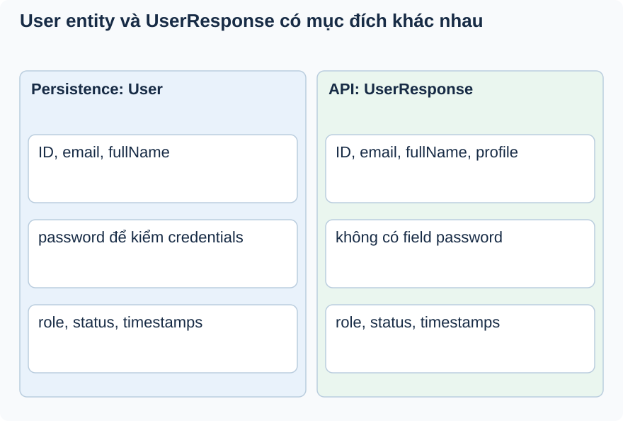

# Bài 3. Entity, DTO và hợp đồng kiểu

[Giáo trình](../../README.md) · [Mục lục module](README.md)

**Trong bài:** [Tình huống và cách nghĩ](#tình-huống-và-cách-nghĩ) · [Cùng trace source](#cùng-trace-source) · [Luyện từ có hướng dẫn đến tự làm](#luyện-từ-có-hướng-dẫn-đến-tự-làm)

**20–30 phút · Chương 2: Cơ chế và dữ liệu**

**Câu hỏi trung tâm:** Vì sao User lưu password nhưng response không được mang password?

Sau bài này, bạn có thể:

- Lập bảng field Entity/DTO và chỉ field không được lộ.
- Giải thích User/String trong JpaRepository.
- Phân biệt generated mapping với authorization.

**Cần biết trước:** [Bài toán module](01-bai-toan.md); bài ngay trước theo thanh điều hướng cuối trang. Hoàn thành Auth, đặc biệt principal và SecurityContext.

## Tình huống và cách nghĩ

User giả có id U1, email lan@example.test và password hash.

Entity mô tả dữ liệu persistence. DTO mô tả dữ liệu một use case cho phép đi qua API. Hai tập field có
thể khác nhau có chủ đích. Generics như JpaRepository<User,String> ràng buộc entity và kiểu ID lúc
compile; chúng không tự kiểm tra quyền truy cập hoặc che trường nhạy cảm.



So từng dòng theo mục đích. Password tồn tại trong entity không phải lý do serialize entity ra API.
Mapper chỉ ánh xạ hợp đồng đã định, không tự quyết quyền xem.

## Cơ chế trong EventHub

Phần dưới dựa trên source working tree. Phương án thay thế là phân tích/đề xuất; race cần test riêng
trước khi kết luận runtime.

Entity User có password để persistence; UserResponse chỉ có thông tin profile/role/status/timestamps.
Tách DTO tránh expose password và tránh serializer đi qua quan hệ ngoài ý muốn. MapStruct sinh mapping
lúc compile; mapper không tự kiểm tra caller có quyền xem field. Nếu thêm field nhạy cảm trùng tên vào
response, cần review mapping chứ không nghĩ mapper đã làm bảo mật.

JpaRepository<User,String> dùng generics để xác định entity và kiểu khóa. findByEmail/existsByEmail được
Spring Data phân tích theo tên property; không phải method tìm email đã viết SQL tay. Trường email
UNIQUE/NOT NULL khai báo ở entity, nhưng tìm theo email vẫn cần cân nhắc normalize/case-sensitive theo
DB thật.

Thay thế: projection DTO có thể tránh load trường không cần nhưng buộc query hợp đồng; mapping tay dễ
kiểm soát nhưng lặp code. Hiện luồng profile nhỏ nên chưa cần tối ưu chỉ vì có thể. Debug mapper bằng
generated source trong target/generated-sources/annotations sau compile, không sửa file generated.
UserMapperTest kiểm tra register mapping; chưa chứng minh mọi UserResponse không lộ secret ở HTTP.

UserRepositoryTest chạy Spring/H2 save/find email, chưa chứng minh collation/index PostgreSQL.

## Cùng trace source

Mở theo thứ tự: [User](../../../../backend/src/main/java/com/eventhub/eventhub_backend/user/entity/User.java) → [UserResponse](../../../../backend/src/main/java/com/eventhub/eventhub_backend/user/dto/response/UserResponse.java) → [UserMapper](../../../../backend/src/main/java/com/eventhub/eventhub_backend/user/mapper/UserMapper.java) → [UserRepository](../../../../backend/src/main/java/com/eventhub/eventhub_backend/user/repository/UserRepository.java).

Điểm cần tìm: `toUserResponse; findByEmail; JpaRepository<User,String>`. Với mỗi guard, ghi input và kết quả khi đúng/sai; với mỗi setter/query, ghi dữ liệu thay đổi ở object hay DB. Tra [bảng source module](01-bai-toan.md) nếu cần DTO hoặc test liên quan.

Đoạn trích nguyên văn từ [UserRepository, dòng 8](../../../../backend/src/main/java/com/eventhub/eventhub_backend/user/repository/UserRepository.java#L8); chỉ là phần cần quan sát, không phải toàn bộ method:

```java
public interface UserRepository extends JpaRepository<User, String> {
    Optional<User> findByEmail(String email);
    boolean existsByEmail(String email);

}
```

Đọc khai báo này cùng field/kiểu và nơi gọi nó. Annotation hay interface không tự chứng minh toàn bộ
request: DTO cần validation pipeline, mapper cần nhánh service phù hợp, query cần transaction và DB
thật. Chọn ranh giới liên quan đến ví dụ trong bài.

## Ví dụ được giải từng bước

**Ví dụ minh họa**, dùng ID/số liệu giả; không phải request ghi vào môi trường thật.

User giả có id U1, email lan@example.test và password hash.

1. Repository trả User chứa dữ liệu persistence.
2. UserMapper tạo UserResponse với các field có trong hợp đồng response.
3. UserResponse không có password, nên luồng này không cần serialize hash.
4. Nếu sau này thêm password vào DTO, mapping phải review lại; MapStruct không quyết định chính sách bảo mật.

**Dừng lại và dự đoán:** Thay String ID bằng Long trong lời gọi findById của JpaRepository<User,String>
có phải lỗi chỉ xuất hiện khi query DB không?

<details>
<summary>Đối chiếu sau khi đã tự trả lời</summary>

Không; hợp đồng generic đã yêu cầu String ở compile time. Tuy nhiên String đúng kiểu vẫn có thể là ID
không tồn tại hoặc không thuộc người gọi.

</details>

## Tự nhớ lại, không nhìn lên trên

1. Giải thích bằng lời: Vì sao User lưu password nhưng response không được mang password?
2. Trace hoặc dự đoán: Thay String ID bằng Long trong lời gọi findById của JpaRepository<User,String> có
   phải lỗi chỉ xuất hiện khi query DB không?
3. Tìm trong source một guard, query hoặc mapping quyết định kết quả; nó đọc/ghi dữ liệu nào?
4. Bài tập có hướng dẫn muốn chứng minh tính chất nào? Dependency nào phải chạy thật để chứng minh nó?

<details>
<summary>Đáp án và cách kiểm tra</summary>

1. Entity mô tả dữ liệu persistence. DTO mô tả dữ liệu một use case cho phép đi qua API. Hai tập field
   có thể khác nhau có chủ đích. Generics như JpaRepository<User,String> ràng buộc entity và kiểu ID lúc
   compile; chúng không tự kiểm tra quyền truy cập hoặc che trường nhạy cảm.

2. Không; hợp đồng generic đã yêu cầu String ở compile time. Tuy nhiên String đúng kiểu vẫn có thể là ID
   không tồn tại hoặc không thuộc người gọi.

3. Lần theo `toUserResponse; findByEmail; JpaRepository<User,String>` trong các file đã dẫn; câu trả lời
   phải có tên field/điều kiện, không chỉ nói “service kiểm tra”.

4. Phân biệt generated mapping với authorization. Đối chiếu gợi ý/rubric bài tập: thuật toán cần
   encoder/mapper thật; query/constraint/rollback/lock cần DB phù hợp; routing/validation/security HTTP
   cần pipeline thật. Chọn phần đúng bài này, không chạy mọi tầng vô điều kiện.

</details>

## Luyện từ có hướng dẫn đến tự làm

**Có hướng dẫn:** Tự lập bảng field User và UserResponse từ source; thiết kế assertion JSON không chứa
password, kể cả null.

**Tự làm:** Đề xuất thêm một field nhạy cảm vào User. Tự thiết kế response/mapping và test absence để
thay đổi entity không vô tình mở rộng API.

<details>
<summary>Gợi ý khi mắc kẹt</summary>

Mở hai class song song. Chỉ liệt kê field thật; generated mapper ở target là sản phẩm compile, không sửa ở đó.

</details>

<details>
<summary>Rubric tự chấm</summary>

Đạt khi bảng đúng source, nêu ranh giới DTO và có assertion absence thay vì chỉ password=null.

Tự cho 0–2 điểm mỗi mục: expected rõ; bằng chứng source đúng; giải thích cơ chế; phân biệt giới hạn
test. Đạt từ 6/8 và không sai invariant chính. Điểm này giúp chọn chỗ ôn, không chứng nhận năng lực
production.

</details>

## Giữ lại điều cốt lõi

User phục vụ persistence, UserResponse phục vụ API. Password không thuộc response. Generics bảo vệ kiểu
lúc compile; MapStruct ánh xạ field, không thay chính sách quyền hoặc review dữ liệu nhạy cảm.

[← Bài trước](02-co-che.md) · [Mục lục module](README.md) · [Học tiếp →](04-tu-kiem-chung.md)

Nếu chưa giải thích được câu hỏi trung tâm, làm lại biến thể trước khi học tiếp; không cần đọc thêm mọi
tài liệu tham khảo.
