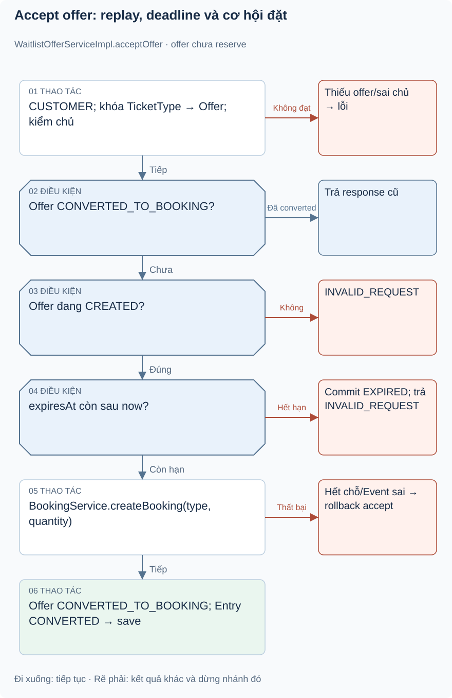
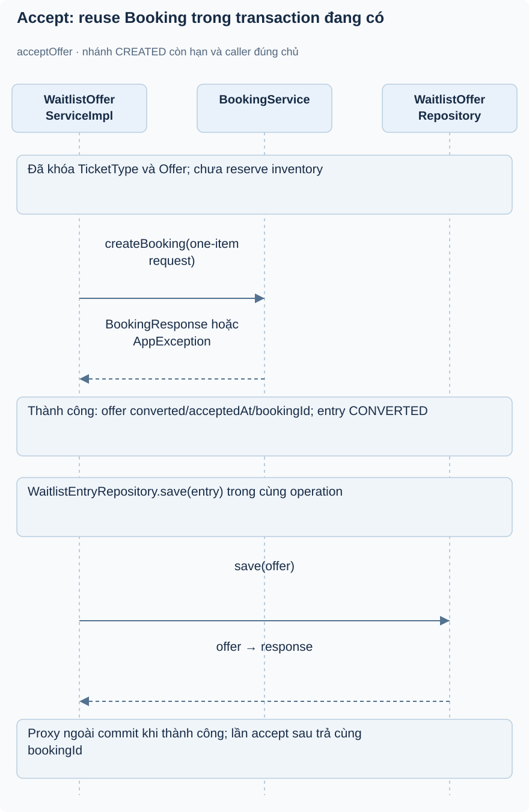
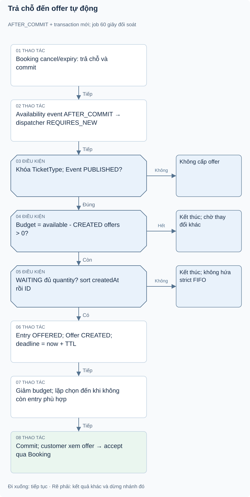

# Bài 1. Waitlist — hàng chờ và lời mời: bài toán trước code

[Giáo trình](../../README.md) · [Mục lục module](README.md)

**Trong bài:** [Bắt đầu từ người dùng](#bắt-đầu-từ-người-dùng) · [Mở source theo thứ tự này](#mở-source-theo-thứ-tự-này) · [Tự làm có hướng dẫn](#tự-làm-có-hướng-dẫn)

**20–25 phút · Chương 1: Bài toán và đường đi**

**Câu hỏi trung tâm:** Module này quyết định điều gì trong hành trình mua vé, và điều gì thuộc module khác?

Sau bài này, bạn có thể:

- Kể lại nhu cầu của actor và quy tắc chính bằng lời.
- Trace luồng chính từ điểm vào đến kết quả hoặc lỗi.
- Chỉ ra dữ liệu module sở hữu và một giới hạn hiện tại.

**Cần biết trước:** Hoàn thành Booking và Ticketing; hiểu conditional update và trạng thái. [Lộ trình đầy đủ](../../learning-path.md).

## Bắt đầu từ người dùng

Ví dụ minh họa: vé VIP đã hết, Lan xin chờ 3 vé, Nam vào sau xin 1. Khi chỉ một vé trở lại, chọn người
cũ nhất đủ số lượng có thể là Nam. Đó là FIFO trong tập đủ điều kiện, không phải FIFO tuyệt đối. Người
xin nhiều có thể chờ lâu nếu capacity trở lại từng vé nhỏ.

WaitlistEntry ghi nhu cầu customer/type/quantity, active là WAITING hoặc OFFERED. Join yêu cầu Event
PUBLISHED và quantity-soldQuantity≤0; một customer/type không được có entry active theo exists check.
WaitlistOffer ghi lời mời với expiresAt; offer không reserve. Accept mới gọi BookingService để thử giữ
chỗ và tạo pending booking.

**ĐÃ XÁC MINH Phase 8:** listener sau commit cấp offer khi Booking trả chỗ; scheduler vừa hết hạn offer vừa đối soát hàng chờ. Không có endpoint cấp offer công khai. Customer xem lời mời qua API hiện có; email/Kafka thuộc Phase 9.

## Mô hình và luồng thật

### Góc nhìn 1: Accept offer: replay, deadline và cơ hội đặt

Khóa TicketType rồi Offer trước state check. Converted trả cũ; hết hạn commit EXPIRED bằng exception riêng. Còn hạn phải qua Booking reserve; lỗi Booking rollback accept.

### Góc nhìn 2: Accept: reuse Booking trong transaction đang có

BookingService dùng current customer của request accept. Chỉ sau booking thành công mới ghi
convertedBookingId và các state converted; lỗi booking làm operation accept rollback.

POST accept → JWT/CUSTOMER → requireCustomer → khóa TicketType rồi Offer→owner. Nếu status CONVERTED_TO_BOOKING, trả kết
quả cũ; nếu khác CREATED thì 400. Nếu expiresAt không còn sau now, expireOffer rồi throw exception chuyên biệt không rollback nhánh hết hạn. Nếu còn hạn,
tạo CreateBookingRequest một item với type/quantity offer, gọi BookingService.createBooking; transaction
booking tham gia giao dịch accept. Khi thành công, offer CONVERTED_TO_BOOKING, acceptedAt,
convertedBookingId; entry CONVERTED; save→response. Client dùng bookingId để tiếp tục luồng thanh toán
hiện tại.

Nếu booking hết chỗ hoặc event không PUBLISHED, lỗi Booking khiến accept rollback; offer vẫn CREATED để retry trước hạn. Riêng accept quá hạn ném WaitlistOfferExpiredException được cấu hình dontRollbackOn, nên EXPIRED của entry/offer được commit trước khi trả INVALID_REQUEST. Ownership được kiểm trước thay đổi.

Đọc hình từ điểm vào được ghi trên hình, lần theo các điều kiện trước khi nhìn phần lưu/response. Mũi
tên là thứ tự xử lý, không phải bằng chứng mọi nhánh đều chạy hoặc mọi thay đổi đã commit. Dừng ở nhánh
lỗi và tự nói điều gì chưa xảy ra.

## Mở source theo thứ tự này

| File/Class | Trách nhiệm | Vì sao / khi đọc |
|---|---|---|
| [WaitlistController](../../../../backend/src/main/java/com/eventhub/eventhub_backend/waitlist/controller/WaitlistController.java) | Join/list/accept/skip | Phân biệt endpoint có thật với service nội bộ |
| [JoinWaitlistRequest](../../../../backend/src/main/java/com/eventhub/eventhub_backend/waitlist/dto/request/JoinWaitlistRequest.java), [CreateWaitlistOfferRequest](../../../../backend/src/main/java/com/eventhub/eventhub_backend/waitlist/dto/request/CreateWaitlistOfferRequest.java) | Quantity và expiry | DTO thứ hai chưa được controller dùng |
| [WaitlistServiceImpl](../../../../backend/src/main/java/com/eventhub/eventhub_backend/waitlist/service/Impl/WaitlistServiceImpl.java) | Join và active statuses | Hiểu nhu cầu chờ và duplicate check |
| [WaitlistOfferServiceImpl](../../../../backend/src/main/java/com/eventhub/eventhub_backend/waitlist/service/Impl/WaitlistOfferServiceImpl.java) | Create/select/accept/skip/expire | Cốt lõi phối hợp BookingService |
| [WaitlistEntry](../../../../backend/src/main/java/com/eventhub/eventhub_backend/waitlist/entity/WaitlistEntry.java), [WaitlistOffer](../../../../backend/src/main/java/com/eventhub/eventhub_backend/waitlist/entity/WaitlistOffer.java) | Nhu cầu và lời mời | Quan hệ/FK, convertedBookingId chỉ String |
| [EntryRepository](../../../../backend/src/main/java/com/eventhub/eventhub_backend/waitlist/repository/WaitlistEntryRepository.java), [OfferRepository](../../../../backend/src/main/java/com/eventhub/eventhub_backend/waitlist/repository/WaitlistOfferRepository.java) | Active exists/FIFO/expiry/query me | Derived query biểu diễn policy chọn |
| [WaitlistScheduler](../../../../backend/src/main/java/com/eventhub/eventhub_backend/config/WaitlistScheduler.java) | Expire mỗi phút | Không cấp offer mới |
| [WaitlistServiceImplTest](../../../../backend/src/test/java/com/eventhub/eventhub_backend/waitlist/WaitlistServiceImplTest.java), [WaitlistOfferServiceImplTest](../../../../backend/src/test/java/com/eventhub/eventhub_backend/waitlist/WaitlistOfferServiceImplTest.java) | 5 + 15 unit tests | Join, replay, selection, expired accept |

Lượt đầu chỉ mở controller và service cốt lõi trong bảng. Ghi tên guard, dữ liệu trước/sau, rồi mới mở
DTO/repository tương ứng. Test đọc sau khi đã tự dự đoán.

## Một ví dụ nhỏ để tự lần theo

Ví dụ minh họa dựa trên rule hiện có: Booking bị cancel và trả vé: scheduler hiện có tự tạo offer mới
ngay không?

1. Xác định actor, dữ liệu và state trước thao tác.
2. Tìm guard tương ứng trong service/controller của bảng source.
3. Ghi quyết định và tác động: Chưa có runtime caller nối release với
   createOffer/offerNextEligibleEntry. WaitlistScheduler chỉ expire offer.

**Thử biến thể trước khi xem:** Nếu người gọi có role đúng nhưng không sở hữu tài nguyên, role có tự bỏ
qua ownership không?

Đối chiếu biến thể

Không với các use case có ownership guard. Auth/common không tự sở hữu booking/event; phải tìm service
tài nguyên. Role ADMIN có ngoại lệ nào thì đọc từng guard, không suy rộng cho mọi endpoint.

## Tự nhớ lại

1. Đóng bài: kể actor, nhu cầu và kết quả của module trong 60 giây.
2. Với tình huống ví dụ, thao tác dừng ở guard nào và dữ liệu nào không thay đổi?
3. Module này có kiểm tiền ngân hàng, giữ chỗ hoặc phát vé không? Chỉ nhận trách nhiệm có source.
4. Tìm một feature chưa có; bằng chứng nào giúp phân biệt “có DTO/service” với “có runtime caller”?

Đáp án định hướng

1. Đối chiếu phần bài toán; phải kể nhu cầu thay vì chỉ tên layer.
2. Chưa có runtime caller nối release với createOffer/offerNextEligibleEntry. WaitlistScheduler chỉ
   expire offer.
3. Xem phạm vi đầu bài và trace, không gán mọi bước mua vé cho module này.
4. Tìm controller/caller, không chỉ class tồn tại. Các khoảng thiếu đã ghi trong bài là điều cần kiểm
   chứng lại khi source đổi.

## Tự làm có hướng dẫn

Vẽ luồng join→offer nội bộ→accept→booking; dùng nét đứt ghi khoảng thiếu caller cấp offer.

Sau đó bỏ tài liệu, tự ghi một happy path và một failure path. Với mỗi bước, nêu dữ liệu vào/ra; không
viết code production.

Gợi ý

Dùng bảng năm dòng: actor → điểm vào → guard → dữ liệu → kết quả. Khi thiếu bằng chứng, ghi “chưa xác
minh”, không điền theo trí nhớ framework.

Tiêu chí hoàn thành

Có tên method thật, guard cụ thể, dữ liệu trước/sau và nhánh lỗi; không thêm endpoint/tác động ngoài
source. Nếu thiếu hai trong bốn phần, quay lại trace trước bài tiếp.

## Chốt lại và chỗ dễ nhầm

Luồng gọi và quyền hợp lệ chưa chứng minh dữ liệu commit hay chống được cạnh tranh. Học cơ chế ở chương
tiếp theo rồi quay lại tự vẽ luồng này một lần nữa.

[← Bài trước](../ticketing/05-tu-kiem-chung.md) · [Mục lục module](README.md) · [Học tiếp →](02-co-che.md)

Nếu chưa giải thích được câu hỏi trung tâm, làm lại biến thể trước khi học tiếp; không cần đọc thêm mọi
tài liệu tham khảo.

## Runtime Phase 8 đã hoàn thiện

Cancel/expiry Booking phát sự kiện nội bộ; sau commit, listener gọi dispatcher trong transaction mới.
Job mỗi 60 giây xử lý offer hết hạn và đối soát type còn WAITING để phục hồi sự kiện bỏ lỡ.
Dispatcher khóa TicketType, chỉ cấp cho Event PUBLISHED; budget là khả dụng trừ lượng offer CREATED.
Offer mặc định 900 giây, chưa reserve: người mua thường vẫn có thể lấy chỗ trước khi accept.

**Đọc source bổ sung:** [WaitlistInventoryListener](../../../../backend/src/main/java/com/eventhub/eventhub_backend/waitlist/event/WaitlistInventoryListener.java)
→ [WaitlistScheduler](../../../../backend/src/main/java/com/eventhub/eventhub_backend/config/WaitlistScheduler.java)
→ [WaitlistConcurrencyTest](../../../../backend/src/test/java/com/eventhub/eventhub_backend/concurrency/WaitlistConcurrencyTest.java).
[Tiêu chí và kiểm chứng Phase 8](../../../project/phase-8-verification.md).
