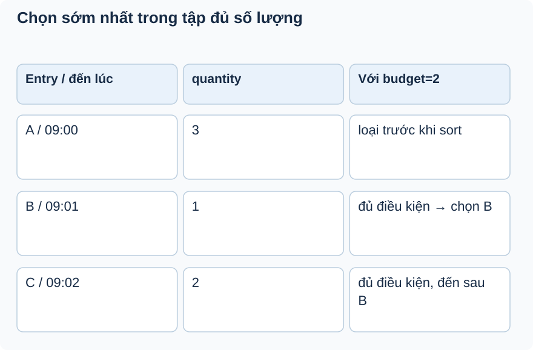

# Bài 2. Ai là người tiếp theo?

[Giáo trình](../../README.md) · [Mục lục module](README.md)

**Trong bài:** [Tình huống và cách nghĩ](#tình-huống-và-cách-nghĩ) · [Cùng trace source](#cùng-trace-source) · [Luyện từ có hướng dẫn đến tự làm](#luyện-từ-có-hướng-dẫn-đến-tự-làm)

**20–30 phút · Chương 2: Cơ chế và dữ liệu**

**Câu hỏi trung tâm:** “Sớm nhất đủ chỗ” có phải FIFO tuyệt đối không?

Sau bài này, bạn có thể:

- Đọc tên derived query thành filter/sort policy.
- Chọn oldest eligible cho một bảng quantity/time.
- Nêu trade-off FIFO tuyệt đối, starvation và tie-break.

**Cần biết trước:** [Bài toán module](01-bai-toan.md). Hoàn thành Booking và Ticketing; hiểu conditional update và trạng thái.

## Tình huống và cách nghĩ

Hàng chờ A đến 09:00 cần 3, B đến 09:01 cần 1; còn 2 chỗ.

Tên derived query là một chính sách lựa chọn có thể đọc được: cùng loại vé, WAITING, quantity không vượt
khả dụng, rồi createdAt tăng dần, lấy một. Lọc đủ chỗ trước khi sort nghĩa là người đứng đầu yêu cầu quá
nhiều có thể bị bỏ qua.



Lọc theo quantity trước, sau đó xếp createdAt trong tập còn lại. B thắng không có nghĩa query đảo FIFO;
policy đang là oldest eligible, có trade-off người xin nhiều chờ lâu.

## Cơ chế trong EventHub

Phần dưới dựa trên source working tree. Phương án thay thế là phân tích/đề xuất; race cần test riêng
trước khi kết luận runtime.

`findFirstByTicketTypeIdAndStatusAndQuantityLessThanEqualOrderByCreatedAtAscIdAsc` biểu diễn lọc type,
WAITING, quantity≤available, rồi lấy cũ nhất. Đây không chỉ là tên dài: nó quyết định ai có cơ hội mua.
Budget cấp offer = max(0, quantity - soldQuantity - tổng quantity của offer CREATED). Offer quá hạn chưa được job chuyển trạng thái vẫn chiếm budget đến khi được xử lý.

Spring Data dịch property path thành query. Code hiện tại sắp createdAt rồi ID để ổn định khi hòa thời điểm, và khóa TicketType trước chọn/lưu. Các worker cùng loại vé được tuần tự hóa, nên không cùng tiêu budget hay tạo hai active offer cho một entry qua service. Không có unique active constraint cho SQL ghi trực tiếp ngoài giao thức khóa.

Cần quyết định policy công bằng trước tối ưu.

Debug tại available và entry được chọn, không chỉ thời gian join. Unit test oldest eligible có mock kết
quả repository, không chạy sorting SQL thật. Test đề xuất hai entry qty3/qty1, available1; cùng
timestamp và hai workers cấp offer.

## Cùng trace source

Mở theo thứ tự: [EntryRepository](../../../../backend/src/main/java/com/eventhub/eventhub_backend/waitlist/repository/WaitlistEntryRepository.java) → [WaitlistOfferServiceImpl](../../../../backend/src/main/java/com/eventhub/eventhub_backend/waitlist/service/Impl/WaitlistOfferServiceImpl.java).

Điểm cần tìm: `offerNextEligibleEntry`. Với mỗi guard, ghi input và kết quả khi đúng/sai; với mỗi setter/query, ghi dữ liệu thay đổi ở object hay DB. Tra [bảng source module](01-bai-toan.md) nếu cần DTO hoặc test liên quan.

Đoạn trích nguyên văn từ [WaitlistEntryRepository, dòng 31](../../../../backend/src/main/java/com/eventhub/eventhub_backend/waitlist/repository/WaitlistEntryRepository.java#L31); chỉ là phần cần quan sát, không phải toàn bộ method:

```java
    Optional<WaitlistEntry> findFirstByTicketTypeIdAndStatusAndQuantityLessThanEqualOrderByCreatedAtAscIdAsc(
            String ticketTypeId,
            WaitlistEntryStatus status,
            Integer quantity
    );
```

Đọc khai báo này cùng field/kiểu và nơi gọi nó. Annotation hay interface không tự chứng minh toàn bộ
request: DTO cần validation pipeline, mapper cần nhánh service phù hợp, query cần transaction và DB
thật. Chọn ranh giới liên quan đến ví dụ trong bài.

## Ví dụ được giải từng bước

**Ví dụ minh họa**, dùng ID/số liệu giả; không phải request ghi vào môi trường thật.

Hàng chờ A đến 09:00 cần 3, B đến 09:01 cần 1; còn 2 chỗ.

1. Query loại A vì 3>2.
2. B thỏa quantity<=2 và là người sớm nhất trong tập đủ điều kiện.
3. B được chọn dù A đến trước.
4. Khi createdAt bằng nhau, ID tăng dần quyết định thứ tự. Khóa TicketType tuần tự hóa các worker trước khi chọn và lưu offer.

**Dừng lại và dự đoán:** A cần 3, B cần 1, còn 3: query chọn ai nếu cả hai WAITING?

<details>
<summary>Đối chiếu sau khi đã tự trả lời</summary>

A vì cả hai qua điều kiện quantity, sau đó createdAt của A sớm hơn. Kết quả còn phụ thuộc dữ liệu thật
và trạng thái.

</details>

## Tự nhớ lại, không nhìn lên trên

1. Giải thích bằng lời: “Sớm nhất đủ chỗ” có phải FIFO tuyệt đối không?
2. Trace hoặc dự đoán: A cần 3, B cần 1, còn 3: query chọn ai nếu cả hai WAITING?
3. Tìm trong source một guard, query hoặc mapping quyết định kết quả; nó đọc/ghi dữ liệu nào?
4. Bài tập có hướng dẫn muốn chứng minh tính chất nào? Dependency nào phải chạy thật để chứng minh nó?

<details>
<summary>Đáp án và cách kiểm tra</summary>

1. Tên derived query là một chính sách lựa chọn có thể đọc được: cùng loại vé, WAITING, quantity không
   vượt khả dụng, rồi createdAt tăng dần, lấy một. Lọc đủ chỗ trước khi sort nghĩa là người đứng đầu yêu
   cầu quá nhiều có thể bị bỏ qua.

2. A vì cả hai qua điều kiện quantity, sau đó createdAt của A sớm hơn. Kết quả còn phụ thuộc dữ liệu
   thật và trạng thái.

3. Lần theo `offerNextEligibleEntry` trong các file đã dẫn; câu trả lời phải có tên field/điều kiện,
   không chỉ nói “service kiểm tra”.

4. Nêu trade-off FIFO tuyệt đối, starvation và tie-break. Đối chiếu gợi ý/rubric bài tập: thuật toán cần
   encoder/mapper thật; query/constraint/rollback/lock cần DB phù hợp; routing/validation/security HTTP
   cần pipeline thật. Chọn phần đúng bài này, không chạy mọi tầng vô điều kiện.

</details>

## Luyện từ có hướng dẫn đến tự làm

**Có hướng dẫn:** Tạo bảng bốn entry có thời gian, quantity, status; chọn người tiếp theo cho
available=1,2,3. Nêu starvation và đề xuất policy khác nếu cần.

**Tự làm:** Ba lần có thêm một vé, người đầu xin3 và nhiều người sau xin1. Tự dự đoán policy hiện tại,
nêu nguy cơ starvation và thiết kế acceptance criteria nếu đổi fairness.

<details>
<summary>Gợi ý khi mắc kẹt</summary>

Áp WHERE trước ORDER BY; OFFERED không phải WAITING.

</details>

<details>
<summary>Rubric tự chấm</summary>

Đạt khi không gọi policy này strict FIFO và nêu unique active join chưa được DB bảo vệ.

Tự cho 0–2 điểm mỗi mục: expected rõ; bằng chứng source đúng; giải thích cơ chế; phân biệt giới hạn
test. Đạt từ 6/8 và không sai invariant chính. Điểm này giúp chọn chỗ ôn, không chứng nhận năng lực
production.

</details>

## Giữ lại điều cốt lõi

Query lọc WAITING và quantity≤available trước khi chọn createdAt sớm nhất. Đây là oldest eligible, không
strict FIFO. Cùng timestamp dùng ID tăng dần; hai worker được tuần tự hóa bằng khóa TicketType trước khi chọn.

[← Bài trước](01-bai-toan.md) · [Mục lục module](README.md) · [Học tiếp →](03-co-che.md)

Nếu chưa giải thích được câu hỏi trung tâm, làm lại biến thể trước khi học tiếp; không cần đọc thêm mọi
tài liệu tham khảo.
