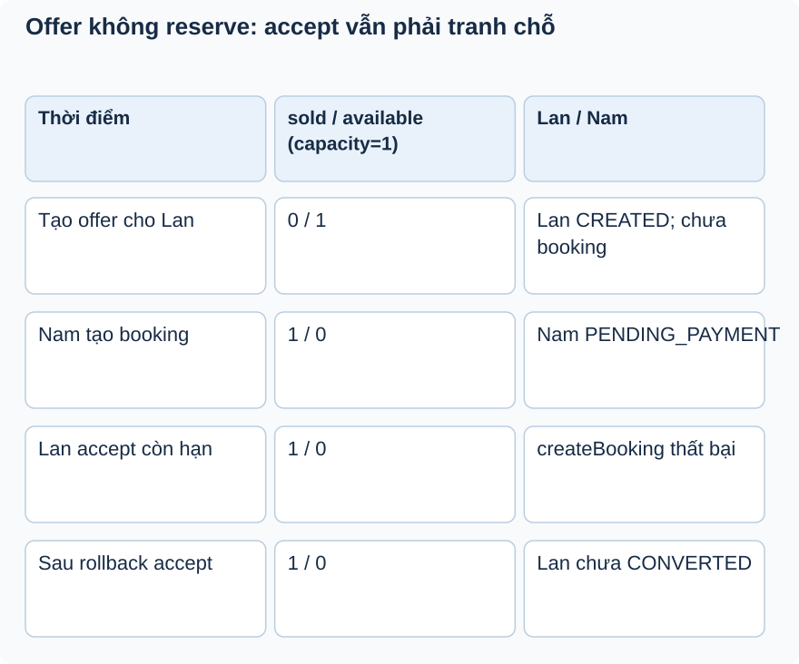

# Bài 3. Lời mời chưa giữ chỗ

[Giáo trình](../../README.md) · [Mục lục module](README.md)

**Trong bài:** [Tình huống và cách nghĩ](#tình-huống-và-cách-nghĩ) · [Cùng trace source](#cùng-trace-source) · [Luyện từ có hướng dẫn đến tự làm](#luyện-từ-có-hướng-dẫn-đến-tự-làm)

**20–30 phút · Chương 2: Cơ chế và dữ liệu**

**Câu hỏi trung tâm:** Vì sao có offer vẫn có thể không tạo được booking?

Sau bài này, bạn có thể:

- Phân biệt offer record với reservation counter.
- Trace accept gọi BookingService với current customer.
- Dự đoán rollback khi chỗ bị khách khác giữ trước.

**Cần biết trước:** [Bài toán module](01-bai-toan.md); bài ngay trước theo thanh điều hướng cuối trang. Hoàn thành Booking và Ticketing; hiểu conditional update và trạng thái.

## Tình huống và cách nghĩ

Còn 1 chỗ, Lan có offer CREATED cho 1.

Offer là cơ hội thực hiện một hành động trước deadline. Reservation là thay đổi tồn kho để dành chỗ.
Trong implementation, tạo offer đổi entry status và ghi offer, không reserve counter. Chỉ accept gọi
BookingService.createBooking mới tranh chỗ bằng rule booking hiện có.



Quan sát counter không đổi ở hàng tạo offer. Chỉ booking của Nam giữ chỗ. Offer của Lan còn hạn không bỏ
qua hàng rào tồn kho; skip offer cũng không release counter.

## Cơ chế trong EventHub

Phần dưới dựa trên source working tree. Phương án thay thế là phân tích/đề xuất; race cần test riêng
trước khi kết luận runtime.

Offer là quyền thử tạo booking trong thời gian giới hạn, chưa có counter reserved riêng và
createOfferForEntry không gọi reserve. Dispatcher hiện giới hạn tổng lời mời CREATED bằng budget khi cấp; khách mua trực tiếp vẫn có thể lấy chỗ sau đó. Accept mới đi qua atomic reservation của booking, nên offer còn hạn không bảo đảm tạo booking thành
công.

Đây là coupling đúng về rule: waitlist không sao chép công thức giá/giữ chỗ mà gọi BookingService. Trong
runtime current user chính là customer offer sau ownership check, nên BookingService tạo booking cho
người đang accept. Tác vụ nền gọi createBooking sẽ thiếu SecurityContext; không giả định scheduler có
customer context.

Thay thế: reserve ngay lúc offer tạo cho trải nghiệm bảo đảm hơn nhưng cần timeout/release/transfer
reservation sang booking đúng một lần; thêm một kiểu reservation làm tăng phức tạp. Với hiện trạng phải
làm rõ UX và API error; không tự đổi nghiệp vụ trong docs. Tests accept mock booking không chứng minh
hết chỗ race.

## Cùng trace source

Mở theo thứ tự: [WaitlistOfferServiceImpl](../../../../backend/src/main/java/com/eventhub/eventhub_backend/waitlist/service/Impl/WaitlistOfferServiceImpl.java) → [WaitlistController](../../../../backend/src/main/java/com/eventhub/eventhub_backend/waitlist/controller/WaitlistController.java).

Điểm cần tìm: `createOfferForEntry; acceptOffer`. Với mỗi guard, ghi input và kết quả khi đúng/sai; với mỗi setter/query, ghi dữ liệu thay đổi ở object hay DB. Tra [bảng source module](01-bai-toan.md) nếu cần DTO hoặc test liên quan.

Đoạn trích nguyên văn từ [WaitlistOfferServiceImpl, dòng 133](../../../../backend/src/main/java/com/eventhub/eventhub_backend/waitlist/service/Impl/WaitlistOfferServiceImpl.java#L133); chỉ là phần cần quan sát, không phải toàn bộ method:

```java
        BookingResponse booking = bookingService.createBooking(CreateBookingRequest.builder()
                .items(List.of(BookingItemRequest.builder()
                        .ticketTypeId(offer.getTicketType().getId())
                        .quantity(offer.getQuantity())
                        .build()))
                .build());
```

Đọc khối này trong method bao quanh: điều kiện trước nó quyết định có đến được đây không,
caller/transaction phía ngoài quyết định thay đổi có commit không. Không dùng riêng snippet để suy ra
toàn bộ flow.

## Ví dụ được giải từng bước

**Ví dụ minh họa**, dùng ID/số liệu giả; không phải request ghi vào môi trường thật.

Còn 1 chỗ, Lan có offer CREATED cho 1.

1. Tạo offer không tăng soldQuantity.
2. Nam đặt trực tiếp và reserve chỗ cuối.
3. Lan accept đúng hạn nhưng createBooking thấy không đủ chỗ nên lỗi.
4. Transaction accept không chuyển offer sang CONVERTED khi booking thất bại. Ngoài ra chưa có runtime
   caller tự tạo offer sau release.

**Dừng lại và dự đoán:** Skip offer có phải giảm soldQuantity để “trả vé” không?

<details>
<summary>Đối chiếu sau khi đã tự trả lời</summary>

Không. Offer chưa reserve. Skip đổi offer/entry sang SKIPPED; giảm counter sẽ làm sai chỗ của booking khác.

</details>

## Nối với bài đã học

Nhớ conditional update giữ vé. Offer không đi qua bước đó cho tới accept; vì sao còn hạn vẫn có thể hết chỗ? [Ôn bài gốc](../booking/03-co-che.md).

## Tự nhớ lại, không nhìn lên trên

1. Giải thích bằng lời: Vì sao có offer vẫn có thể không tạo được booking?
2. Trace hoặc dự đoán: Skip offer có phải giảm soldQuantity để “trả vé” không?
3. Tìm trong source một guard, query hoặc mapping quyết định kết quả; nó đọc/ghi dữ liệu nào?
4. Bài tập có hướng dẫn muốn chứng minh tính chất nào? Dependency nào phải chạy thật để chứng minh nó?

<details>
<summary>Đáp án và cách kiểm tra</summary>

1. Offer là cơ hội thực hiện một hành động trước deadline. Reservation là thay đổi tồn kho để dành chỗ.
   Trong implementation, tạo offer đổi entry status và ghi offer, không reserve counter. Chỉ accept gọi
   BookingService.createBooking mới tranh chỗ bằng rule booking hiện có.

2. Không. Offer chưa reserve. Skip đổi offer/entry sang SKIPPED; giảm counter sẽ làm sai chỗ của booking khác.

3. Lần theo `createOfferForEntry; acceptOffer` trong các file đã dẫn; câu trả lời phải có tên field/điều
   kiện, không chỉ nói “service kiểm tra”.

4. Dự đoán rollback khi chỗ bị khách khác giữ trước. Đối chiếu gợi ý/rubric bài tập: thuật toán cần
   encoder/mapper thật; query/constraint/rollback/lock cần DB phù hợp; routing/validation/security HTTP
   cần pipeline thật. Chọn phần đúng bài này, không chạy mọi tầng vô điều kiện.

</details>

## Luyện từ có hướng dẫn đến tự làm

**Có hướng dẫn:** Vẽ bảng counter/entry/offer/booking trước tạo offer, sau Nam đặt, sau Lan accept lỗi;
ghi nơi call createBooking.

**Tự làm:** Đề xuất reserve ngay khi tạo offer. Tự liệt kê timeout/release/transfer sang booking và
assertion chống giữ hai lần; so với UX hiện tại offer chỉ là cơ hội thử.

<details>
<summary>Gợi ý khi mắc kẹt</summary>

Vẽ release→commit→listener→dispatcher và nhánh job đối soát; không vẽ offer như một reservation.

</details>

<details>
<summary>Rubric tự chấm</summary>

Đạt khi counter chỉ thay đổi ở booking và đánh dấu khoảng thiếu tự động phát offer.

Tự cho 0–2 điểm mỗi mục: expected rõ; bằng chứng source đúng; giải thích cơ chế; phân biệt giới hạn
test. Đạt từ 6/8 và không sai invariant chính. Điểm này giúp chọn chỗ ôn, không chứng nhận năng lực
production.

</details>

## Giữ lại điều cốt lõi

Offer chưa reserve, skip không release. Accept còn hạn vẫn phải qua createBooking và có thể hết chỗ.
Waitlist reuse rule booking thay vì tự tính giá/giữ chỗ; caller sau release đã có listener AFTER_COMMIT và job đối soát định kỳ.

[← Bài trước](02-co-che.md) · [Mục lục module](README.md) · [Học tiếp →](04-co-che.md)

Nếu chưa giải thích được câu hỏi trung tâm, làm lại biến thể trước khi học tiếp; không cần đọc thêm mọi
tài liệu tham khảo.

**Cập nhật Phase 8:** accept/skip/expiry lấy khóa TicketType rồi Offer. Hai accept cùng offer trả cùng convertedBookingId; lỗi reserve không đổi offer sang converted. Xem [kiểm chứng PostgreSQL](../../../project/phase-8-verification.md).
