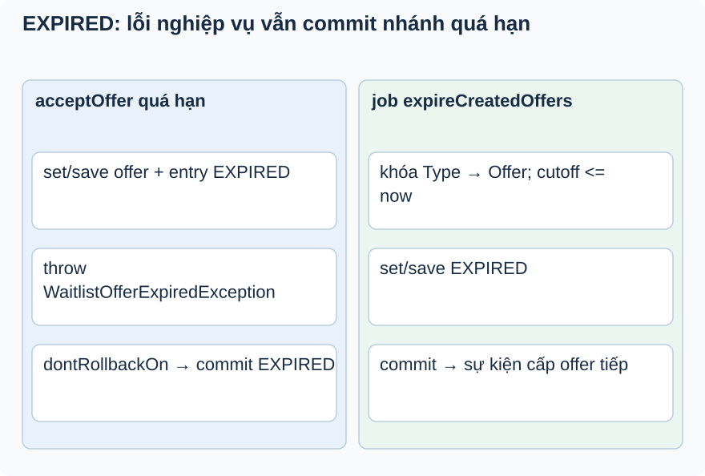

# Bài 4. Hết hạn rồi throw

[Giáo trình](../../README.md) · [Mục lục module](README.md)

**Trong bài:** [Tình huống và cách nghĩ](#tình-huống-và-cách-nghĩ) · [Cùng trace source](#cùng-trace-source) · [Luyện từ có hướng dẫn đến tự làm](#luyện-từ-có-hướng-dẫn-đến-tự-làm)

**20–30 phút · Chương 2: Cơ chế và dữ liệu**

**Câu hỏi trung tâm:** Vì sao gọi save(EXPIRED) trước exception vẫn có thể không lưu EXPIRED?

Sau bài này, bạn có thể:

- Trace save(EXPIRED) rồi RuntimeException ra proxy.
- Phân biệt mock object với DB sau rollback.
- So expiry boundary và nhánh replay converted/skip.

**Cần biết trước:** [Bài toán module](01-bai-toan.md); bài ngay trước theo thanh điều hướng cuối trang. Hoàn thành Booking và Ticketing; hiểu conditional update và trạng thái.

## Tình huống và cách nghĩ

Offer CREATED hết hạn.

Setter thay object, save tham gia persistence, commit mới hoàn tất transaction. RuntimeException thoát
ra có thể rollback cả những save trước đó. Retry idempotent cũng chỉ đúng cho nhánh được định nghĩa;
replay phải kết hợp khóa TicketType/Offer để bảo vệ cuộc đua accept/skip/expire.



So hai cột accept và job: cả hai commit EXPIRED khi xử lý hết hạn. Riêng accept trả INVALID_REQUEST qua exception chuyên biệt; lỗi Booking thông thường vẫn rollback. Phải reload ở context mới để chứng minh commit.

## Cơ chế trong EventHub

Phần dưới dựa trên source working tree. Phương án thay thế là phân tích/đề xuất; race cần test riêng
trước khi kết luận runtime.

Accept converted trả response cũ có convertedBookingId; skip skipped trả cũ. Retry terminal khác không
được tự chuyển chéo: skip sau converted bị từ chối. Idempotency là theo hành động và state, không phải
mọi request lặp đều 200. Entry/offer chuyển trạng thái cùng transaction để không có OFFERED còn offer
converted do ghi thiếu trong luồng bình thường.

Private expireOffer chạy trong transaction public. Trước sửa, throw AppException sau save làm EXPIRED rollback. Hiện acceptOffer dùng @Transactional(dontRollbackOn = WaitlistOfferExpiredException.class), chỉ exception hết hạn này được commit; lỗi tạo Booking và các RuntimeException khác vẫn rollback mặc định. Kiểm owner trước khi expire để caller sai chủ không đổi trạng thái.

Một phương án khác là tách kết quả terminal ra ngoài transaction. Code hiện tại chọn exception riêng và giữ API lỗi cũ. TicketType được khóa trước Offer trên mọi transition, nên accept/skip/expiry cạnh tranh không ghi đè terminal state. Suite PostgreSQL kiểm cả response và DB sau commit.

## Cùng trace source

Mở theo thứ tự: [WaitlistOfferServiceImpl](../../../../backend/src/main/java/com/eventhub/eventhub_backend/waitlist/service/Impl/WaitlistOfferServiceImpl.java) → [AppException](../../../../backend/src/main/java/com/eventhub/eventhub_backend/common/exception/AppException.java) → [WaitlistScheduler](../../../../backend/src/main/java/com/eventhub/eventhub_backend/config/WaitlistScheduler.java).

Điểm cần tìm: `acceptOffer; expireOffer; expireCreatedOffers`. Với mỗi guard, ghi input và kết quả khi đúng/sai; với mỗi setter/query, ghi dữ liệu thay đổi ở object hay DB. Tra [bảng source module](01-bai-toan.md) nếu cần DTO hoặc test liên quan.

Đoạn trích nguyên văn từ [WaitlistOfferServiceImpl, dòng 127](../../../../backend/src/main/java/com/eventhub/eventhub_backend/waitlist/service/Impl/WaitlistOfferServiceImpl.java#L127); chỉ là phần cần quan sát, không phải toàn bộ method:

```java
        if (!offer.getExpiresAt().isAfter(Instant.now())) {
            expireOffer(offer);
            eventPublisher.publishEvent(new TicketAvailabilityChangedEvent(offer.getTicketType().getId()));
            throw new WaitlistOfferExpiredException();
        }
```

Đọc khối này trong method bao quanh: điều kiện trước nó quyết định có đến được đây không,
caller/transaction phía ngoài quyết định thay đổi có commit không. Không dùng riêng snippet để suy ra
toàn bộ flow.

## Ví dụ được giải từng bước

**Ví dụ minh họa**, dùng ID/số liệu giả; không phải request ghi vào môi trường thật.

Offer CREATED hết hạn.

1. acceptOffer qua proxy transaction, kiểm owner/state.
2. expireOffer set offer và entry EXPIRED, gọi save.
3. acceptOffer throw WaitlistOfferExpiredException, được khai báo dontRollbackOn.
4. Transaction commit EXPIRED rồi trả lỗi INVALID_REQUEST; sự kiện sau commit cho phép cấp người tiếp theo. Nếu Booking reserve lỗi thì vẫn rollback, không dùng quy tắc ngoại lệ hết hạn.

**Dừng lại và dự đoán:** Job dùng expiresAtLessThanEqual(now), offer expiresAt đúng bằng now: có được query
chọn không?

<details>
<summary>Đối chiếu sau khi đã tự trả lời</summary>

Có. Query mới dùng <= cutoff, còn accept coi !isAfter(now) là hết hạn. Hai đường thống nhất tại biên bằng nhau; test PostgreSQL kiểm cutoff cố định.

</details>

## Nối với bài đã học

Nhớ RuntimeException rollback transaction ngoài. Lần này áp vào save(EXPIRED) rồi throw ngay trong accept. [Ôn bài gốc](../payment/03-co-che.md).

## Tự nhớ lại, không nhìn lên trên

1. Giải thích bằng lời: Vì sao gọi save(EXPIRED) trước exception vẫn có thể không lưu EXPIRED?
2. Trace hoặc dự đoán: Job dùng expiresAtLessThanEqual(now), offer expiresAt đúng bằng now: có được query chọn không?
3. Tìm trong source một guard, query hoặc mapping quyết định kết quả; nó đọc/ghi dữ liệu nào?
4. Bài tập có hướng dẫn muốn chứng minh tính chất nào? Dependency nào phải chạy thật để chứng minh nó?

<details>
<summary>Đáp án và cách kiểm tra</summary>

1. Setter thay object, save tham gia persistence, commit mới hoàn tất transaction. RuntimeException
   thoát ra có thể rollback cả những save trước đó. Retry idempotent cũng chỉ đúng cho nhánh được định
   nghĩa; replay phải kết hợp khóa TicketType/Offer để bảo vệ cuộc đua accept/skip/expire.

2. Có. Query expiry dùng <= cutoff; accept dùng !isAfter(now), nên cùng coi bằng deadline là hết hạn. Test biên dùng cutoff cố định để kiểm cả lần xử lý đầu và retry.

3. Lần theo `acceptOffer; expireOffer; expireCreatedOffers` trong các file đã dẫn; câu trả lời phải có
   tên field/điều kiện, không chỉ nói “service kiểm tra”.

4. So expiry boundary và nhánh replay converted/skip. Đối chiếu gợi ý/rubric bài tập: thuật toán cần
   encoder/mapper thật; query/constraint/rollback/lock cần DB phù hợp; routing/validation/security HTTP
   cần pipeline thật. Chọn phần đúng bài này, không chạy mọi tầng vô điều kiện.

</details>

## Luyện từ có hướng dẫn đến tự làm

**Có hướng dẫn:** Thiết kế DB test accept offer hết hạn rồi reload bằng transaction mới; thiết kế riêng
job expiry và retry converted/skip. Ghi expected hiện tại khác mong muốn.

**Tự làm:** Hai accept cùng CREATED còn hạn. Tự thiết kế invariant tối đa một booking được chuyển đổi,
chọn điểm bảo vệ offer state, và kiểm số booking/state sau commit.

<details>
<summary>Gợi ý khi mắc kẹt</summary>

Đừng để test transaction bao ngoài che commit của service. Quan sát sau khi exception đã thoát khỏi proxy.

</details>

<details>
<summary>Rubric tự chấm</summary>

Đạt khi phân biệt object/mock/DB commit và không mô tả enum ACCEPTED là transition đã dùng.

Tự cho 0–2 điểm mỗi mục: expected rõ; bằng chứng source đúng; giải thích cơ chế; phân biệt giới hạn
test. Đạt từ 6/8 và không sai invariant chính. Điểm này giúp chọn chỗ ôn, không chứng nhận năng lực
production.

</details>

## Giữ lại điều cốt lõi

Save không phải commit. Phải đọc rollback rule: accept quá hạn dùng exception riêng để commit EXPIRED; lỗi Booking vẫn rollback. Khóa TicketType rồi Offer bảo vệ transition, còn test đồng thời kiểm số booking và cả hai kết quả caller.

[← Bài trước](03-co-che.md) · [Mục lục module](README.md) · [Học tiếp →](05-tu-kiem-chung.md)

Nếu chưa giải thích được câu hỏi trung tâm, làm lại biến thể trước khi học tiếp; không cần đọc thêm mọi
tài liệu tham khảo.
