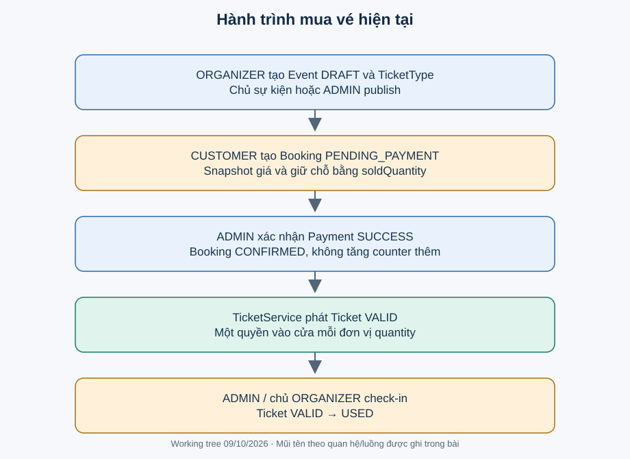

# Bài mở đầu. Theo một lần mua vé

[Giáo trình](README.md) · [Lộ trình](learning-path.md)

**Trong bài:** [Lan muốn mua hai vé workshop](#lan-muốn-mua-hai-vé-workshop) · [Mở đúng ba chỗ, chưa đọc hết file](#mở-đúng-ba-chỗ-chưa-đọc-hết-file) · [Bài tập đầu tiên: tự làm trước đáp án](#bài-tập-đầu-tiên-tự-làm-trước-đáp-án)

**15–25 phút · Học trước Auth**

**Câu hỏi trung tâm:** Một lần mua vé đi qua những đối tượng nào, và chỗ được giữ lúc nào?

Sau bài này, bạn có thể phân biệt TicketType/Booking/Payment/Ticket, kể hành trình mua vé và tính
counter trước/sau một lần đặt. Cần biết trước: class Java chứa dữ liệu, HTTP request gửi dữ liệu và nhận
kết quả. Chưa cần hiểu JPA hay JWT.

## Lan muốn mua hai vé workshop

Organizer tạo Event, cấu hình loại vé khi DRAFT rồi publish. Lan là CUSTOMER đăng nhập, chọn loại vé và
đặt. ADMIN xác nhận thanh toán theo luồng nội bộ hiện có; hệ thống phát vé cá nhân để check-in.

Đây là câu chuyện minh họa. EventHub chưa tích hợp ngân hàng hay tự gửi offer sau khi trả vé; đừng điền
những bước đó vào flow hiện trạng.

## Bốn đối tượng dễ nhầm

| Đối tượng | Câu hỏi nó trả lời | Ví dụ giả |
|---|---|---|
| TicketType | Bán loại nào, giá và capacity bao nhiêu? | VIP giá 100.000, capacity10 |
| Booking/BookingItem | Ai giữ/mua bao nhiêu, giá lúc đặt là gì? | Lan đặt VIP×2, total200.000 |
| Payment | Xác nhận nội bộ nào cho booking? | provider P, ref R, SUCCESS |
| Ticket | Vé cá nhân nào được dùng ở cổng? | Hai mã riêng, mỗi vé VALID/USED |

Counter không thay thế identity vé. Hai vé cùng loại có thể có trạng thái check-in khác nhau.

Nhìn từ phần chuẩn bị Event đến tạo Booking rồi Payment và Ticket. Mỗi vùng là một trách nhiệm. Dừng ở
pending: trong working tree hiện tại, chỗ đã được giữ dù chưa có vé cá nhân. Hình tổng quan không thay
các guard/transaction ở bài module.

## Cùng tính một ví dụ

**Ví dụ minh họa:** VIP capacity=10, soldQuantity=3 trước khi Lan đặt.

1. Khả dụng ban đầu = 10−3=7.
2. Lan đặt 2 hợp lệ; Booking PENDING_PAYMENT, soldQuantity=5, khả dụng=5.
3. ADMIN confirm: Booking CONFIRMED, Payment SUCCESS, phát 2 Ticket VALID. Counter vẫn 5.
4. Nếu thay vì confirm, Lan cancel khi pending: counter trở về 3. Hai nhánh này là lựa chọn thay thế,
   không phải confirm rồi cancel theo flow hiện có.

Tên soldQuantity dễ khiến bạn nghĩ chỉ tăng sau khi trả tiền. Hãy tin hành vi source: pending đã reserve. [ADR-003](../decisions/ADR-003-current-inventory-semantics.md) ghi khác biệt với tài liệu lịch sử.

## Mở đúng ba chỗ, chưa đọc hết file

1. [BookingServiceImpl.createBooking](../../backend/src/main/java/com/eventhub/eventhub_backend/booking/service/Impl/BookingServiceImpl.java): tìm PENDING_PAYMENT, reserveInventory và save; đánh dấu chỗ giữ chỗ trước khi lưu kết quả.
2. [TicketTypeRepository.reserveAvailableQuantity](../../backend/src/main/java/com/eventhub/eventhub_backend/ticket/repository/TicketTypeRepository.java): nhìn điều kiện không vượt capacity. Chi tiết query sẽ học ở Booking.
3. [PaymentServiceImpl.confirmPayment](../../backend/src/main/java/com/eventhub/eventhub_backend/payment/service/Impl/PaymentServiceImpl.java): tìm CONFIRMED và issueTicketsForBooking; không có tăng sold lần nữa.

**ĐÃ XÁC MINH:** các nhánh trên có trong source hiện tại. Chúng chưa chứng minh mọi cuộc đua
cancel/confirm/expire đều an toàn; đó là bài sau, có nhãn suy luận và test đề xuất.

## Bài tập đầu tiên: tự làm trước đáp án

Standard capacity=8, soldQuantity=2. Nam đặt 3 và còn pending. Viết ba dòng:

1. available trước đặt và sold/available sau đặt.
2. Nếu confirm, counter và số vé mới là bao nhiêu?
3. Nếu thay vào đó expire khi còn pending, counter trở về bao nhiêu?

Vẽ bốn hộp TicketType → Booking → Payment → Ticket. Ghi “giữ chỗ” dưới bước làm counter tăng. Không cần
chạy app hoặc nhờ AI tính giúp.

Gợi ý

Counter bắt đầu 2. Tăng 3 ngay khi booking thành công. Confirm giữ nguyên counter; expire giải phóng
đúng phần booking pending giữ. Confirm và expire là hai nhánh riêng trong ví dụ.

Đáp án và tiêu chí

1. Trước: available6. Sau đặt: sold5, available3.
2. Confirm: sold5, available3, phát 3 vé mới nếu chưa có vé và issuance thành công.
3. Expire thay vì confirm: sold2, available6, không phát vé từ booking đó.

Đạt khi gắn “giữ chỗ” với tạo booking, không tăng lại ở payment và không nhầm ba vé cá nhân với một
TicketType. Nếu sai, tính lại ví dụ Lan trước khi sang Auth.

## Tự nhớ lại

1. Đóng tài liệu: giải thích TicketType khác Ticket bằng lời trong 30 giây.
2. Nam confirm có làm sold tăng từ 5 lên 8 không? Trace tới method quyết định.
3. Offer waitlist có phải booking đã giữ chỗ không?

Đối chiếu

TicketType là sản phẩm/capacity, Ticket là từng quyền vào cửa. Confirm không tăng counter lần hai. Offer
chưa reserve; accept mới thử createBooking. Nếu chưa hiểu offer, chỉ nhớ phân biệt này rồi học chi tiết
ở Waitlist.

## Chốt một ý rồi học tiếp

Mỗi module giữ một phần hành trình và một tập rule. Học cơ chế từ một tình huống nhỏ, rồi trace để kiểm
chứng. Bạn chưa cần thuộc annotation.

[← Trang bắt đầu](README.md) · [Cách học 25 phút](how-to-study.md) · [Học tiếp: Auth bài 1 →](modules/auth/01-bai-toan.md).
