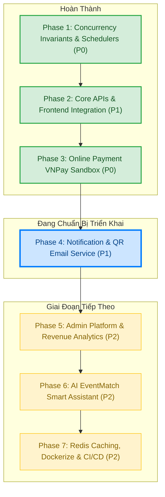

# 📊 EventHub Project Tracking Board & Task Management

> **Dự án**: EventHub — Nền tảng Quản lý sự kiện, Đặt vé trực tuyến, Thanh toán tự động & Check-in QR  
> **Cập nhật lần cuối**: 31/10/2026  
> **Trạng thái tổng thể**: Đã hoàn tất 100% Phase 1, Phase 2, Phase 3 và Phase 4. Đang chuẩn bị cho Phase 5.

---

## 🗺️ Lộ trình Phát triển Tổng quan (Project Timeline)



---

## 📋 Chi tiết các Phase & Danh mục Task

### ✅ Phase 1: Invariants Tồn kho, Concurrency & Schedulers (Ưu tiên: P0 — ĐÃ XONG)
*Mục tiêu: Đảm bảo tính toàn vẹn dữ liệu, chống overselling, không double-counting vé, tự động giải phóng vé quá hạn.*

| Mã Task | Tên Task | Phân hệ | Mức ưu tiên | Trạng thái | Tiêu chí nghiệm thu (DoD) |
|---|---|---|---|:---:|---|
| **TSK-101** | Atomic Ticket Reservation | Backend | `P0` | `DONE` | Trừ tồn kho bằng câu query nguyên tử cấp DB, chống race condition. |
| **TSK-102** | Khóa sắp xếp chống Deadlock | Backend | `P0` | `DONE` | Đặt chỗ nhiều loại vé sắp xếp theo `ticketTypeId ASC` trước khi lock. |
| **TSK-103** | Idempotent Payment Confirmation | Backend | `P0` | `DONE` | Bỏ tăng `soldQuantity` lần 2 (ADR-003), khóa bi quan `Booking`, retry an toàn. |
| **TSK-104** | Waitlist Event Dispatcher | Backend | `P1` | `DONE` | Phát `TicketAvailabilityChangedEvent` sau khi hủy booking commit thành công. |
| **TSK-105** | Smart Waitlist Reconciler | Backend | `P1` | `DONE` | Tính budget trừ offer `CREATED`, duyệt FIFO, xử lý TTL 15 phút. |
| **TSK-106** | Schedulers tác vụ nền | Backend | `P1` | `DONE` | `BookingScheduler` hủy đơn quá 15 phút; `WaitlistScheduler` quét offer hết hạn. |
| **TSK-107** | Unit & Concurrency Test Suite | Test | `P0` | `DONE` | 123 tests JUnit/H2 pass 100%; 40 concurrency integration tests sẵn sàng. |

---

### ✅ Phase 2: Hoàn thiện API Cốt lõi & Kết nối Frontend (Ưu tiên: P1 — ĐÃ XONG)
*Mục tiêu: Cung cấp đầy đủ các endpoint còn thiếu để 20 trang Frontend hoạt động mượt mà với dữ liệu thật.*

| Mã Task | Tên Task | Phân hệ | Mức ưu tiên | Trạng thái | Tiêu chí nghiệm thu (DoD) |
|---|---|---|---|:---:|---|
| **TSK-201** | API Cập nhật Profile `PUT /users/me` | Backend | `P1` | `DONE` | Cho phép cập nhật `fullName`, `phone`, `avatarUrl` của user đang đăng nhập. |
| **TSK-202** | API Đổi mật khẩu `POST /users/change-password` | Backend | `P1` | `DONE` | Kiểm tra mật khẩu cũ qua BCrypt, mã hóa mật khẩu mới (tối thiểu 6 ký tự). |
| **TSK-203** | API Sự kiện Organizer `GET /events/my-events` | Backend | `P1` | `DONE` | Trả về cả sự kiện `DRAFT`, `PUBLISHED`, `CANCELLED` của Organizer có phân trang. |
| **TSK-204** | API Đơn chờ duyệt `GET /bookings/pending` | Backend | `P1` | `DONE` | Dành riêng cho `ADMIN` xem danh sách đơn `PENDING_PAYMENT` chờ đối soát. |
| **TSK-205** | Đấu nối Trang `ProfilePage.tsx` | Frontend | `P1` | `DONE` | Kết nối lưu thông tin, refresh profile và form đổi mật khẩu có thông báo. |
| **TSK-206** | Đấu nối Trang `OrganizerDashboardPage.tsx` | Frontend | `P1` | `DONE` | Sử dụng `getMyEventsApi` hiển thị đầy đủ sự kiện bản nháp của Organizer. |
| **TSK-207** | Nâng cấp Trang `AdminPaymentPage.tsx` | Frontend | `P1` | `DONE` | Hiển thị bảng đơn chờ đối soát với nút "Chọn duyệt" tự động điền mã đơn. |
| **TSK-208** | Frontend Build & Regression Tests | Fullstack | `P0` | `DONE` | 18/18 frontend tests pass; `npm run build` thành công 0 lỗi. |

---

### ✅ Phase 3: Tích hợp Cổng thanh toán trực tuyến tự động (Ưu tiên: P0 — ĐÃ XONG)
*Mục tiêu: Khách hàng thanh toán online qua VNPay Sandbox / MoMo QR và tự động nhận vé trong 5 giây.*

| Mã Task | Tên Task | Phân hệ | Mức ưu tiên | Trạng thái | Tiêu chí nghiệm thu (DoD) |
|---|---|---|---|:---:|---|
| **TSK-301** | Cấu hình & Utility VNPay HMAC-SHA512 | Backend | `P0` | `DONE` | Tạo class `VNPayConfig`, sinh chữ ký số SHA512 bảo mật và đọc cấu hình sandbox. |
| **TSK-302** | API Sinh URL Thanh toán `POST /payments/create-url` | Backend | `P0` | `DONE` | Nhận `bookingId`, kiểm tra quyền sở hữu, sinh redirect URL VNPay chuẩn SHA512. |
| **TSK-303** | API Webhook IPN `GET /payments/vnpay-ipn` | Backend | `P0` | `DONE` | Tiếp nhận thông báo ngầm từ VNPay server, kiểm tra checksum, xác nhận đơn. |
| **TSK-304** | API Callback Trả về `GET /payments/vnpay-callback` | Backend | `P0` | `DONE` | Tiếp nhận redirect của khách hàng, cập nhật booking `CONFIRMED` và xuất vé. |
| **TSK-305** | Đấu nối Giao diện `PaymentPage.tsx` | Frontend | `P1` | `DONE` | Cho phép chọn cổng VNPay Sandbox, bấm thanh toán chuyển hướng sang gateway. |
| **TSK-306** | Đấu nối Giao diện `PaymentResultPage.tsx` | Frontend | `P1` | `DONE` | Đọc params `vnp_ResponseCode`, gọi backend xác thực và hiển thị trạng thái vé. |
| **TSK-307** | Unit Tests & Mock Gateway | Backend | `P1` | `DONE` | 6 unit tests cho luồng VNPay pass 100% (sinh URL, verify checksum, IPN). |

---

### ✅ Phase 4: Dịch vụ Email & Thông báo tự động (Ưu tiên: P1 — ĐÃ XONG)
*Mục tiêu: Gửi email vé điện tử kèm mã QR sau thanh toán và email mời nhận vé từ Waitlist.*

| Mã Task | GitHub Issue | Tên Task | Phân hệ | Mức ưu tiên | Trạng thái | Tiêu chí nghiệm thu (DoD) |
|---|---|---|---|:---:|:---:|---|
| **TSK-401** | [#26](https://github.com/ThangHoQuoc/EventHub/issues/26) | Cấu hình Spring Boot Mail & ZXing QR Code Engine | Backend | `P1` | `DONE` | Bổ sung `spring-boot-starter-mail`, `zxing`, cấu hình SMTP Sandbox và service sinh ảnh QR Code từ `ticketCode`. |
| **TSK-402** | [#27](https://github.com/ThangHoQuoc/EventHub/issues/27) | Thiết kế HTML E-Ticket Template & Async Mail Service | Backend | `P1` | `DONE` | Async mail sender bằng `@Async` ThreadPoolTaskExecutor; HTML email template responsive chèn QR code. |
| **TSK-403** | [#28](https://github.com/ThangHoQuoc/EventHub/issues/28) | Tích hợp Trigger gửi E-Ticket tự động khi thanh toán thành công | Backend | `P1` | `DONE` | Tự động bắn email vé kèm mã QR khi đơn hàng `CONFIRMED` (cả VNPay online lẫn Admin duyệt chuyển khoản). |
| **TSK-404** | [#29](https://github.com/ThangHoQuoc/EventHub/issues/29) | Gửi email thông báo Waitlist Offer & Nhắc nhở hạn chót | Backend | `P1` | `DONE` | Tự động gửi email thông báo khi có vé trống và được phát hành suất WaitlistOffer, đính kèm link thanh toán. |
| **TSK-405** | [#30](https://github.com/ThangHoQuoc/EventHub/issues/30) | API Gửi lại vé điện tử qua Email (Resend E-Ticket) | Backend | `P1` | `DONE` | Endpoint `POST /api/v1/tickets/{ticketCode}/resend-email` cho phép gửi lại vé điện tử vào hòm thư. |
| **TSK-406** | [#31](https://github.com/ThangHoQuoc/EventHub/issues/31) | Frontend: Nút "Gửi lại vé qua Email" & Banner thông báo | Frontend | `P1` | `DONE` | Bổ sung UI trên `PaymentResultPage`, `TicketDetailPage`, `MyBookingsPage` với Toast notification. |
| **TSK-407** | [#32](https://github.com/ThangHoQuoc/EventHub/issues/32) | Unit Tests & Verification cho Notification & QR Engine | Testing | `P1` | `DONE` | Viết unit tests cho QRCodeGenerator, EmailService, trigger thanh toán; 100% test pass. |

---

### ⏳ Phase 5: Quản trị Admin Nâng cao & Thống kê Doanh thu (Ưu tiên: P2 — TIẾP THEO)
*Mục tiêu: Cung cấp dashboard quản trị người dùng toàn sàn và biểu đồ doanh thu theo thời gian thực.*

| Mã Task | Tên Task | Phân hệ | Mức ưu tiên | Trạng thái | Tiêu chí nghiệm thu (DoD) |
|---|---|---|---|:---:|---|
| **TSK-501** | API Quản lý User `GET /admin/users` & Khóa/Mở khóa | Backend | `P2` | `TODO` | Danh sách user phân trang, API `PATCH /admin/users/{id}/status` đổi `ACTIVE/BANNED`. |
| **TSK-502** | API Thống kê Doanh thu Sàn `GET /admin/stats` | Backend | `P2` | `TODO` | Thống kê tổng doanh thu theo ngày/tháng, tổng số vé bán, sự kiện bán chạy nhất. |
| **TSK-503** | API Thống kê cho Organizer `GET /events/{id}/stats` | Backend | `P2` | `TODO` | Tỷ lệ lấp đầy loại vé, doanh thu chi tiết từng loại vé của sự kiện. |
| **TSK-504** | Frontend Dashboard Analytics | Frontend | `P2` | `TODO` | Hiển thị biểu đồ doanh thu và thẻ KPI sống trên Organizer & Admin Portal. |

---

### 📅 Phase 6: Trợ lý AI EventMatch Backend (Ưu tiên: P2 — DỰ KIẾN)
*Mục tiêu: Biến tính năng tìm kiếm sự kiện tự nhiên bằng AI thành sản phẩm thực tế.*

| Mã Task | Tên Task | Phân hệ | Mức ưu tiên | Trạng thái | Tiêu chí nghiệm thu (DoD) |
|---|---|---|---|:---:|---|
| **TSK-601** | Structured Prompt & LLM Client Service | Backend | `P2` | `TODO` | Cấu hình Gemini API / OpenAI API trích xuất yêu cầu (thời gian, địa điểm, ngân sách). |
| **TSK-602** | API Match Sự kiện `POST /events/match` | Backend | `P2` | `TODO` | Nhận text tự nhiên, lọc database và chấm điểm độ tương thích (0-100%). |
| **TSK-603** | Đấu nối Trang `EventMatchPage.tsx` | Frontend | `P2` | `TODO` | Khách hàng nhập văn bản tự nhiên, hiển thị kết quả gợi ý kèm lý do lựa chọn. |

---

### 📅 Phase 7: Tối ưu Caching, Đóng gói Docker & CI/CD (Ưu tiên: P2 — DỰ KIẾN)
*Mục tiêu: Đưa hệ thống vào trạng thái Production-Ready và vận hành tự động.*

| Mã Task | Tên Task | Phân hệ | Mức ưu tiên | Trạng thái | Tiêu chí nghiệm thu (DoD) |
|---|---|---|---|:---:|---|
| **TSK-701** | Tích hợp Redis Caching | Backend | `P2` | `TODO` | Cache danh sách sự kiện public `GET /events/public` và chi tiết sự kiện. |
| **TSK-702** | Redisson Distributed Lock | Backend | `P2` | `TODO` | Bảo vệ giữ chỗ và mua vé trên môi trường phân tán đa máy chủ (Multi-node). |
| **TSK-703** | Multi-stage Dockerfile | DevOps | `P2` | `TODO` | Đóng gói Backend (Java 21 JAR) và Frontend (Nginx static build). |
| **TSK-704** | `docker-compose.prod.yml` hoàn chỉnh | DevOps | `P2` | `TODO` | Chạy toàn bộ hệ sinh thái (Postgres + Redis + Backend + Frontend + Nginx). |
| **TSK-705** | GitHub Actions CI Pipeline | DevOps | `P2` | `TODO` | Tự động chạy `mvn test` và `npm test` mỗi khi có commit hoặc Pull Request. |

---

## 📈 Tóm tắt Tỷ lệ Hoàn thành Dự án

```
[███████████████████████████░░░░░░░░░░░░░] 67% Hoàn thành toàn dự án
- Phase 1 (Invariants & Concurrency):   [████████████████████] 100% (7/7 Tasks)
- Phase 2 (Core APIs & FE Connect):     [████████████████████] 100% (8/8 Tasks)
- Phase 3 (Online Payment Gateway):     [████████████████████] 100% (7/7 Tasks)
- Phase 4 (Notification & Email):       [████████████████████] 100% (7/7 Tasks)
- Phase 5 (Admin & Analytics):          [░░░░░░░░░░░░░░░░░░░░]   0% (0/4 Tasks)
- Phase 6 (AI EventMatch):              [░░░░░░░░░░░░░░░░░░░░]   0% (0/3 Tasks)
- Phase 7 (Redis, Docker & CI/CD):      [░░░░░░░░░░░░░░░░░░░░]   0% (0/5 Tasks)
```
