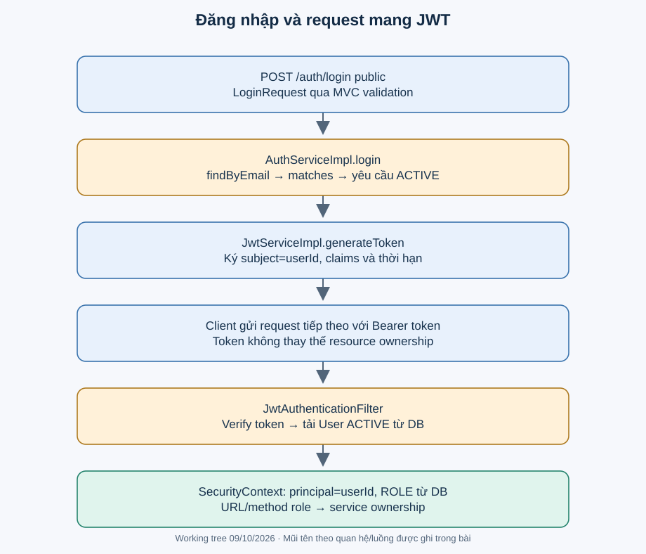

# Mô hình bảo mật hiện tại

Authentication (xác thực) xác định người gọi. Authorization (phân quyền) quyết định người đó được làm gì với tài nguyên nào. JWT chỉ tham gia xác thực; ownership và trạng thái tài khoản vẫn phải kiểm tra.

## Đăng ký và đăng nhập

[AuthServiceImpl](../../backend/src/main/java/com/eventhub/eventhub_backend/auth/service/Impl/AuthServiceImpl.java) kiểm tra email tồn tại, mapper tạo User, PasswordEncoder băm mật khẩu bằng BCrypt, service tự đặt CUSTOMER/ACTIVE. Login tìm email, so mật khẩu bằng matches, từ chối non-ACTIVE rồi phát token. Phản hồi gồm accessToken/tokenType/expiresIn; expiresIn lấy expiration cấu hình tính **mili giây**, không mặc định cho là giây.

[JwtServiceImpl](../../backend/src/main/java/com/eventhub/eventhub_backend/auth/security/Impl/JwtServiceImpl.java) dùng khóa HMAC từ jwt.secret, subject=userId, claims email/role, issuedAt/expiration. Token được ký để kiểm tra toàn vẹn, không được mã hóa để giấu payload. Không đưa token mẫu thật vào docs.

## Request có Bearer token

[JwtAuthenticationFilter](../../backend/src/main/java/com/eventhub/eventhub_backend/auth/security/Impl/JwtAuthenticationFilter.java) lấy Authorization, chỉ đọc prefix `Bearer `, parse/verify token; token thiếu hoặc sai đi tiếp như chưa xác thực. Với token hợp lệ, filter tải User theo subject, yêu cầu ACTIVE rồi tạo UsernamePasswordAuthenticationToken có principal là userId và authority từ role trong DB. Claim role không phải quyền cuối cùng nếu role DB đổi. Tài khoản bị khóa sẽ không được xác thực ở request sau qua đường filter này.

[SecurityConfig](../../backend/src/main/java/com/eventhub/eventhub_backend/config/SecurityConfig.java) cho phép register/login và GET public paths theo matcher URL (matcher không giới hạn HTTP method). `/api/v1/admin/**` cần ADMIN; `/api/v1/organizer/**` cần ORGANIZER/ADMIN dù chưa thấy controller organizer riêng. Các URL còn lại authenticated. @EnableMethodSecurity bật @PreAuthorize trên controller; service kiểm tra ownership nơi đã implement.

## Ma trận bảo vệ

| Tài nguyên/thao tác | Role | Ownership |
|---|---|---|
| Event create | ADMIN/ORGANIZER | Gán organizer từ current user |
| Event update/publish/cancel | ADMIN/ORGANIZER | Organizer phải là chủ; ADMIN được qua |
| TicketType write | ADMIN/ORGANIZER | Chủ Event; chỉ DRAFT |
| Booking read/cancel | CUSTOMER | Customer phải là chủ |
| Payment confirm | ADMIN | Không kiểm tra chủ customer; đây là chức năng quản trị |
| Ticket read | CUSTOMER | Customer sở hữu vé |
| Ticket check-in | ADMIN/ORGANIZER | Organizer sở hữu Event |
| Waitlist accept/skip | CUSTOMER | Customer của entry gắn offer |
| TicketType read | authenticated | Chưa kiểm tra ownership/public event |

## Giới hạn và điểm cần kiểm chứng

- **ĐÃ XÁC MINH:** chưa có refresh endpoint, refresh persistence/rotation/revocation hoặc logout nghiệp vụ. Không mô tả logout mặc định của framework như thu hồi JWT đã implement.
- **ĐÃ XÁC MINH:** CSRF bị tắt; chưa thấy cấu hình CORS hay SessionCreationPolicy.STATELESS. Không khẳng định hệ thống hoàn toàn stateless. Cần kiểm tra cookie/session và preflight trong môi trường frontend thực.
- **ĐÃ XÁC MINH:** login phân biệt user không tồn tại 404 và mật khẩu sai 401; có thể tạo tín hiệu dò tài khoản. Mức khai thác/rate limit thực chưa kiểm chứng.
- **SUY LUẬN:** mã vé chứa bookingId và sequence, QR là payload không ký; cần threat model nếu người biết bookingId có thể đoán mã. Không khẳng định đã khai thác được.
- **KHOẢNG THIẾU:** rate limiting, audit log nghiệp vụ, token revocation và HTTP security integration tests.

JwtAuthenticationEntryPoint trả 401/1004; JwtAccessDeniedHandler trả 403/1005. Tests login/filter hiện chỉ có 3+3 ca, không chứng minh đầy đủ filter chain/HTTP/expiry/chữ ký thật. Xem [bài auth](../learning/modules/auth.md).

Tham khảo cơ chế framework: [Spring Security về session](https://docs.spring.io/spring-security/reference/servlet/authentication/session-management.html). Cấu hình source của dự án vẫn là căn cứ để xác định chính sách đang áp dụng.
